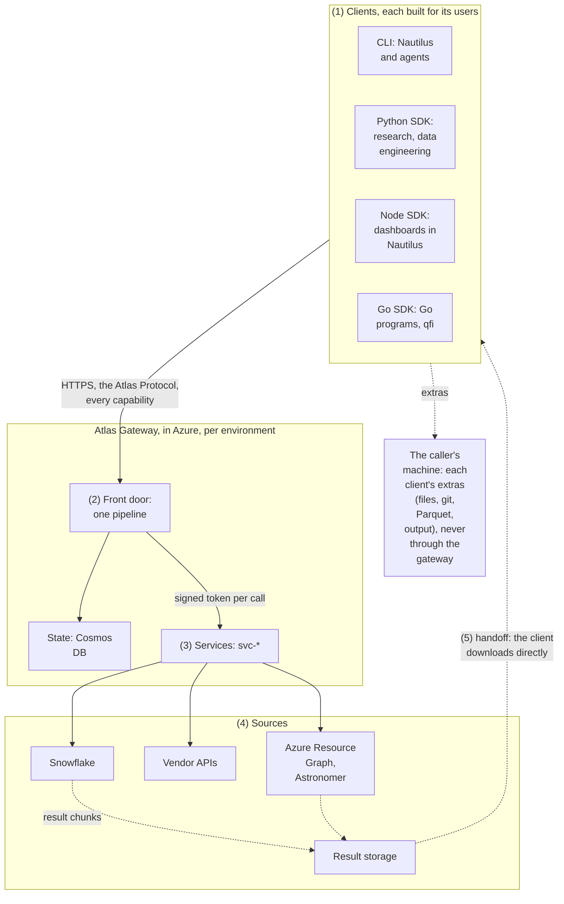

# Overview

Atlas is the one door to the platform's data and work: the Atlas Gateway, its one host, offers capabilities that describe themselves in profiles it serves (the writer side), and clients in any language, each optimised for its language and its users, read those profiles and turn what arrives into what their caller asked for (the reader side), over one language-neutral protocol.

**Atlas on one page.** Built in this repository: the Atlas Gateway in `gateway/`, the clients in `clients/python/`, `clients/node/` and `clients/cli/`, and the Go SDK in `sdk/go/`. Why it exists: [the vision](00-vision.md): an agent can build whatever anyone in the firm needs, through the CLI and SDKs alone.

### In short

1. **One host: the Atlas Gateway.** Every client, in every language, calls the Atlas Gateway over HTTPS, for every capability: the platform's data, its resources, Azure and Astronomer alike.
2. **The gateway owns the writer side.** Every capability describes itself in a profile the gateway serves and evolves; the gateway guarantees that what it sends matches it, even when it does not carry the bytes.
3. **Clients own the reader side.** A client contains no code for any capability: it reads profiles, resolves what arrives to the contract it knows, and hands its caller the shape and format asked for. A contract change never needs a client release.
4. **Each client is built for its users.** Python for researchers and data engineers, Node for analysts' dashboards in Nautilus, the CLI for Nautilus and agents, Go for Go programs. Each may add extras: work it does on the caller's machine without the gateway (Node's files and git for a dashboard), never a capability.
5. **Four surfaces.** Data (read what is), resources (objects the platform keeps), actions (change a system outside Atlas), events (something happened), plus the built-ins (`atlas.*`).
6. **Names are concepts; endpoints are infrastructure.** `portfolio.holdings@v1:fetch` is what people, agents and access rules see; where it is served is a binding the client follows.
7. **You see what you can use.** Everything a caller sees while working is what they may use, here, now; only `atlas.access` shows the rest, with reasons.
8. **Every system reached the safest way it allows:** the gateway runs the work, hands the bytes off, or brokers a connection the client makes, as the person wherever the system accepts it (§6.3).
9. **One front door, many services.** Every call is decided once (authenticate, resolve, authorise, validate, limit), routed to a service that can be scaled and moved on its own, settled and audited.
10. **One protocol for every language,** strict enough to write a client from its text, schemas and test vectors, with a conformance suite that decides.

### Picture

### How it works

One call, traced: a notebook asks for a fund's holdings, which come back handed off.

1. **Find.** `atlas.search("portfolio holdings")` returns only what this person may use here (§2.6).
2. **Understand.** `atlas.describe` returns the profile `portfolio.holdings@v1#bcaa5bbad97cc612`: its request and result schemas, its executions (`gateway`, `handoff`), the person's limits (§3.1).
3. **Call (1 → 2).** The Python SDK validates `{"portfolios": ["147HYC"], "columns": [...]}` and sends it with `Atlas-Profile-Expect`, `Atlas-Deadline` and its features: it can take a handoff (§4).
4. **Decide (2).** The front door validates the token, resolves the address, finds a grant, checks the request, reserves the limit (§6.2).
5. **Plan and run (3 → 4).** The data service plans the writer contract as SQL (every column aliased and cast), the guard passes it, and Snowflake runs it (§2.2.1).
6. **Hand off (5).** The answer is a handoff document: the result's chunk links and the writer profile. The client downloads the chunks in parallel from Snowflake's storage, with no Snowflake session.
7. **Read.** The client decodes each chunk into the writer's Arrow schema, checks it, resolves it to the profile its notebook knows (§3.4), and returns a `pandas.DataFrame`.
8. **Settle.** The gateway settles the call from Snowflake's own record and audits it.

### Seams

| Seam | One side owns | The other side owns | The contract | Defined in |
|---|---|---|---|---|
| Caller and client | The caller: what they ask, in their language | The client: discovery, validation, resolution, formats | The client's interface | §5, §9.7 |
| Client and gateway | The client: the reader side | The Atlas Gateway: the writer side | The Atlas Protocol | §9 |
| Client and its extras | The client's interface | The extra: work on the caller's machine, never the gateway | The client's own API | §5, §9.7.12 |
| The gateway and each system | The gateway: the decision, the identity, the handshake | Each system: its own permissions | The register of patterns and identities | §6.3 |
| Front door and services | The front door: every decision | Services: the work | The service protocol, a signed token | §6.1 |
| Services and engines | Services: the capability | Adapters: the engine | The `DataSource` port | §6.4 |
| Profile and code | The profile: the contract | The code: fulfilling it | The gate and registration | §3.3 |

### Rules

- **ATLAS-CORE-001.** Every capability has a profile, served by the gateway, from which a conforming client can discover, call and read it without code written for that capability.
- **ATLAS-CORE-002.** A change to a capability's contract that versioning classifies as safe or dangerous requires no client release.
- **ATLAS-CORE-003.** Every call, through every edge, passes the same pipeline and resolves to exactly one `capability@version:interaction`.
- **ATLAS-CORE-004.** The Atlas Gateway passes the gateway conformance suite; every client passes the client conformance suite at the levels it declares.
- **ATLAS-CORE-005.** The same request yields identical records through every execution, binding and encoding a capability offers.
- **ATLAS-CORE-006.** A deny always wins; what a caller cannot use never appears in their working view.
- **ATLAS-CORE-007.** Identity comes only from validated tokens; credentials on the caller's machine never leave it.
- **ATLAS-CORE-008.** Every capability is served by the Atlas Gateway, and only by it; a client extra is never a capability and never calls the gateway except through the client's ordinary calls.
- **ATLAS-CORE-009.** Deploying a gateway with a new capability needs no change anywhere else: no client release, and no change to any agent, skill, system prompt, MCP tool list or harness configuration. Every client in use finds, understands and calls it, and an agent completes a task with it, the moment it is served.

Atlas must never let a client call what its context does not allow, persist a vendor-licensed row except a job's answer for its own caller, let a client edit the computation behind a capability, or need a client release for a contract change.

### Decisions

The ones everything rests on (all, with why, in §8):

- Avro's model (writer and reader profiles, resolution), not a GraphQL server; GraphQL's practices for the surface.
- JSON Schema 2020-12 with an Atlas vocabulary; Arrow, NDJSON and Parquet as encodings derived from it.
- Results streamed by the gateway or handed off first, export next; the broker only if needed.
- A front door over movable services; engines behind one `DataSource` port; one Go module in six layers.
- One host, the Atlas Gateway; clients optimised per language and role, with extras that never need the gateway.
- One normative, language-neutral protocol; no implementation is the reference.

### Go deeper

| § | Part | Read it for |
|---:|---|---|
|  | Vision | Why Atlas exists: an agent builds anything for any role; how it grows |
| 1 | Terms and conventions | The words this spec uses, how it is written, its precedents |
| 2 | The surface | What Atlas offers: capabilities, the four surfaces, discovery |
| 3 | Contracts | Profiles, types, versioning, resolution |
| 4 | Plugging in | How any client uses each surface |
| 5 | Clients | Python, Node, the CLI, Go: who each is for, and its extras |
| 6 | Inside the gateway | Front door, access, reaching systems, data sources, packages |
| 7 | The catalogue | Every capability, by domain |
| 8 | Design decisions | Decided, rejected, gaps, open |
| 9 | The Atlas Protocol (normative) | Everything that crosses the wire, exactly |

Where to start by what you are doing: using a client, §5; building one, §4 then §9; adding a capability, §2, §3.3 and §7; serving Snowflake data, §2.2.1; working on the gateway, §6.
