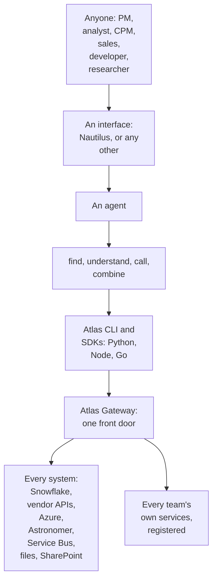

# Vision

Why Atlas exists and where it is going: a backend so complete, consistent and self-describing that an agent can build whatever anyone in the firm needs (a PM, an analyst, a CPM, sales, a developer, a researcher) by working through the Atlas CLI and SDKs alone; and, to grow it, one central gateway to which any team deploys its own services, with every client and all access managed by the front door.

### In short

- **An assistant is a new kind of user.** People judge software by its screens; an assistant judges it by its tools. Atlas is that experience, designed by us: a one-line map of what the person may use, the manual only when needed, house rules for which source is the truth for what, one route per question, and errors that name the fix.
- **The goal: everyone in the firm wants to use what is built on Atlas.** Whatever their role, a person asks for what they need, and an agent builds it: a dashboard, an analysis, a report, a job, an application.
- **Atlas is the backend that makes that possible.** It is not the interface people see: any interface, Nautilus or another, plugs into it. Atlas's part is to let an agent **find, understand, call and combine** anything the firm's systems offer, through the CLI and the SDKs, without help.
- **So Atlas is judged by what an agent can build with it,** for every role, and that is tested: role journeys an agent must complete with the CLI and SDKs alone (testing).
- **The agent builds tools, and the tools run on their own.** It explores with the CLI, then builds on the SDK that fits (a Node dashboard, a Python model or scheduled job, a Go service, a client in any language), all one shape; what it builds replays the same route every time, with no agent in the loop.
- **It reaches every system the safest way it can:** it runs the work, hands the bytes off, or brokers a connection, as the person wherever the system allows (§6.3).
- **It grows by every team adding its own services** to one central gateway, while the front door keeps sign-in, access, limits and audit for all of them.

### Picture

### How it works

A portfolio manager asks: “Show me where 147HYC's duration differs from its benchmark by sector, and tell me when new holdings land.”

1. **Find.** The agent runs `atlas search "portfolio holdings benchmark duration" --json`. It sees only what this PM may use: `portfolio.holdings@v1`, `portfolio.benchmark-comparison@v1`, `security.analytics@v1`, `data.landed@v1`.
2. **Understand.** `atlas guide` explains each: its parameters, its columns with units and meanings, examples in the CLI's syntax, and the effect of each interaction (`read`: safe to run without asking). `atlas explain` with the PM's portfolio shows the exact query and its cost before anything runs.
3. **Try.** It fetches a sample of each with the CLI and checks the join: both are keyed by ISIN and date.
4. **Build.** It writes a dashboard with the Node SDK, using the same names it just used in the CLI, and a short Python job that computes the differences, with the SDK returning exact decimals.
5. **Wire up.** It subscribes the dashboard to `data.landed@v1` for the PM's portfolio; the gateway brokers the connection, and the dashboard refreshes when holdings land.
6. **Recover.** One call fails with `not_granted` for `yieldbook.scenarios@v1`; the problem names the role to ask for, and the agent tells the PM instead of guessing.

The PM never saw a table name, a URL, a credential or a format. Every call was decided, limited and audited.

### Seams

| Seam | One side | Other side | The contract |
|---|---|---|---|
| People and an interface | The interface: how people ask and see | Not Atlas | Each interface's own spec |
| An agent and Atlas | The agent: what to build | The CLI and SDKs: everything it can find and call | §5, §9 |
| Atlas and the systems | The gateway: deciding, reaching | Each system: its own permissions | §6.3 |
| Atlas and a team's services | The front door: identity, access, limits, audit, routing | The service: its capabilities' work | Registration (§6.1.6); the provider protocol, to write |

### Rules

1. **Everything an agent needs is in Atlas.** A capability is finished only when an agent can find it, understand it and call it from its profile alone: a summary, every parameter and column with its meaning and unit, examples, the effect of each interaction, and the problems it can return with their next steps.
2. **One shape everywhere.** The same names, parameters, columns, problems and operations in the CLI, Python, Node and Go, so what an agent learns in one it uses in all.
3. **Only what the caller can use appears while working,** so an agent never wastes a step.
4. **Every failure says what to do next.**
5. **No role is special-cased.** What a role can build follows from its grants, never from code written for it.
6. **One route per question.** No two capabilities answer the same question, and the house rules say which source is the truth for what (§7, §2.6).
7. **What an agent builds runs on its own, the same way every time.** The agent chooses the route once, while building; a dashboard, a model, a job or a tool replays it from its lock: the same addresses, the same profiles, no discovery at run time (§9.7.9).
8. **A door for every use, added by us.** MCP and the CLI for assistants; the SDKs for programs; a client in a new language whenever a use needs one, written or generated from §9 and accepted by the conformance suite. Tooling for agents changes every few months; the next door is ours to add.
9. **One set of rules behind every door.** Access and limits per person on every capability, every call on the person's behalf, a confirmation before a costly call (§6.2.6), every call audited.

- **ATLAS-VISION-001.** Every role journey (below) is completed by an agent using only the CLI and SDKs, in every release.
- **ATLAS-VISION-002.** Every capability's profile passes the agent-readiness check: a summary, a meaning and unit for every field, at least one example, and a next step for every problem it declares.
- **ATLAS-VISION-003.** A role journey run twice calls the same capabilities, in the same order.
- **ATLAS-VISION-004.** An artefact an agent built (a dashboard, a model, a job, a tool) pins its addresses and profiles in a lock, and makes no discovery call when it runs.

### Detail

#### What each role asks for

| Role | Asks for, for example | The agent uses |
|---|---|---|
| Portfolio manager | Positions against benchmark; alerts when data lands | CLI to explore; Node dashboard; events |
| Analyst | A daily view that replaces a spreadsheet | CLI; Node dashboard; a Python job |
| CPM | Exposures and limits across portfolios | CLI; Python; a dashboard |
| Sales | A client-ready summary of a fund's positioning | CLI; Python to write the report |
| Developer | An application, or a service of their own on Atlas | All SDKs; registering a service |
| Researcher | Data for a hypothesis, a backtest, a pipeline on Astronomer | Python; the CLI; Astronomer pipelines |

#### What makes Atlas agent-buildable

| Property | Where it is specified |
|---|---|
| Discovery that returns only what the caller can use, ranked against their words | §2.6 |
| Profiles that describe everything, with meanings, units and examples | §3.1 |
| Four surfaces with fixed verbs, so one way of working fits every capability | §2 |
| Effect classes, so an agent knows what it may run, confirm or plan | §2.1 |
| Problems with a code and a next step | §4.1 |
| One shape across clients; extras where a language's users need them | §5 |
| A small fixed set of tools for agents | §4.2 |
| Contracts that change without breaking anyone | §3.3, §3.4 |
| Every system reached safely, the bytes going direct where they can | §6.3 |

#### Agents build tools on the gateway

The agent's way of working is the same for every role: **explore with the CLI, then build on the SDK that fits the use.** Every SDK has the same shape (the same names, parameters, columns, problems and operations, §5), so what the agent learned in the CLI it writes, unchanged, in whichever SDK the tool needs.

| The tool | Built on | Why that one |
|---|---|---|
| A live dashboard | The Node SDK | The language of Nautilus's pages; its extras read the person's files and git |
| A research model, a backtest, a scheduled job on Astronomer | The Python SDK | DataFrames with exact types, handoffs for large results, Airflow helpers |
| A service, a platform tool | The Go SDK | One Go implementation of the protocol |
| Anything else (a spreadsheet add-in, a language the firm adopts) | A custom SDK: a client written or generated from §9, or typed wrappers generated from a lock | §9 and the conformance suite make any language's client exact |
| A quick answer, a script | The CLI | One generic command per verb; JSON and NDJSON an agent reads |

Each tool, once built, carries its lock and runs on its own (rule 7).

#### How Atlas knows it meets the goal

**Role journeys** are tasks written in a person's words, one or more per role (the PM's request above is one). In every release, an agent is given each journey, a person's grants and only the CLI and SDKs, against the Development gateway. A journey passes when the agent builds what was asked, its calls are all within the person's grants, and its result is checked against an expected answer. A journey that fails is a gap in a profile, a problem's next step, discovery or a client, and is fixed there. The journeys sit with the rest of Atlas's tests.

| Measure | Good is |
|---|---|
| Right answer the first time | Every journey |
| Attempts: calls that failed or were thrown away | None |
| Time to answer | Recorded, release on release |
| Cost: tokens and metered use | Recorded, with a budget for the working view's tokens (O59) |
| The same route on a second run | Every journey (ATLAS-VISION-003) |

The first journeys are ten everyday questions, asked the same way of Atlas and of any other route an assistant has to the same data, so the comparison is measured, not observed.

#### Beside other routes for assistants

Other services route assistants to tools: the firm has onboarded Accio, which picks among MCP servers for an assistant. They are the quick way to give everyone third-party tools (Confluence, Jira, ServiceNow, Microsoft 365). Atlas is the deep way, for the firm's data and workflows: a door for every use, one set of rules. When a tool's agent experience matters, it **graduates**: its own API comes under the gateway as a provider domain, with profiles, per-person access and limits, and it leaves the other route, so each source keeps one route (O58).

#### Every team's services: how Atlas grows

The firm's needs are wider than one team can serve. So the direction is one central gateway, to which any team deploys its own backend services dynamically, each tied to its own domain and profiles, while the front door manages every client and all access centrally.

One team's turn, from a team that has never used Atlas to its capability in every client:

1. **Claim.** A credit-risk team claims the domain `credit-risk` and names its owner.
2. **Describe.** In its own repository, it writes the profile of `credit-risk.spread-duration@v1`, a data capability: its request, its result schema, its grain and keys, its errors. The profile check runs in its own CI.
3. **Build.** It builds a service in the language it chooses, to the provider protocol for the data family, and passes that family's conformance tests in its own CI.
4. **Register.** It deploys the service and registers it with the Development front door. The front door checks the domain claim, the profiles and the tests, and admits the service, all of its capabilities or none.
5. **Grant.** The team's owner grants the capability to the team's analysts and to a risk service's workload.
6. **Use.** A researcher's notebook calls `atlas.credit_risk.spread_duration(...)`. A Go risk service fetches it as Arrow, and an agent finds it with `atlas search` and reads it as NDJSON. Every call is decided, limited and audited by the front door, and routed to the team's service. No client was released.
7. **Evolve.** The team adds a column. The compatibility check classifies it as safe, and readers who know only the old profile resolve to it. No caller changes.

#### Central and owned

| Kept central, by the front door | Owned by each team |
|---|---|
| Sign-in and identity | Its domain's meaning, and its names |
| Discovery: the catalogue, search, describe | Its profiles: the contract of each capability |
| Access: grants, denies, conditions | Its service: code, language, data, scaling |
| Limits, budgets and approvals | Its credentials to its own sources |
| Audit and telemetry | Granting its own domain, within Atlas's rules |
| Versioning checks, at registration | Its releases, on its own schedule |
| Routing to the service |  |

#### Why it is possible

The surfaces are generic: data, resources, actions and events, each with fixed verbs (§2). The protocol's types are generic (§9). The profile describes everything a client needs, so clients hold no code for any capability (§3). What makes it safe to open the gateway to every team is strictness. A provider implements only its family's endpoints, exactly; the front door does everything else:

| Family | A provider implements | Proven by |
|---|---|---|
| Data | `plan` (with the writer contract in the statement), a stream of Arrow under the writer schema or a handoff, `settle` | Batches match the profile; every execution returns the same rows |
| Resources | The standard methods with ETags and field masks; change events from its own state | Masks honoured, `412` on a stale ETag, events emitted |
| Actions | `plan`; the verb as an operation, with an idempotency key; a receipt | Repeats are safe; the receipt matches the plan |
| Events | CloudEvents whose payloads match the profile | Payloads and attributes validate; ordering as declared |
| Every family | `describe`, `health`, verifying the front door's signed token, problems from the registry | Admission: domain, profile check, the family's tests |

#### What it needs

1. A normative **provider protocol** per family, with schemas and test vectors, beside the client protocol (§9).
2. A **provider conformance runner** that drives any team's service, in any language.
3. A **registry of domains** and their owners.
4. The **profile check** (lint and compatibility) as a tool a team runs in its own repository.
5. **Administration delegated** to each domain's owner.
6. A **trust and network model** for a service that runs in a team's own subscription.
7. **The general Atlas spec separated from one instance's:** QFI's catalogue, environments and sources become one instance of it.

**Where Atlas is today.** Every service is the gateway's own Python code. Registration is designed (§6.1.6) but not built, and the service protocol's transport and signed token are open.

### Decisions

**Decided (2026-10-30):** one route per question (D38); what an agent builds runs on its own from its lock (D39); a costly call is confirmed by the person first (D40).

**Decided (2026-10-29):** Atlas's goal is that an agent can build whatever anyone in the firm needs through the CLI and SDKs alone, and it is judged and tested by role journeys (D36). Its long-term direction is a central gateway to which backend services are deployed dynamically for whole teams, with every client and all access managed centrally by the front door (D32).

**Open:** the role journeys and their expected answers, and the agent-readiness check (O56); the first ten questions, the working view's token budget (O59); Atlas beside Accio, and graduation (O58); caching (O60); the provider protocol (O21, O22, O49), domain owners and their registry (O30, O50), delegated administration (O51), trust and network for teams' services (O52), and the general spec apart from QFI's instance (O53), each with its recommendation in §8.

### Go deeper

- Atlas on one page
- §6.3 Reaching systems
- §6.1 Front door and services: registration and the service protocol today
- §2.1 Capabilities: names and domains
- §3.3 Versioning: the compatibility check
- §8 Design decisions
