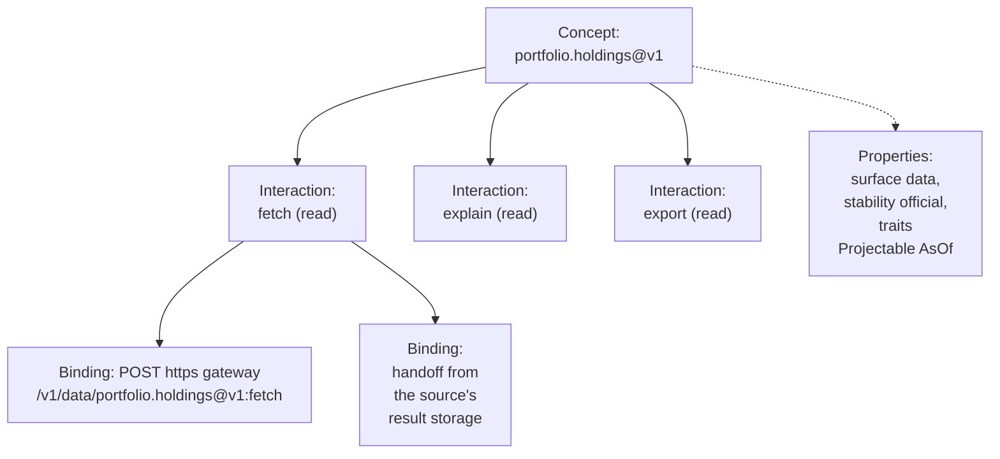

# §2.1 Capabilities

What a capability is: a named concept, the interactions its surface allows, and the bindings each is served at; the properties every capability and interaction declares; traits, effect classes and how capabilities and domains are named.

### In short

- A capability has three layers: the concept (`portfolio.holdings@v1`), its interactions (`:fetch`), and each interaction's bindings (where and how it is served). Names are for people; bindings are for infrastructure.
- Every capability is served by the Atlas Gateway, and declares its surface, stability, lifecycle, visibility and traits; every interaction its effect class, result shape, delivery, executions and bindings.
- Effect classes (`read`, `write`, `external`, `irreversible`) tell a harness how careful to be.
- Names: `atlas.*` only for built-ins; the team's subjects named generically (`portfolio`, never `harbour`); what it does not own named for its provider (`yieldbook`, `azure`); never where it runs.

### Picture

### How it works

An agent asked for “the weights in 147HYC” finds `portfolio.holdings@v1` with `atlas.search`, reads that its `fetch` is a `read` (so it may run it without asking), that it is `Projectable` (so it names the columns it needs), and calls the address `portfolio.holdings@v1:fetch` through the first binding its client supports. It never sees a URL.

### Seams

| Seam | One side | Other side | Where |
|---|---|---|---|
| A name and an endpoint | People, agents, grants: the name | Infrastructure: the binding | Clients follow served bindings; nothing parses a name |
| A capability and its surface | The protocol: the verbs | The capability: its schemas | §2.2–§2.5 |

### Rules

1. A name is for people, agents and governance. No router, edge or service MAY derive where or how to serve a call by parsing a name; routing follows bindings.
2. A capability's family, stability, visibility and effect classes are part of its contract; changing one is classified by §3.3, and a change of effect is always a new version.
3. An id is unique in the catalogue.
4. Every property above appears in the capability's profile.

- **ATLAS-CAP-001.** Every capability declares `id`, `version`, `domain`, `owner`, `family`, `stability`, `lifecycle`, `visibility` and `traits`, and every interaction declares `effect`, `result`, `delivery`, `execution` and at least one binding.
- **ATLAS-CAP-002.** An id matches `^[a-z][a-z0-9-]*(\.[a-z][a-z0-9-]*)+$`; only built-in capabilities have the domain `atlas`; a version is a positive integer; an interaction is one its family defines.
- **ATLAS-CAP-003.** Every request through every edge resolves to exactly one address before it is authorised.
- **ATLAS-CAP-004.** A capability offering both executions returns identical rows in the identical schema for the same request through either; a conformance test asserts it.
- **ATLAS-CAP-005.** A client that does not understand a trait marked critical is refused that capability with a problem naming the trait and the client version that understands it.
- **ATLAS-CAP-006.** Each family has a conformance battery generated from this spec, run against every capability of that family.

### Detail

#### 2.1.A Concept, interaction, binding

A capability has three layers. Names belong to the first two; infrastructure belongs to the third.

| Layer | What it is | Example | Used by |
|---|---|---|---|
| Concept | A named, versioned thing, in one family | `portfolio.holdings@v1` | Discovery, access, limits, audit, versioning, CLI commands, SDK attributes |
| Interaction | A verb the concept offers; its surface fixes the possible verbs | `:fetch`, `:export` | The same, per verb: grants, effect classes and limits attach here |
| Binding | Where and how one interaction is served: protocol, server, address, method, encodings, authentication | `POST https://<gateway>/v1/data/portfolio.holdings@v1:fetch` | Clients (they follow it) and the front door (it routes by it) |

The **address** of a call is `<id>@v<N>:<interaction>`, for example `portfolio.holdings@v1:fetch`. Every request, through every edge, resolves to exactly one address.

#### 2.1.B The four surfaces

A surface (a profile's `family`) fixes the verbs a capability can offer and what each means, so that a client implements each surface once.

| Family | What it is | Interactions | Section |
|---|---|---|---|
| **Data** | Reading what is | `fetch`, `explain`, `export`, `ticket` (the broker) | §2.2 |
| **Resources** | Objects the platform owns and keeps | `get`, `list`, `create`, `update`, `delete`, `watch`, and declared custom verbs | §2.3 |
| **Actions** | Changing a system outside Atlas | `plan`, `approve`, `run` (named by the action's own verb) | §2.4 |
| **Events** | Something that happened, for whoever subscribes | `subscribe`, `publish`, each answered by a connect handover to Service Bus | §2.5 |

The surfaces connect: resources emit change events; actions emit their operations' lifecycle; Harbour emits data-landed events; a dashboard re-fetches data when an event says it changed.

What the protocol fixes (in every client, once): the surfaces and their verbs, result shapes, deliveries, the operation's lifecycle, the event envelope, the standard methods. What profiles evolve (in the gateway, any day): each capability's schemas, bindings, lenses, enums and references.

#### 2.1.C Properties of a capability

| Property | Values | Meaning |
|---|---|---|
| `id` | `<domain>.<name>[.<name>]…` (§2.1.F) | Its name |
| `version` | `1`, `2`, … | Its major version; a new one only when its meaning changes (§3.3) |
| `domain` | the first segment of the id | Its namespace; each domain has one owner |
| `owner` | a team or person | Who answers for its meaning and approves its changes |
| `family` | `data`, `resource`, `action`, `event` | §2.1.B |
| `stability` | `official`, `community`, `upstream` | What it promises (below) |
| `lifecycle` | `preview`, `stable`, `deprecated`, `retired` | Where it is in its life; `deprecated` carries a sunset date and a replacement |
| `visibility` | `listed`, `confidential` | Whether a caller who cannot use it may learn it exists (§2.6) |
| `traits` | a list (§2.1.E) | Uniform behaviours it implements |

| Stability | Promises | Changes reviewed by |
|---|---|---|
| `official` | Full compatibility within a version; its meaning written by its owner | Its domain's owner, under the strict gates |
| `community` | The same compatibility rules; may be withdrawn with notice | Its owning team, under lighter review |
| `upstream` | A provider's own response in Atlas's envelope; its schema observed, fingerprinted and checked for drift, not promised | Its domain's owner |

Anything an application, dashboard, pipeline or job depends on SHOULD be `official` or `community`: an `upstream` capability is normalised into an Atlas-owned schema once something relies on it.

#### 2.1.D Properties of an interaction

| Property | Values | Meaning |
|---|---|---|
| `effect` | `read`, `write`, `external`, `irreversible` | How careful a caller must be |
| `result` | `table`, `record`, `collection`, `content`, `ticket` | The shape of what comes back |
| `delivery` | `single`, `chunked`, `subscription`, `operation`, `transfer` | How it comes back |
| `execution` | `gateway`, `handoff`, `client` (deferred) | Who does a data result's work and moves its bytes (§2.2) |
| `bindings` | a list | Where and how it is served (§4.2) |

| Result shape | What it is | Generic behaviour |
|---|---|---|
| `table` | Rows of typed columns | Column selection, filters, ordering, columnar transport (Arrow) |
| `record` | One typed object, possibly nested | Field selection by path |
| `collection` | A paged list of records | Cursor paging, field selection |
| `content` | Bytes with a media type and a metadata record | Ranges, checksums, media type negotiation |
| `ticket` | A credential issued once, with the planned operation and its permit | Issued once, never cached, settled afterwards |

| Delivery | What it is |
|---|---|
| `single` | One answer |
| `chunked` | One answer, sent in chunks as it is produced |
| `subscription` | Events, for as long as the subscriber listens |
| `operation` | An operation at once, then its progress and result (§4.1) |
| `transfer` | Bytes moved directly between the caller and storage, by byte range, resumable: an upload (publishing a dashboard, a bundle, a file) or a download (an export, a large file), through a short-lived link the host issues |

| Effect | Covers | Default policy in a harness |
|---|---|---|
| `read` | Reading data, `get` and `list` on resources, subscribing | Run it; a metered call whose estimate passes the caller's threshold asks the person first (§6.2.6) |
| `write` | Changing a resource Atlas owns, reversibly | Confirm with the person |
| `external` | Changing a system outside Atlas, or publishing an event | Plan first, then confirm |
| `irreversible` | Anything that cannot be undone | Plan, then approval by someone other than the requester |

**Execution** (the patterns of §6.3). `gateway` (run): the gateway does the work and streams the result. `handoff`: the gateway does the work and the client downloads the result directly from the source's result storage. `client` (the broker): the client runs the planned statement from a ticket; deferred until its credential meets the credential rule (§6.3). All MUST return the same rows in the same schema for the same request.

**A fallback for every client.** Every interaction has a binding over plain HTTP and JSON that any client can use: a stream falls back to an operation polled for its pages; a transfer to an inline body under 1 MiB. Events are the one surface the gateway never carries: a client that cannot reach Service Bus polls the data capability that holds the event's history (its profile's `meaning.history`), and polls the catalogue by ETag and an operation by `get`. The one exception is bulk data (`export`, `client` execution), whose fallback is `fetch` in pages with a row cap and a truncation flag. So the thinnest client can call everything in the catalogue, and only throughput differs.

#### 2.1.E Traits

A trait is a behaviour every client and test handles the same way in every domain. A profile MAY mark a trait **critical**: a client that does not understand it MUST NOT call that capability, and is told so.

| Trait | A capability with it |
|---|---|
| `Projectable` | Accepts `columns` (or field paths) and returns only those |
| `Filterable` | Accepts the filters its profile declares, pushed down to its source |
| `Paged` | Pages by an opaque cursor |
| `AsOf` | Accepts `as_of`, answering as the data stood then; and `start_date` / `end_date` for a range |
| `Keyed` | Declares its keys and its references to other capabilities |
| `Searchable` | Accepts free-text search |
| `Ranged` | Serves byte ranges of content |
| `Handoff` | Offers `handoff` execution |
| `Brokerable` | Offers `client` execution: plan, ticket, run, settle |
| `DryRunnable` | Returns a plan without changing anything |
| `NeedsApproval` | Runs only after someone other than the requester approves, where its policy says |
| `Licensed` | Returns licensed data: never persisted except a job's answer for its own caller; caches stay in memory |
| `Ordered` | Delivers events in order per subject |
| `DynamicSchema` | Its result's columns are chosen by the caller's own query (`snowflake.query`, `azure.resource-graph`): no fixed result schema, each answer carries its own, no resolution, always `upstream` (§9.3) |
| `Metered` | Costs money upstream per call; its profile states the unit and the price |

#### 2.1.F Names and domains

An **id** is `<domain>.<name>[.<name>]…`: lowercase segments of letters, digits and hyphens (`portfolio.reference-values`). It names a concept, never a verb, where it runs, or the system that happens to store the data.

**Three kinds of domain:**

| Kind | Rule | Domains |
|---|---|---|
| **Built-in** | `atlas.*` is reserved for Atlas itself: discovery, access, operations, settings. Nothing else may use it | `atlas` |
| **Subject** | What the firm's quant team owns or models (Harbour's data, its signals, its applications) is named for its subject, generically, and never for where it is stored: no `harbour.*`, `snowflake.*`, `gold.*` or ids | `portfolio`, `index`, `security`, `curve`, `signal`, `securitized`, `research`, `product`, `universe`, `model-portfolio`, `data`, `globalrv`, `kb`, `nautilus`, `event` |
| **Provider** | What the team does not own (a vendor's API, a platform, a cloud service) is named for its provider or platform | `bloomberg`, `yieldbook`, `intex`, `citi`, `dataquery`, `spglobal`, `creditflow`, `snowflake`, `sharepoint`, `azure`, `astronomer` |

**Only capabilities are named here.** What a client does on the caller's machine (reading a file, a git checkout, the person's GitHub) is a client extra, named in its client's own interface and never given an id (§5).

**Names by family:**

| Family | The id names | Examples |
|---|---|---|
| Data | What you read: a noun (`list` and `search` count as nouns: a domain's catalogue and its lookup) | `portfolio.holdings`, `curve.government-zero`, `portfolio.list` |
| Resources | The object: a singular noun | `nautilus.dashboard`, `kb.base`, `atlas.operation` |
| Actions | The thing acted on; the verb is the interaction | `astronomer.deployment:restart` |
| Events | The subject, then what happened, in the past tense | `data.landed`, `nautilus.dashboard.published` |

Every capability, its domain and its properties are listed in §7 The catalogue.

### Decisions

**Decided (2026-10-28):** only built-ins are `atlas.*`; what the team owns is named for its subject, generically, never `harbour.*`; what it does not own is named for its provider or platform; no prefix for where it runs.

**Open:**

- The trait list as the first set; a new trait is a protocol minor version. Recommended: yes.
- Which Snowflake data capabilities offer `handoff`. Recommended: every one the gateway plans as one statement, once the spike confirms the handoff.

### Go deeper

- §2.2–§2.5 the surfaces
- §3.1 Profiles
- §7 The catalogue
