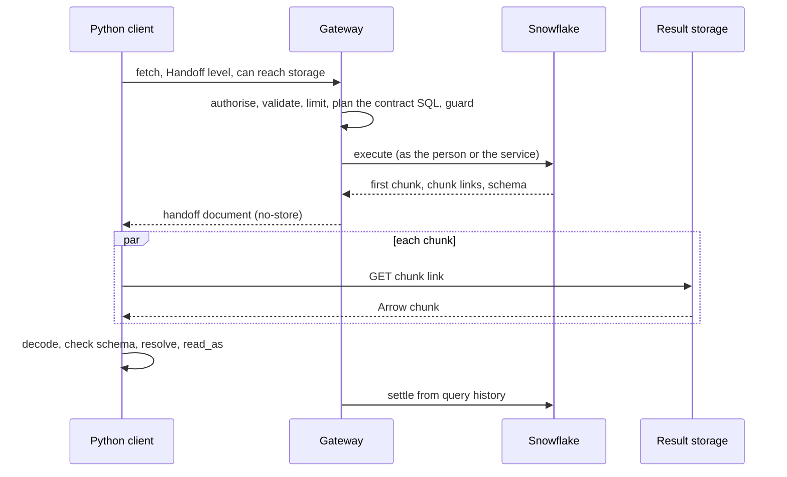
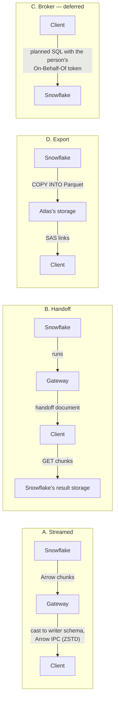

# §2.2.1 Snowflake data

Source: `IMG_2138.MOV` 00:04:08–00:04:42. Diagrams and visible prose/tables manually reconstructed from full-resolution frames.

Data capabilities served from Snowflake: what Snowflake gives natively, streaming and result handoff (the client downloads one result's chunks with no Snowflake session), the ticket (the broker) deferred until its credential meets the credential rule, export by COPY INTO next; the contract in the planned SQL; the type mapping; and what a spike must confirm.

### In short

- Snowflake returns results to its drivers as **Arrow chunks** in its own storage, behind pre-signed links: no conversion is ever needed, and the chunks can be fetched without a session.
- **Streamed:** the gateway reads Arrow batches (never rows), casts them to the writer schema, streams them.
- **Handed off:** the gateway runs the query and gives the client the chunk links; the client downloads and decodes them. No SQL and no Snowflake credential leave the gateway; settlement is exact.
- **Export:** `COPY INTO` Parquet, then links. **Broker:** a ticket (the planned SQL, its writer schema and a credential) the client runs itself; its credential is the one listed exception to the credential rule (§6.3).
- The contract is in the SQL; decimals stay exact; `TIMESTAMP_NTZ` is never assumed.

### Picture

### How it works

A research notebook fetches ten years of `index.constituents@v1`. The gateway's `EXPLAIN` estimates 3 GB, the client declares the Handoff level and `reach-snowflake`, so the gateway runs the query and answers with 41 chunk links. The client downloads them eight at a time, decodes each (`NUMBER(18,6)` as an exact decimal, timestamps as UTC microseconds), checks each batch against `index.constituents@v1#…`, and builds a DataFrame. If a link expires, it asks the operation again for fresh links; the result persists for 24 hours.

### Seams

| Seam | One side | Other side | Where |
|---|---|---|---|
| Gateway and Snowflake | The gateway: plan, guard, credential | Snowflake: run, store the result | The `DataSource` adapter (§6.4) |
| Client and result storage | Snowflake: the chunks | The client: decode and check | The handoff document (§9.3) |

### Rules

1. A Snowflake data capability offers `gateway` execution always; `handoff` where the spike confirms it; `export` where its results can be large; `client` (a ticket) only once its credential meets the credential rule (O54): deferred.
2. The contract is in the planned SQL; no execution passes Snowflake's own types to a client.
3. A handoff document is a credential for one result: short-lived, bound to the caller and the operation, never stored.

- **ATLAS-SNOWFLAKE-001.** The same request through every execution a capability offers yields identical records.
- **ATLAS-SNOWFLAKE-002.** Gateway memory stays flat while streaming a result larger than its memory limit.
- **ATLAS-SNOWFLAKE-003.** A handoff gives the client nothing that reads anything but its one result.
- **ATLAS-SNOWFLAKE-004.** No decimal reaches a client as a float unless its profile declares a `number`.

### Detail

#### 2.2.1.1 What Snowflake gives natively

| Snowflake does | Which gives Atlas |
|---|---|
| Returns query results to its drivers as **Arrow**, in chunks, the first one inline and the rest stored in the account's cloud storage behind pre-signed URLs, which the drivers download in parallel | Arrow end to end with no conversion; parallel download; and the **handoff**: the downloads need no Snowflake session |
| Exposes those chunks to code: `gosnowflake`'s Arrow batches (`WithArrowBatches`), each a chunk fetched on demand (the Python connector's `get_result_batches()` does the same) | The basis of the handoff (the chunks' links are read through a small vendored part of the driver: the spike confirms it) |
| Streams batches to the caller, with exact decimals (`WithHigherPrecision`) | Bounded memory in the gateway |
| Keeps every query's result for 24 hours (`WithFetchResultByID`, `RESULT_SCAN`), readable without re-running it | Resuming a broken stream, or re-issuing expired links, at no compute cost |
| Runs queries asynchronously, by query id (`WithAsyncMode`) | No request held open during a long query |
| Estimates a query before running it (`EXPLAIN`: partitions and bytes) | Choosing how the result travels |
| Unloads results to Parquet in parallel (`COPY INTO <stage> FILE_FORMAT = (TYPE = PARQUET)`) | `export` without the gateway writing files |
| Records every query with its tag (`QUERY_TAG`, query history) | Exact settlement |

#### 2.2.1.2 The four executions on Snowflake

| | A. Streamed | B. Handoff | D. Export | C. Broker |
|---|---|---|---|---|
| Runs the SQL | Gateway | Gateway | Gateway (as `COPY INTO`) | Client |
| Moves the bytes | Gateway | Client, from Snowflake's storage | Client, from Atlas's storage | Client |
| SQL leaves the gateway | No | No | No | Yes |
| Credential leaves the gateway | No | Links to one result | Links to files | Today the gateway's own token; the person's by OBO next; a read-only scope to meet the rule |
| Statement guard applies | Yes | Yes | Yes | No |
| Settlement | Exact | Exact | Exact | By `QUERY_TAG` |
| Clients | All | Handoff level: the Go engine (the Go SDK, the CLI, the Python SDK) first | Bulk level | Broker level |
| Status | Build first | Build first | Next | Deferred (O54) |

#### 2.2.1.3 The handoff, step by step

The client never connects to Snowflake: no login, no session, no warehouse. It downloads one finished result's files.

1. The client calls `fetch`, declaring the Handoff level and that it can reach Snowflake's result storage.
2. The gateway authorises and limits the call, plans the writer-contract SQL (below), runs the statement guard, and executes it on Snowflake (as the person, by On-Behalf-Of, or as its service identity).
3. It reads the result's chunk list: the first chunk inline, then each chunk's pre-signed URL, row count and sizes, the headers the download must send (on some clouds, the result's encryption key), and Snowflake's result schema.
4. It answers with a **handoff document** (§9.3): the writer profile's `exact-id`, the first chunk, the chunk list, the Snowflake chunk format's version, an expiry; never cached (`Cache-Control: no-store`).
5. The client downloads the chunks in parallel by HTTPS, decodes each from Snowflake's Arrow encoding into the writer's Arrow schema, checks the schema, resolves to its caller's profile and converts to the caller's format.
6. The gateway settles exactly: it ran the query and holds its id and row count.
7. If links expire mid-download, the client asks again by operation; the gateway re-reads the persisted result and issues fresh links.

**Decoding.** Snowflake's chunks are Arrow in Snowflake's own encoding (`NUMBER` with a scale as a scaled integer; some timestamps as structs), which its drivers convert. The handoff document is language-neutral; each client implements the decoding for the format version it declares, using Snowflake's own driver code (Apache-2.0) as reference (third-party code). The decoder is written once, in Go (`sdk/go`), for the Go SDK, the CLI and the Python SDK's engine; TypeScript later. A client that does not declare the format version is streamed instead.

#### 2.2.1.4 The stream, made fast

1. `gosnowflake` with `WithAsyncMode`, `WithArrowBatches` and `WithHigherPrecision` (exact decimals): Arrow batches, never rows.
2. Few chunk-prefetch threads, so memory stays flat and the client's reading is the backpressure.
3. Each batch cast to the writer profile's Arrow schema: mostly zero-copy (renames; `NUMBER(p,0)` to `int64`; timestamps to UTC microseconds).
4. Arrow IPC with ZSTD buffer compression, or NDJSON for Core clients.
5. A broken stream resumes from batch *k* using the query id and the persisted result.
6. Everything that can be is in the SQL: columns, filters, limits, order. Only requested columns ever move.

#### 2.2.1.5 The contract in the planned SQL

The gateway renders the writer contract into the statement with the Go SQL library (§6.4): every column aliased to its contract name and cast to its contract type, every timestamp converted to UTC. So in every execution Snowflake itself produces the writer schema; the gateway's own cast (A) and the client's check (B, D) only confirm it.

#### 2.2.1.6 Snowflake types to Atlas types

| Snowflake | Atlas (§9.2) | Note |
|---|---|---|
| `NUMBER(p,0)`, `p ≤ 18` | `integer` (`Int64`) | |
| `NUMBER(p,0)`, `p > 18` | `Decimal(p,0)` | |
| `NUMBER(p,s)`, `s > 0` | `Decimal(p,s)` (`Decimal128`), or `number` where the profile declares a unit (`Bp`, `Fraction`) | Exact decimals must be requested from the driver |
| `FLOAT` | `number` (`Float64`) | |
| `VARCHAR` | `string` | |
| `BOOLEAN`, `DATE`, `BINARY` | `boolean`, `date`, `bytes` | |
| `TIMESTAMP_TZ`, `TIMESTAMP_LTZ` | `date-time` (UTC, microseconds) | |
| `TIMESTAMP_NTZ` | `date-time` only where the profile states the zone it is in; converted to UTC in the SQL | Never assumed |
| `TIME` | `string` in `atlas/1.0` | |
| `VARIANT`, `OBJECT`, `ARRAY` | A declared `object` or `array` schema, or a JSON `string` | Never untyped in an official capability |

#### 2.2.1.7 Choosing the execution

The gateway chooses when it plans, from: the client's levels and whether it can reach Snowflake's storage (`Atlas-Client-Features`); the expected size (`EXPLAIN`, or the capability's declared typical size); the caller's preference (`Atlas-Execution`); and policy. Starting thresholds, to be set by measurement: under about 50 MB, streamed; above it, a handoff where the client can take one, else streamed; files asked for, or above about 5 GB, export.

#### 2.2.1.8 To confirm by a spike, before building

| Question | If the answer is no |
|---|---|
| Can laptops, and Nautilus Cloud's workers, reach Snowflake's result storage (Private Link, proxies)? | Handoff only where reachable; the client declares it; others are streamed |
| How long do the chunk URLs last? | The gateway re-issues from the persisted result |
| What do the download headers carry on Azure, and can they travel in the handoff document? | Handoff waits; streaming serves |
| Can `gosnowflake` give the chunks' links and download headers to put in the handoff document (directly, or through a small vendored part)? | Vendor more of the driver's chunk code (Apache-2.0), or wait for handoff and stream |
| Do exact decimals and `TIMESTAMP_NTZ` behave as above on our connector version? | Cast in the SQL |
| Does the ADBC Snowflake driver serve as well as `gosnowflake` (On-Behalf-Of, `QUERY_TAG`, decimals, chunks)? | Keep `gosnowflake` |
| Throughput and gateway memory: Arrow batches with casting, against handoff, against `COPY INTO` | Thresholds as measured |

### Decisions

**Decided (2026-10-29):** streaming, result handoff and the ticket (the broker) now, every connection as the person in the target (§6.3); export next. The handoff document is language-neutral; the Go engine decodes it first.

**Open:** the spike's questions above.

### Go deeper

- §2.2 The data surface
- §6.4 Data sources
- §9.3 Documents
