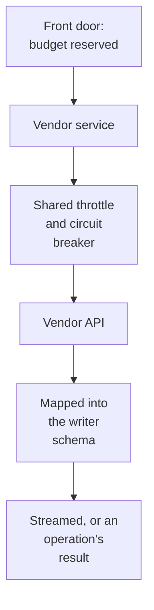

# §2.2.2 Vendor API data

> Source: `IMG_2138.MOV` 00:04:42–00:05:08.

Data capabilities served by calling a vendor's API: upstream until normalised into an Atlas-owned schema at the edge, metered and licensed, long calls as operations, always streamed by the gateway, throttled per vendor.

## In short

- Named for the vendor (`yieldbook.price-yield`), because the team does not own it.
- `upstream` while the vendor's response is passed through; `official` once the service maps it into an Atlas schema, which anything relied on must be. Then a vendor's change touches only the mapping.
- Metered and licensed: budgets reserved before the call; results never persisted.
- Long calls (scenario grids, cash-flow projections) return an operation. Never handed off.

### How it works

`yieldbook.scenarios@v1` for 25 bonds: the front door reserves its metered cost, the service queues the vendor call under Yield Book's shared limit and answers with an operation; when the grid returns, the service maps it into the capability's schema and the operation succeeds with the result.

### Seams

| Seam | One side | Other side | Where |
|---|---|---|---|
| Service and vendor | The service: mapping, throttle | The vendor: its API | The mapping in the service |

## Platform APIs on the same pattern

Two platforms the team does not own are served the same way, from the cloud gateway:

| Domain | What | As whom | Notes |
|---|---|---|---|
| `azure` | **Azure Resource Graph only** (`azure.resource-graph`): a KQL query over every resource the caller may read | Now the gateway's own identity, granted by name only; in the target the caller, by On-Behalf-Of, so each sees exactly what their own Azure roles allow (§6.3) | Read-only by construction; its columns are the query's (`DynamicSchema`); paged by Resource Graph's skip token; throttled per caller |
| `astronomer` | Deployments, DAGs, runs, logs | Now the gateway, with an Astronomer API token per environment, the caller recorded in the audit; the person in the target (§6.3) | What each caller may see is Atlas's grant |

## Rules

1. A vendor capability never returns the vendor's credential, or a link that carries it.
2. An `upstream` capability is normalised before an application, dashboard, pipeline or job depends on it.

- **ATLAS-VENDOR-001.** A change in a vendor's response that the service's mapping absorbs changes no fingerprint.
- **ATLAS-VENDOR-002.** Drift in an `upstream` capability's observed schema is reported to its owner within a day.

## Detail

### What these capabilities share

| Concern | Rule |
|---|---|
| Domain | Named for the vendor (`yieldbook.price-yield`), as a provider domain (§2.1) |
| Stability | `upstream` while the vendor's own response is passed through, in Atlas's envelope, its schema observed and checked for drift; `official` once normalised into an Atlas-owned schema at the edge, which anything relied upon must be |
| Normalising | The service maps the vendor's response into the capability's writer schema; when the vendor changes, only that mapping changes, and the profile does not |
| Metering | Most calls cost money or count against a licence: the `Metered` trait, with its unit and price; budgets reserved before the call (§6.2) |
| Licences | Results are `Licensed`: never persisted, except a job's answer for its own caller |
| Long calls | A vendor call that runs for minutes (Yield Book scenarios, Intex cash flows) returns an operation |
| Travel | Always `gateway` execution, streamed or as an operation's result; never handoff (there is no vendor result storage to hand off) |
| Throttle | One shared rate and concurrency limit per vendor, across every copy of its service, and a circuit breaker (§6.1) |

## Go deeper

- §2.2 The data surface
- §6.1 Front door and services
