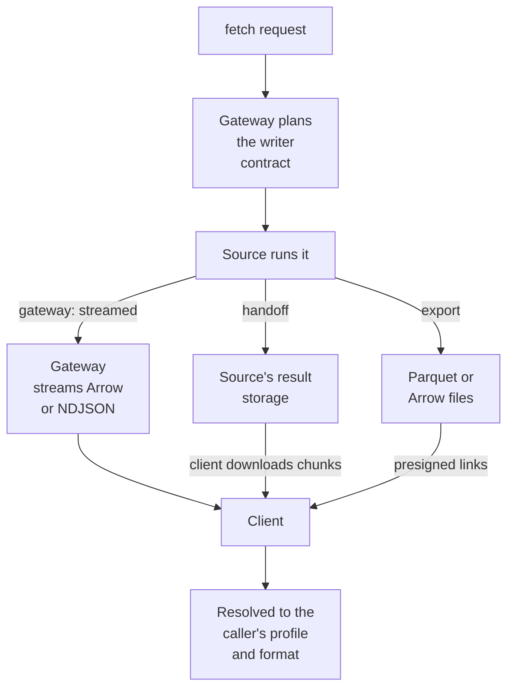

# §2.2 The data surface

Reading data with one contract whoever runs the work and however the bytes travel: fetch, explain and export; a result streamed by the gateway, handed off to the client, or brokered by a ticket; export next; the contract written into the planned query; and the sub-profiles by source.

### In short

- Interactions: `fetch` (the data), `explain` (the plan it would run), `export` (the result as files). `ticket` hands the caller the planned statement to run itself (the broker).
- A result travels **streamed by the gateway** (every client, every size) or **handed off** (the client downloads it directly from the source's result storage); **export** writes files; the **broker** hands the client a ticket: the planned SQL, its writer schema and a credential, to run the query itself (§6.3).
- Whatever the path, the same rows in the same writer schema: the gateway writes the contract into the **query it plans**, so the source itself produces it.
- A data capability is a **sanctioned computation**: the caller gives values and columns, never the query.

### Picture

### How it works

`index.constituents@v1:fetch` for one index on one date (about 3,000 rows) is **streamed**: the gateway reads Snowflake's Arrow batches, casts each to the writer schema and streams it. The same capability over ten years (about 30 million rows) from Python is **handed off**: the gateway runs the query and returns the result's chunk links; the client downloads them in parallel and gets identical rows. Asked from the CLI with `--format parquet`, it is **exported** to files.

### Seams

| Seam | One side | Other side | Where |
|---|---|---|---|
| The planned query | The gateway: the writer contract in SQL | The source: running it | §2.2.1, §6.4 |
| The bytes | The gateway or the source's storage | The client: reading, checking, resolving | §9.6 |

### Rules

1. A table capability SHOULD implement `Projectable`; every table capability whose source can filter SHOULD implement `Filterable`.
2. A planned statement carries a tag the source records (for Snowflake, `QUERY_TAG`), and the gateway settles every handed-off, exported or brokered call from the source's own record.
3. A ticket's credential is short-lived, read-only, scoped to the planned operation, answered once, and never stored (`Cache-Control: no-store`); the record the gateway keeps is the permit, never the credential. It is the **caller's own identity** at the source, obtained by On-Behalf-Of exchange, so the source's own grants are the final limit. The Snowflake ticket's credential is today the gateway's own token: the one listed exception to the credential rule, which blocks tickets beyond Development until it is closed (§6.3).
4. Rows of a `Licensed` capability fetched by the client (handed off, or brokered) stay in memory on the caller's side.
5. A `fetch` whose answer may be large or slow SHOULD offer `chunked` delivery or return an operation.
6. An export's links are short-lived, bound to the caller and the operation, and expire with it; its files are deleted when the operation's retention ends.

- **ATLAS-DATA-001.** A `fetch` with `columns` returns exactly those columns, in the writer profile's types, through every execution the capability offers.
- **ATLAS-DATA-002.** In client execution, the statement the caller receives includes the requested columns and pushed-down filters; the caller runs it unchanged.
- **ATLAS-DATA-003.** Settlement compares what the source recorded under the ticket's tag with the planned statement, and records a mismatch against the caller.
- **ATLAS-DATA-005.** A ticket's credential can do nothing at the source that the caller's own identity could not.
- **ATLAS-DATA-006.** An export's files are readable only through its links, which expire, and only by the caller.
- **ATLAS-DATA-004.** `explain` returns the plan the same request's `fetch` runs, byte for byte for a SQL statement; a capability that cannot explain itself does not offer `explain`.
- **ATLAS-DATA-007.** `explain` is decided, validated and resolved exactly as the same request's `fetch` (the same problem for an invalid parameter), and runs nothing at the source except its estimate.

### Detail

#### Interactions

| Interaction | Effect | Result | Delivery | What it does |
|---|---|---|---|---|
| `fetch` | `read` | `table`, `record`, `collection` or `content` | `single`, `chunked`, `operation`, or a handoff | Returns the data for a request: streamed by the gateway, or handed off |
| `explain` | `read` | `record` | `single` | Takes the same request as `fetch` and returns what that `fetch` would do, without doing it: the plan (for a SQL source, the exact statement), the columns that would come back, the estimated rows, bytes and cost, and the execution it would choose (`explain.schema.json`, §9.3) |
| `export` | `read` | `content` | `transfer` | Writes the whole result to storage as Parquet or Arrow files, then returns short-lived download links |
| `ticket` | `read` | `ticket` | `single` | The broker: plans the `fetch` and hands the caller a ticket (the statement, its writer schema, a credential) to run it |

#### The ways a result travels

| Execution | Who runs the work | Who moves the bytes | Credential given out | For | Status |
|---|---|---|---|---|---|
| `gateway`: streamed | The gateway | The gateway, streamed, never buffered (Arrow or NDJSON) | None | Every client and every size; the only path for thin clients | **Build first** |
| `handoff` | The gateway | **The client, directly from the source's result storage** | Links to this one result only | Large results to clients that can reach and decode the source's result files | **Build first** (Snowflake, Python) |
| `export` | The gateway (or the source, writing files itself) | Storage, by presigned links | Links to the files | Very large results; callers who want files | After the first two |
| `client`: the broker | The client, running the planned statement at the source | The client | A ticket: the statement, its schema, a credential (§6.3) | Clients that run the query at the source themselves | **Deferred** until its credential meets the credential rule (O54) |

A capability's profile lists the executions it offers; the gateway chooses one per call from the client's levels, the expected size of the result, the caller's preference and policy. Whichever is chosen, the result is the same rows in the same writer schema: nothing above the bytes differs. Which executions a sub-profile can offer is its own section's business (§2.2.1).

#### The contract in the planned query

The gateway owns the writer side even when it does not carry the bytes (a handoff, an export): it writes the contract into the query it plans. Every column is aliased to its contract name and cast to its contract type, so the source itself produces the writer schema. A client still checks each batch's schema against the profile (one comparison per batch) and reports `invalid_document` on a mismatch, rather than pass wrong types to its caller.

#### The sanctioned computation

A data capability is a sanctioned computation, as OKF's Attested Computation is: the caller supplies parameter values and its column selection; it never authors or edits the computation. Column selection and the filters the profile declares are pushed down **when the gateway plans**, so the planned statement already contains them. Anything else the caller does (renaming, deriving values for display, further filtering) happens on the returned rows and never touches the statement.

Free-form SQL is not a sanctioned computation. It is its own capability (`snowflake.query`), behind a named grant, with `stability: upstream`'s promises only.

#### Sub-profiles

| Sub-profile | Capabilities | Adds | Section |
|---|---|---|---|
| **Snowflake** | Harbour's subjects (`portfolio`, `index`, `security`, `curve`, `signal`, …) and vendor data stored there | The four executions, the handoff, Snowflake's types, optimisation | §2.2.1 |
| **Vendor and platform APIs** | `bloomberg`, `yieldbook`, `intex`, `citi`, `dataquery`, `creditflow`; `azure` (Resource Graph), `astronomer` | Metering, the vendor's schema stability, normalisation, long calls as operations | §2.2.2 |

### Decisions

**Open:**

- What a settlement mismatch does beyond being recorded. Recommended: record now; decide enforcement later.
- When the Node SDK takes handoffs (a dashboard reading a large result). Recommended: after Python's; streaming and `export` cover the need first.

**Decided (2026-10-29):** results travel streamed by the gateway, handed off, or brokered by a ticket, as the register in §6.3 sets for each system; export next. The broker's credential is the caller's own identity at the source in the target. The contract is written into the planned query. Arrow Flight is a later binding.

### Go deeper

- §2.2.1 Snowflake data
- §2.2.2 Vendor API data
- §6.4 Data sources
