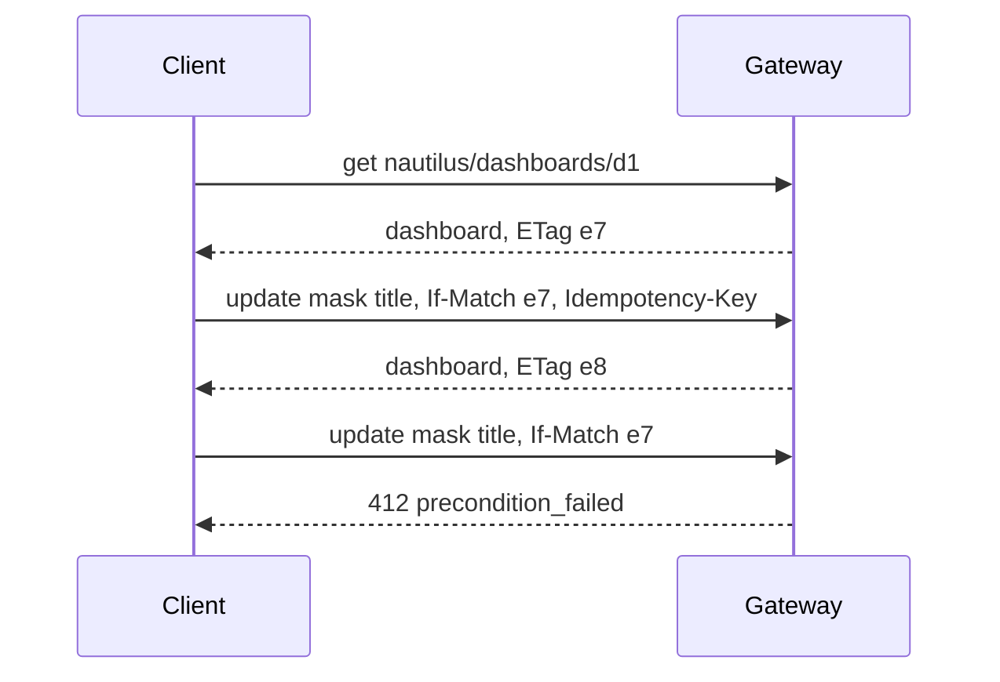

# §2.3 Resources

> Source: `IMG_2138.MOV` 00:05:08–00:05:32.  
> `spec/surface/resources.md` · proposed

Objects the platform owns and keeps (dashboards, knowledge bases, grants, operations), served through standard methods with field masks, ETags, idempotency keys and paging, and served in several versions of one stored form.

## In short

- Standard methods: `get`, `list`, `create`, `update` (with a field mask), `delete`, `watch`; custom verbs only where none fits (`nautilus.dashboard:publish`).
- Every write carries an idempotency key; every `update` and `delete` an ETag (`If-Match`): no unconditional overwrite.
- One envelope on every record: `name`, `metadata`, its own fields, and `status` where the gateway converges it.
- One stored version, served at up to two versions, converted by the newer version's lens.
- Uploads (a dashboard's files, a bundle) use resumable transfers.

## Picture



### How it works

Two people rename the same dashboard. The first `update` (mask `[title]`, `If-Match: e7`) succeeds and the ETag becomes `e8`; the second, still holding `e7`, gets `precondition_failed`, re-reads, and decides. A client on `nautilus.dashboard@v1` and one on `@v2` edit the same stored dashboard; each sees its own version's fields.

### Seams

| Seam | One side | Other side | Where |
|---|---|---|---|
| Served and stored versions | The gateway: conversion by lens | Clients: their own version | §3.3 |

## Rules

1. A resource is named by a path of collection and id segments (`nautilus/dashboards/{id}`); the name is stable for the resource's life.
2. Every write carries an idempotency key, and every `update` and `delete` the ETag it read; there is no unconditional overwrite.
   1. A write that uploads files (publishing a dashboard, a knowledge-base bundle, a workspace file) uses `transfer` delivery: the caller uploads to a short-lived link by byte range, resumably, then commits; the commit is idempotent.
3. A new served version of a resource type requires its lens to and from the stored form; a resource type changes its stored form only by a migration recorded in its profile's evolution.
4. Every record carries the envelope of §9.3 §9.3.4; the caller writes its own fields and `labels`, the gateway everything else, and only a controller writes `status`.
5. A resource whose desired state the gateway acts on outside itself (a Service Bus subscription, a public copy of a dashboard) is converged by a controller (§6.1 §6.1.13), never inside the call that wrote it: the call answers with the record, and `status` says when it is `ready`.

- **ATLAS-RESOURCE-001.** `update` changes only the fields in its mask, and fails with `412` when the ETag no longer matches.
- **ATLAS-RESOURCE-002.** A `create` repeated with the same idempotency key returns the first result and creates nothing.
- **ATLAS-RESOURCE-003.** A resource written through one served version reads back through every other served version, converted by the declared lenses; a conformance test round-trips each pair.
- **ATLAS-RESOURCE-004.** Every resource record the gateway sends validates against `resource.schema.json`, and its profile's record schema declares the envelope exactly.
- **ATLAS-RESOURCE-005.** A `create` or `update` that sets `metadata` (other than `labels`) or `status` changes neither; a field mask naming them is `invalid_request`.
- **ATLAS-RESOURCE-006.** `metadata.generation` and the ETag move on every change to the record's own fields or labels, and on nothing else.
- **ATLAS-RESOURCE-007.** A converged resource's `status.observed_generation` reaches its `metadata.generation`, with `ready` true, once its controller has converged it; while it cannot, `ready` is false with a `reason`.

## Detail

### Standard methods

| Interaction | Effect | Result | Semantics |
|---|---|---|---|
| `get` | `read` | `record` | One resource by its name (`nautilus/dashboards/{id}`) |
| `list` | `read` | `collection` | Paged, filtered, ordered |
| `create` | `write` | `record` | Requires an idempotency key; returns the resource with its ETag |
| `update` | `write` | `record` | Takes a field mask: only the named fields change; requires the ETag it read |
| `delete` | `write` or `irreversible` | `record` | Requires the ETag; its profile says whether it can be undone |
| `watch` | `read` | `record` | `subscription` of changes to one resource or a filtered list |
| custom (`:publish`, `:share`) | `declared` | `declared` | The exception: an operation that is not one of the above |

These follow Google's API Improvement Proposals (resource names, standard methods, field masks, ETags, paging).

### The envelope

```json
{
  "name": "nautilus/dashboards/d1",
  "metadata": {
    "uid": "6f1c0e9a2b7d4c3e8f5a1b2c3d4e5f60",
    "etag": "\"e8\"",
    "generation": 8,
    "created": "2026-10-01T09:00:00Z",
    "updated": "2026-10-30T14:02:11Z",
    "owner": "3f2b…",
    "labels": { "desk": "credit" },
    "deleting": null
  },
  "title": "Credit risk",
  "visibility": "public",
  "status": {
    "observed_generation": 8,
    "conditions": [
      {
        "type": "published",
        "status": "true",
        "reason": "copied",
        "message": "",
        "observed_generation": 8,
        "last_transition": "2026-10-30T14:02:15Z"
      },
      {
        "type": "ready",
        "status": "true",
        "reason": "converged",
        "message": "",
        "observed_generation": 8,
        "last_transition": "2026-10-30T14:02:15Z"
      }
    ]
  }
}
```

Its exact structure and rules are §9.3 §9.3.4. Atlas keeps the desired fields at the top of the record rather than under a `spec` member, so field masks and profiles stay flat (§6.6 §6.6.2).

### Versions of a resource

A resource type has **one stored form** and MAY be **served in several versions**, as Kubernetes serves one object in several API versions: the gateway converts between the stored form and each served version with the lens the newer version declares. A `nautilus.dashboard@v1` client and a `@v2` client can then edit the same dashboard safely.

### Events

Every resource emits change events (`<id>.created`, `<id>.updated`, `<id>.deleted`) from the gateway's state (`gateway`); `watch` is a subscription to them.

## Decisions

**Open:** Which of today's routes become resources first (`/v1/nautilus/workspace/*`, `/v1/nautilus/dashboards/*`, the admin routes for grants and limits, `kb.*`). Recommended: the dashboards, with Nautilus V3.

## Go deeper

- §3.3 Versioning
- §9.6 HTTP
