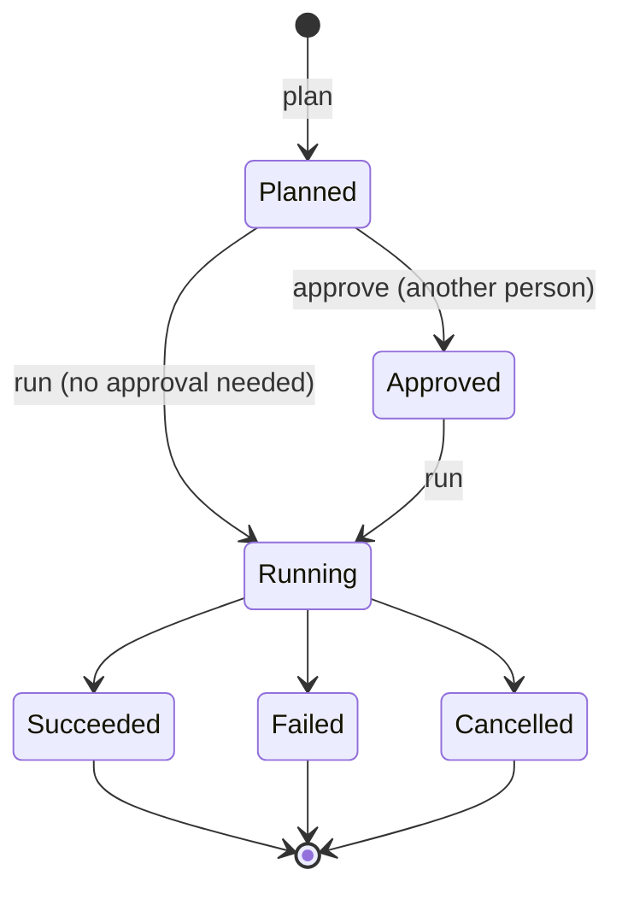

# §2.4 Actions

> `spec/surface/actions.md` · proposed

Changes to systems outside Atlas, made understandable before they happen: plan, approve where the policy needs it, then run as an operation with a receipt; effects declared and never changed within a version.

## In short

- `plan` changes nothing and returns what would happen; `approve` is by someone other than the requester, where the policy says; the action's own verb runs it as an **operation** and ends with a **receipt**.
- Effects (which system, which environments, whether it can be undone) are part of the contract; changing them is always a new version.
- Every run carries an idempotency key; Production refuses an action unless a person runs it.

## Picture

### How it works

An agent is asked to restart a deployment in Acceptance. It calls `plan` and shows the person what will happen; the policy needs approval in Acceptance, so `run` answers `approval_required` until a colleague approves the plan. The run then returns an operation (`pending`, `running`, `succeeded`) whose result is the receipt. No action is catalogued yet; this example is illustrative.

### Seams

| Seam | One side | Other side | Where |
|---|---|---|---|
| Plan and run | The caller: deciding | The gateway: policy, approval, the run | §6.2 |

## Rules

1. Every `run` requires an idempotency key; a repeated key returns the first run and changes nothing twice.
2. A plan expires; running an expired plan plans again.
3. A change to an action's effects is always a new version, never a lens: a caller who approved “restarts the deployment” never silently gets “recreates it”.
4. An `irreversible` action is approved by someone other than its requester, always.

- **ATLAS-ACTION-001.** `plan` changes nothing in any system; a conformance test checks the target before and after.
- **ATLAS-ACTION-002.** A `run` whose policy needs approval is refused with `approval_required` until approved by another principal.
- **ATLAS-ACTION-003.** Every finished run has a receipt in its profile's schema, linked from the audit record.

## Detail

### Interactions

| Interaction | Effect | Result | Delivery | What it does |
|---|---|---|---|---|
| `plan` | `read` | `record` | `single` | What `run` would do, changing nothing (like Terraform's plan); stored, with an id |
| `approve` | `write` | `record` | `single` | Approves a stored plan, by someone other than its requester, where the policy requires it |
| `run` | the action's own (`external` or `irreversible`) | `record` | `operation` | Carries out a plan (or plans and runs, where no approval is needed); returns its operation |
| the action's verb (`:restart`, `:trigger`) | as `run` | as `run` | as `run` | The name callers see; it is `run` with its own verb |

### What an action's profile adds

- **Effects:** which system it changes, in which environments, whether it can be undone, and the capability that undoes it if one exists.
- **The plan's schema and the receipt's schema** (what actually happened: the evidence the audit keeps).
- **Policy:** where approval is needed; the environments where it is refused unless a person runs it (Production always).

### The run

A plan is a stored document with an id; a run is an operation (`pending`, `running`, `succeeded`, `failed`, `cancelled`, and `UNKNOWN` for a state a client does not know). A run whose policy needs approval is refused with `approval_required` until another principal approves its plan. It emits its lifecycle as events.

## Go deeper

- §9.3 Documents: the operation
- §6.2 Access
