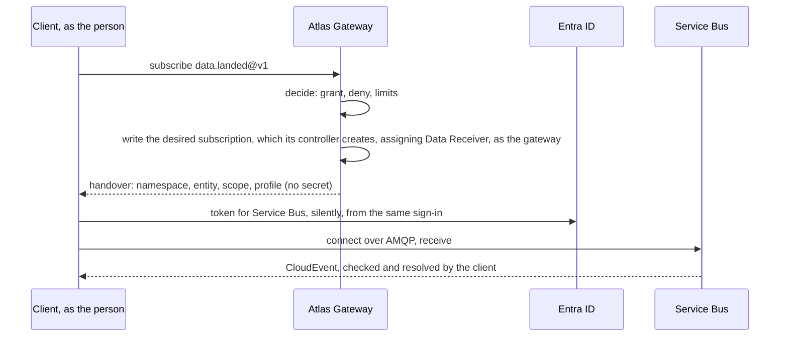

# §2.5 Events

> Source: `IMG_2138.MOV` 00:05:54–00:06:20.  
> `spec/surface/events.md` · proposed

Something that happened, for whoever may know: event types registered in the catalogue with their publisher, topics, queues and subscriptions created by the gateway for those granted them, and publishing and listening done by the client directly on Service Bus as the person, with the gateway as the broker and the same contracts and versioning as every capability.

## In short

- **The gateway is the broker, not the pipe.** It registers event types, creates topics, queues and subscriptions, and grants who may send and listen; the client then publishes and listens **directly on Service Bus**, as the person.
- **Every event type is a capability** with a profile and an owner, its publisher: a team or a person. `atlas.catalog` and `atlas.access` show which exist, who publishes them, and what the caller may do with each.
- **Rights are per interaction and per entity:** `event.topic@v1:create` for those who may create topics; sending to or listening on one topic is a grant on that entity, mirrored exactly by a Service Bus role on it.
- **Every event is a CloudEvent** whose `dataschema` names its profile. The client checks it before publishing and resolves it after receiving. At least once; duplicates dropped by `id`; unknown types ignored.

## Picture



### How it works

An analyst's dashboard subscribes to `data.landed@v1` for the index source. The gateway checks the analyst's grant, creates their subscription on the `data-landed` topic with a filter on the source, assigns them Data Receiver on that one subscription, and returns a handover. The Node SDK gets a Service Bus token from the analyst's sign-in, connects, and yields each event, resolved to the profile the dashboard knows. When the analyst's laptop sleeps, Service Bus keeps the events; on waking the SDK reconnects and receives them. If the grant is revoked, the gateway removes the role, and Service Bus refuses the next connection.

### Seams

| Seam | One side | Other side | Where |
|---|---|---|---|
| The gateway and Service Bus | The gateway: entities, roles, the registry | Service Bus: every message, retention, locks | §6.3 |
| Publisher and subscriber | The publisher: the payload | The subscriber: resolving it | The event's profile |

## Rules

1. **Brokered.** The gateway never carries an event. It creates entities and assigns roles as its own identity, and returns a handover with no secret; the client connects with its own token for Service Bus.
2. **Rights mirror grants exactly.** A person holds Data Sender or Data Receiver on an entity only while Atlas grants them that entity's `publish` or `subscribe`; a deny or revoke removes the role. Shared-access keys are off. Entities and roles are converged by controllers from the state Atlas keeps, never created inside the call (§6.1 §6.1.13).
3. **At least once.** A subscriber may receive an event twice; clients drop recent duplicates by `id`, and handlers MUST be idempotent.
4. **Unknown event types are ignored;** adding an event type is a dangerous change, not a breaking one.
5. **Within a version, payloads are fully and transitively compatible;** a breaking change is a new type (`…v2`), published beside the old one for a migration window.
6. **Filters are applied at the source:** Service Bus subscription filters, never sending and discarding.
7. **Order** is guaranteed only per subject, for capabilities with the `Ordered` trait (Service Bus sessions).
8. **History is read from a data capability,** never by replaying events: every event profile names it in `meaning.history`, and a client that cannot reach Service Bus polls it instead of subscribing.
9. **No event travels through the gateway,** the gateway's own included (`atlas.catalog.changed`, resource changes, `atlas.operation.*`): they are published from its state to Service Bus and reached the same way.

- **ATLAS-EVENT-001.** A client checks an event against its profile before publishing it, and refuses one that does not conform; a gateway-held sampling subscription reports non-conforming official events to their owner.
- **ATLAS-EVENT-002.** A durable subscriber that reconnects receives every event delivered while it was away, at least once, within the entity's retention.
- **ATLAS-EVENT-003.** Every event's `dataschema` names a profile fingerprint the catalogue serves.
- **ATLAS-EVENT-004.** The AsyncAPI document for every event capability is generated from its profile and validated by the AsyncAPI tooling in the gates.
- **ATLAS-EVENT-005.** A person holds a Service Bus data role on an entity if and only if Atlas grants them the matching interaction on it (a reconciliation test).
- **ATLAS-EVENT-006.** A role no grant backs is removed within 60 seconds of the grant's change, and within five minutes when the change's event is lost or the change was a group membership in Entra; a role or entity the gateway made and no record owns is removed by the next resync.

## Detail

### Capabilities

| Capability | Interactions | What they do |
|---|---|---|
| An event type (`data.landed@v1`) | `publish` (`external`), `subscribe` (`read`) | Return a handover to send to, or listen on, its topic |
| `event.topic@v1` | `get`, `list`, `create` (`write`), `delete` (`irreversible`) | Topics: one per event type or family; creating one registers its owner as publisher |
| `event.queue@v1` | `get`, `list`, `create` (`write`), `delete` (`irreversible`) | Queues: point-to-point work for one consumer |
| `event.subscription@v1` | `get`, `list`, `create` (`write`), `delete` (`write`) | A durable listener on a topic, with its filter, owned by a person or a workload |

Service Bus sits behind an adapter: a change of broker changes no name or grant.

### The event

Every event is a CloudEvent:

| Attribute | Value |
|---|---|
| `type` | The capability and version: `com.jhg.fiquant.data.landed.v1` for `data.landed@v1` |
| `dataschema` | The writer profile's URI and fingerprint |
| `id`, `source`, `time`, `subject` | As CloudEvents defines them; `id` is unique per event, for deduplication |
| `data` | The payload, a record in the profile's schema |

### The handover for events

`publish` and `subscribe` answer with a handover of kind `connect` (§6.3.4):

```json
{
  "kind": "connect",
  "protocol": "amqp",
  "namespace": "dv-eus2-fiqdataevents-sbus.servicebus.windows.net",
  "entity": "data-landed/subscriptions/ana-7f2",
  "auth": { "kind": "entra-scope", "scope": "https://servicebus.azure.net/.default" },
  "rights": ["listen"],
  "profile": "data.landed@v1#51c7e08b2d6f9a43",
  "format": "cloudevents+json",
  "settle": "peek-lock",
  "durable": true,
  "expires": "2026-10-30T18:00:00Z"
}
```

Its exact structure is `connect.schema.json` (§9.3); what the client does with it is §9.7.8.

### What a client does

One loop for every event capability: ask the gateway for the handover; get its own token for the handover's scope from the shared sign-in; connect with Azure's Service Bus library; receive, resolve each payload to its reader profile, yield it, complete it; renew the token before it expires; on refusal, ask the gateway again (a revoked grant answers `not_granted`). To the caller it is a loop over typed events. Publishing checks the payload against the profile, wraps it as a CloudEvent and sends it.

### Published descriptions

Every event capability is published as AsyncAPI 3.0, generated from its profile, with the profile's JSON Schema as its payloads' schema format, so that tools (an event catalogue, code generators, validators) can read it. The AsyncAPI files are generated; they are never the source.

## Decisions

**Decided (2026-10-29):** events are brokered: the gateway registers types, creates entities and assigns roles as itself; clients publish and listen directly on Service Bus as the person (D37).

**Decided (2026-10-30):** `atlas/1.0` has no subscription over HTTP: every event, the gateway's own included, is reached by a connect handover; a client that cannot reach Service Bus polls (D41).

**Open:**

- Where the event catalogue lives: in Atlas (here) or at the platform level. Recommended: the platform level, publishing and subscribing through Atlas.
- Whether a browser page can connect to Service Bus (AMQP over WebSockets) in our network. Recommended: the Service Bus spike checks it; until then pages poll or use a Node process.
- Triggers: durable subscriptions the platform holds that start an action for each event. Recommended: later.

## Go deeper

- §6.3 Reaching systems
- §6.1 State and events
