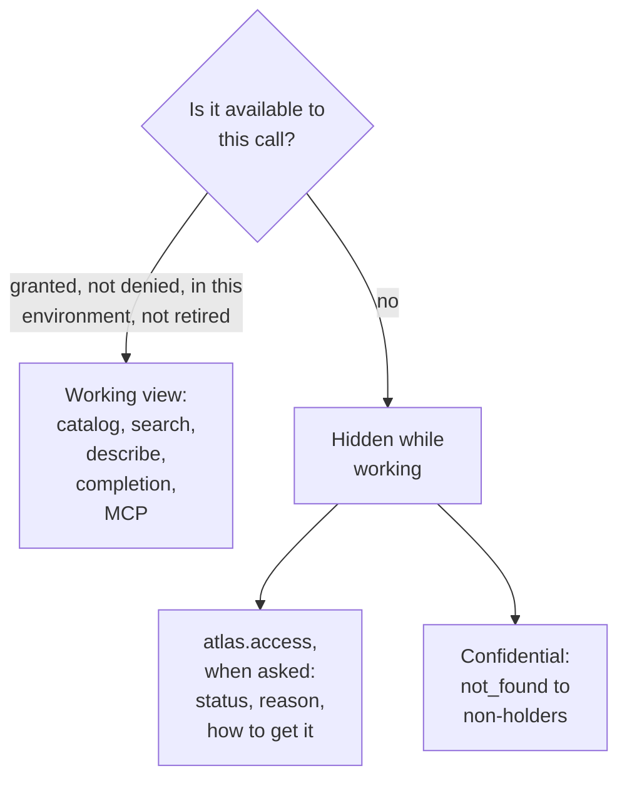

# §2.6 Discovery

> Source: `IMG_2138.MOV` 00:06:20–00:07:06.  
> `spec/surface/discovery.md` · proposed

How people and agents find and use Atlas: the bootstrap, the built-in capabilities, the working view that shows only what the caller can use here and now, the access view that shows the rest with reasons, and the journey an agent follows.

## In short

- One address is known in advance: `/.well-known/atlas`. Everything else is found from it.
- Three ways to understand a capability: `atlas.describe` (what it is), `atlas.guide` (how to use it) and `explain` with parameters (what this call would do).
- **The working view** (`atlas.catalog`, `atlas.search`, `atlas.describe`, completion, MCP tools) shows only what is available: granted, not denied, in this environment, not retired.
- **The access view** (`atlas.access`) shows every listed capability with the caller's status, the reason and how to get it; confidential capabilities stay `not_found` to non-holders.
- Agents use a small fixed set of tools: orient, find, understand, act, recover; ask about access only when needed.

## Picture



### How it works

An agent asked about “credit curves” calls `atlas.search`: two capabilities come back, both usable. The person asks why they cannot see Yield Book; the agent calls `atlas.access` with `domain: yieldbook` and reports: `not_granted`, held by the role `fi-vendor-analytics`, ask its owner.

### Seams

| Seam | One side | Other side | Where |
|---|---|---|---|
| Working view and access view | Discovery: what is usable | Access: what is not, and why | §6.2 |

## Rules

1. **The working view shows only what is usable.** A capability appears in `atlas.catalog`, `atlas.search`, the CLI's lists and completion, MCP's tools and the SDKs' attributes only when it is available to the caller (below), and only with the interactions they may use.
2. **Availability.** A capability is available to a call when all hold: the caller holds at least one of its interactions and no deny refuses it; it exists in the environment; its lifecycle is not `retired` (nor `preview`, unless the caller asked for previews); and the caller's client supports every trait it marks critical.
3. **Only `atlas.access` shows what is not usable,** and only when called. No other response lists, suggests or completes a capability the caller cannot use.
4. **Calling by name is explicit.** A call to a listed capability the caller cannot use is refused with its status with the problem for its status (`not_granted`, `denied`, `not_in_environment`, `limit_exceeded`, `retired`), and a `next` step that names `atlas.access`. A confidential capability the caller does not hold answers `not_found`, identically to one that does not exist.
5. **The house rules travel with the map.** `atlas.whoami` returns every house rule that applies to the caller, and every catalogue and search page the rules that name a capability on it (House rules, §9.3.2).
6. **Nothing about anyone else.** The access view tells the caller about their own access only.

- **ATLAS-DISCOVERY-001.** `/.well-known/atlas` is served by the gateway in every environment and needs no sign-in.
- **ATLAS-DISCOVERY-002.** The working view returns exactly the capabilities available to the caller; a conformance test varies each availability condition alone and checks the capability disappears.
- **ATLAS-DISCOVERY-003.** A denied capability appears in no working-view response (catalogue, search, describe, completion, MCP tools), and appears in `atlas.access` with status `denied`.
- **ATLAS-DISCOVERY-004.** `atlas.access` returns, for every listed capability, one status from the table above, its reason, how to obtain it, and the caller's limits and use where they hold it.
- **ATLAS-DISCOVERY-005.** A confidential capability answers `not_found` to every caller who does not hold it, in both views and on a direct call.
- **ATLAS-DISCOVERY-007.** A compatible profile change reaches a long-lived client within 60 seconds through the change feed, and within 15 minutes without it.
- **ATLAS-DISCOVERY-008.** `atlas.describe` lists, for the calling client, every binding it cannot use with what is missing.
- **ATLAS-DISCOVERY-009.** `atlas.guide` answers, for every capability available to the caller, every section of the guide in order, within `max_tokens`, its examples in the calling client's syntax and each valid against the request schema.
- **ATLAS-DISCOVERY-010.** No guide names a capability the caller cannot use.

## Detail

### The bootstrap

The only address any client hard-codes is `/.well-known/atlas` on the gateway of an environment. It returns the gateway's protocol versions, its environment, its sign-in, and the bindings of the built-in capabilities. Everything else is found from there.

### Two views

| | **The working view** (the default) | **The access view** (only when asked) |
|---|---|---|
| Shows | Only what the caller can use, here, now | Every listed capability, whether the caller can use it or not |
| For each | Its summary, the interactions the caller may use, their effect classes, its fingerprint | Its status for the caller, the reason, how to get access, and the caller's limits and use |
| Served by | `atlas.catalog`, `atlas.search`, `atlas.describe`, the CLI's lists and completion, MCP's tools, the SDKs' attributes | `atlas.access` only |
| Used when | Working: finding and calling capabilities | Asking “what could I have, why can't I use this, what are my limits” |

A capability that is denied to the caller, not granted to them, absent from this environment, or retired does **not appear in the working view at all**. Nothing in the working view says it exists.

### Status in the access view

| Status | Meaning | What the access view says |
|---|---|---|
| `available` | The caller can use it here | Each interaction, how they hold it (a role, their own grant, everyone), their limits and use |
| `partial` | Some interactions granted, others not | Which, and why |
| `not_granted` | No grant reaches it | Who owns it, which role would grant it, how to ask |
| `denied` | A deny refuses it, whatever else they hold | That it is denied, when, and who to ask; never anything about anyone else |
| `not_in_environment` | It does not exist in this environment | The environments where it does |
| `limited` | Granted, but a limit is used up | Which limit, when it resets, who set it |
| `deprecated` | Usable, with a sunset | The sunset and the replacement |

### Listed and confidential

A capability's profile says whether it is **listed** (the default: it appears in the access view to every signed-in caller) or **confidential** (administration, sensitive sources: it appears only to those who hold it, in either view, and is `not_found` to everyone else).

### The built-in capabilities

The `atlas.*` capabilities are part of the protocol, as GraphQL's `__schema` is part of GraphQL. They are the only capabilities a client knows without reading a profile, and they change only with the protocol.

| Capability | Family | View | What it gives |
|---|---|---|---|
| `atlas.whoami` | data | — | Who the caller is to the gateway: identity, roles, environment, and a summary of what is available by domain |
| `atlas.catalog` | data | working | The available capabilities, by domain, family or effect class |
| `atlas.search` | data | working | Available capabilities ranked against words (“credit curves for US IG”) |
| `atlas.describe` | data | working | One available capability's full profile, with the caller's own limits and use for it |
| `atlas.guide` | data | working | How to use one available capability, written for an agent, in the calling client's own syntax (below) |
| `atlas.access` | data | access | Every listed capability (or one, or a domain) with its status for the caller, the reason, how to get it, and limits |
| `atlas.usage` | data | — | What the caller has used, and what is left, across everything |
| `atlas.setup` | data | — | How to set a machine and harness up for Atlas: which client, sign-in, skill |
| `atlas.clients` | data | — | The client catalogue (below) |
| `atlas.compare` | data | working | Two versions of one data capability, side by side |
| `atlas.operation` | resource | — | The operations the caller started (protocol) |

### House rules

The working view is the map; `atlas.describe` is the manual for one place; the **house rules** say how to use the map. Administrators write and publish them as managed context (`atlas.context`, confidential); every caller receives them through `atlas.whoami` (all that apply) and each catalogue page (those naming its capabilities), and the CLI, the SDKs and the MCP edge hand them to an agent with the working view: which capability is the truth for what, curated capabilities before free SQL, when to confirm a cost, and what each role usually needs. A rule reaches a caller only when the caller can use every capability it names, so it never reveals one they cannot.

### How an agent uses Atlas

Agents use Atlas through a small, fixed set of tools, not one tool per capability: with hundreds of capabilities, one tool each would flood an agent's context, and the set would change under it. The journey:

1. **Orient:** `atlas.whoami`: who am I here, which environment, what is broadly available.
2. **Find:** `atlas.search` with the person's words, or `atlas.catalog` by domain: short, ranked, only what it can use.
3. **Understand:** `atlas.guide` for how to use it (`atlas.describe` when a program needs the exact contract); then, if it helps, `explain` with the person's parameters to see exactly what the call would do and cost.
4. **Act:** call the interaction. The effect class tells the harness whether to run it, confirm it, plan it first, or seek approval.
5. **Recover:** every problem says what happened and the `next` step.
6. **Ask about access,** only when the person asks, or when the agent cannot find what the person needs: `atlas.access` says whether it exists, why the caller cannot use it, and how to get it.

The agent never sees a capability it cannot use until step 6, and step 6 is never needed to do work.

**What an agent is given is generic.** The skill `atlas setup` installs in a harness, the MCP edge's instructions and any system prompt teach this journey and the house rules' place in it, and **name no capability:** they change only with the protocol. Everything about a capability (what it is, when to use it, its parameters, examples, problems) is served: its profile, `atlas.guide`, and the house rules from `atlas.whoami`. So a capability deployed today is found and used by an agent already running, with no change to its harness (ATLAS-CORE-009). The rules that come with a session at its start are refreshed by `atlas.whoami` at any time.

### Three ways to understand a capability

Each answers a different question, so each is its own call:

| Question | Call | Takes the parameters? | Answered by | Returns |
|---|---|---|---|---|
| **What is it?** | `atlas.describe {id}` | No | The catalogue (built-in) | The contract: the profile, the caller's governance, its availability, the calling client's eligible bindings. For programs; cached by fingerprint |
| **How do I use it?** | `atlas.guide {id, client}` | No | The catalogue (built-in) | A guide for an agent, in Markdown, within a token budget (below) |
| **What would this call do?** | `explain` with the request | **Yes** | The capability's own service, after the same decision and validation as `fetch` | The exact plan: for a SQL source the statement `fetch` would run, every column aliased and cast; the columns that would come back; the estimated rows, bytes and cost; the execution it would choose; warnings (§2.2) |

What the catalogue can answer alone is a built-in; what needs the service to plan is an interaction. An invalid parameter fails `explain` exactly as it would fail `fetch`, so `explain` is also a dry run. Grants are per interaction, so an owner may withhold `explain` without withholding `fetch`.

### The guide

`atlas.guide` writes, from the profile, the caller's governance and the managed context (`atlas.context`: the capability's skill text and the house rules), these sections, always in this order:

1. **What it is:** the summary, the family, its stability and lifecycle.
2. **When to use it, and when not,** with the house rules that name it.
3. **What you may do:** each interaction the caller holds, with its effect class and what that means for asking the person first.
4. **Parameters:** each with its type, whether required, its default, its meaning and unit, its allowed values or the capability that lists them.
5. **What comes back:** for a table its grain and keys, then each column with its type, unit and meaning; for a record, its fields.
6. **Examples:** each of the profile's examples, written in the calling client's syntax (§9.7.1).
7. **Problems:** each problem it can return, with its next step.
8. **Your limits and its cost:** what is left for the caller, and the cost of a call where it is metered.
9. **Related:** the capabilities it refers to and those that refer to it.

It never names a capability the caller cannot use. It fits `max_tokens` by shortening sections from the last, saying so, and never drops sections 1 to 4. The same profile, governance revision, context revision and client give the same guide.

### What this client can use

A caller may hold a capability that its *client* cannot use in every way: a bulk interaction needs Arrow, a stream needs SSE. `atlas.describe` answers for the calling client (from its `Atlas-Client-Features`): for each interaction, the bindings it can use, in order of preference, and those it cannot, each with what is missing and a hint:

```json
{
  "interaction": "fetch",
  "eligible": [
    { "binding": "https", "encoding": "json", "limits": { "max_rows": 100000 } }
  ],
  "ineligible": [
    {
      "binding": "flight",
      "missing": ["transport:arrow-flight"],
      "hint": "Use atlas.python, or export with --format parquet"
    }
  ]
}
```

This is about the *client*, never about access: a capability the caller may not use is still not shown here.

### Freshness

The catalogue and every profile carry an ETag (a profile's is its fingerprint); a client revalidates with `If-None-Match` and gets `304` when nothing changed. The gateway publishes a **catalogue change feed**, the event `atlas.catalog.changed` carrying the new catalogue ETag, on Service Bus like every event (as MCP's list-changed notifications and Envoy's incremental xDS updates do): long-lived clients at the Events level (Nautilus Desktop, an agent's session) refetch only what changed; others poll every 15 minutes. A client otherwise caches the catalogue for at most an hour and revalidates at the start of every session.

### Three answers, never one

| Question | Answered by |
|---|---|
| Can the caller see it? | The working view (access, environment, lifecycle) |
| Can it be served now? | Its availability: `available` or `unavailable` |
| Can this client call it? | `atlas.describe`'s eligible and ineligible bindings |

### The client catalogue

`atlas.clients` lists the Atlas clients: for each, its language, the roles it is built for, its extras, its current version, and how to install it (clients). Nautilus Desktop reads it when a person plugs into Atlas, so its agent knows which client to use for what.

## Decisions

**Decided (2026-10-28):** listing every capability with `invocable: false` and its missing requirements is rejected for access: what a caller may not use stays hidden until they ask `atlas.access`, which uses the same `missing` structure. For a client's own limits (a transport it lacks), `atlas.describe` lists what is missing.

**Decided (2026-10-28):** a capability the caller cannot use does not show unless the caller explicitly asks for the view that returns everything, with what they have and do not have access to, and their limits.

**Open:**

- Which capabilities are confidential. Recommended: the administration capabilities and those whose existence is itself sensitive; everything else listed.
- Requesting access from the access view (`atlas.access:request`, routed to the capability's owner or the role's administrator). Recommended: later; until then `next` names who to ask.

## Go deeper

- §9.3 The built-ins
- §6.2 Access
