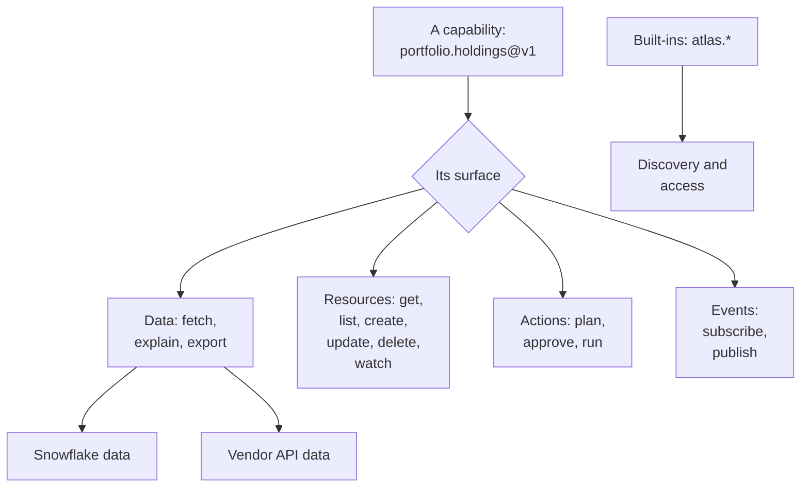

# §2 The surface

What Atlas offers: every capability sits on one of four surfaces (data, resources, actions, events) or is a built-in, and each surface fixes the verbs a caller can use, what its contract adds, and how its results travel.

### In short

- A capability is a named, versioned concept on one surface; the surface fixes its verbs.
- **Data:** read what is (`fetch`, `explain`, `export`), streamed or handed off. **Resources:** objects the platform keeps (`get`, `list`, `create`, `update`, `delete`, `watch`). **Actions:** change a system outside Atlas (`plan`, `approve`, then the action's verb). **Events:** something happened (`subscribe`, `publish`).
- The built-ins (`atlas.*`) are discovery, access, usage, operations, settings and administration.
- **Sub-profiles** group capabilities that share more than their surface: Snowflake data, vendor API data.
- Every capability is served by the Atlas Gateway. What a client does on the caller's machine is a client extra, not a capability (§5).
- A caller sees only what it can use here and now; `atlas.access` shows the rest.

### Picture

### How it works

A dashboard on Nautilus Desktop, built on the Node SDK, uses three surfaces at once: it **fetches** `portfolio.holdings@v1` (data), **gets** the dashboard's own `nautilus.dashboard` record (a resource), and **subscribes** to `data.landed@v1` (an event) so it refetches when new data lands. Each call is one address, one profile, one decision; the dashboard knew none of them in advance: it found them with `atlas.search` and read their profiles. Beside them it reads a CSV from the analyst's own folder through the Node SDK's file extra, which never touches the gateway.

### Seams

| Seam | Owned by | Defined in |
|---|---|---|
| What a surface's verbs mean | The protocol | §2.1, §9 |
| A capability's schemas and meaning | Its owner, through its profile | §3 |
| Which capabilities exist | The catalogue | §7 |

### Rules

- Every capability is on exactly one surface, or is a built-in.
- A surface's verbs and their meaning are part of the protocol; a capability's schemas are its own.

### Detail

| Surface | Contract adds | Results travel | Examples | Section |
|---|---|---|---|---|
| Data | Request; result (rows, a record, a page, content); grain, keys, as-of rule, source | Streamed, handed off, exported | `portfolio.holdings`, `yieldbook.price-yield`, `azure.resource-graph` | §2.2 |
| Resources | The resource as served at each version; name pattern; immutable fields | Single answers; changes by watch | `nautilus.dashboard`, `kb.base`, `atlas.operation` | §2.3 |
| Actions | Request, plan, receipt; effects; approval policy | An operation | (none catalogued yet; for example a deployment restart) | §2.4 |
| Events | Payload and attributes; when emitted; ordering; retention | A subscription | `data.landed`, `atlas.catalog.changed` | §2.5 |
| Built-ins | Fixed by the protocol | Single answers | `atlas.search`, `atlas.describe`, `atlas.access` | §2.6 |

### Go deeper

- [§2.1 Capabilities](02-1-capabilities.md)
- §2.2 Data: Snowflake and vendor APIs
- §2.3 Resources
- §2.4 Actions
- §2.5 Events
- §2.6 Discovery
- Every capability: §7
