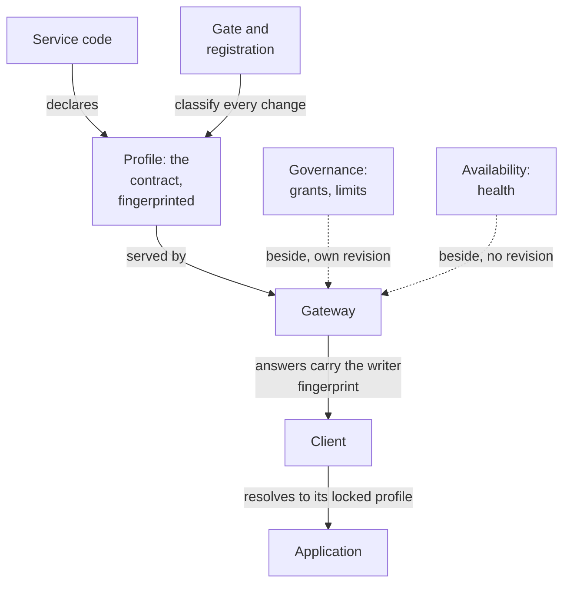
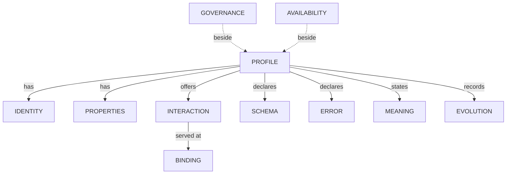
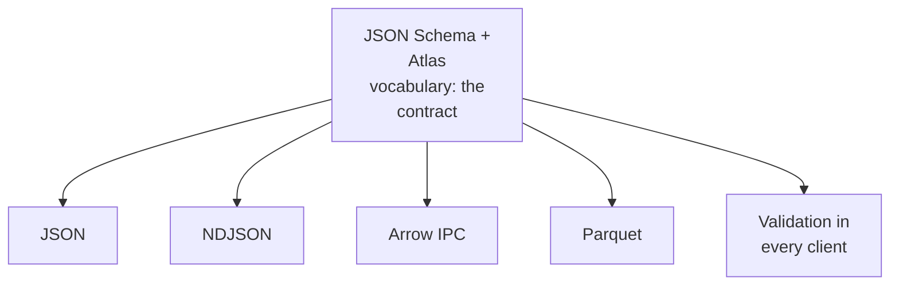
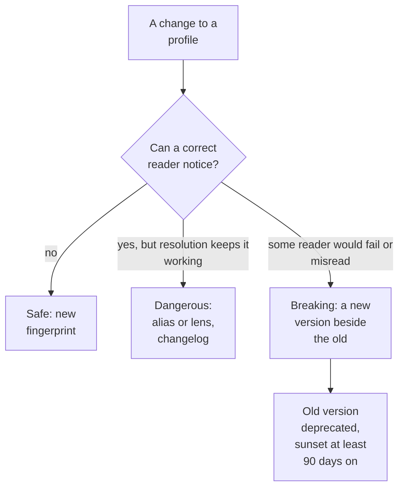
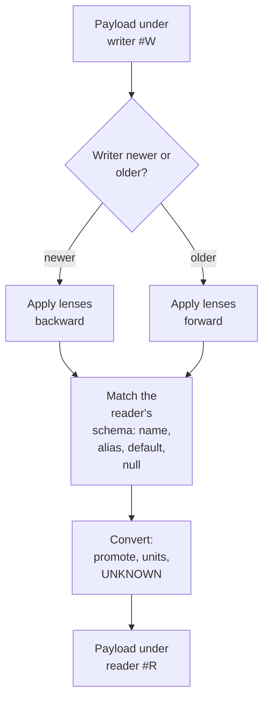

# 3. Contracts

`spec/contracts.md` · proposed

A capability's contract is its profile, which the gateway declares beside its code and serves: what each surface's contract holds, the types its schemas are written in, how it may change without any client release, and how a reader meets a writer that knows a different version.

### In short

- **The contract is the profile:** properties, interactions and bindings, schemas, errors, meaning, compatibility, usage, evolution, with a fingerprint. Governance (who may, limits) and availability (live health) sit beside it.
- **Types:** JSON Schema 2020-12 with an Atlas vocabulary (logical types, keys, aliases, references, deprecation); JSON, NDJSON, Arrow and Parquet are encodings derived from it.
- **Versioning:** a change of shape stays in the version (a new fingerprint, an alias, a lens); a change of meaning is a new version; only a protocol change ever needs a client release.
- **Resolution:** whoever reads resolves the writer's profile to the one it knows, by fixed rules.

### Picture



### How it works

The owner of `portfolio.holdings@v1` renames the column `mv` to `market_value`. The gate classifies it as **dangerous:** allowed within `@v1` with an alias and a `rename` lens. The profile gets a new fingerprint. An application locked to the old fingerprint sends it as `Atlas-Profile-Expect`; the gateway accepts the old name; the answer, written under the new fingerprint, is resolved by the client back to `mv`, with a deprecation warning. No client is released. Had the grain changed (end of day to intraday), it would be `@v2`, served beside `@v1`.

### Seams

| Seam | One side | Other side | Defined in |
|---|---|---|---|
| Profile and code | The profile: the contract | The code: fulfilling it | §3.1, §3.3 |
| Writer and reader | The writer's profile | The reader's profile | §3.4, §9.5 |
| Contract and encoding | The schemas | JSON, NDJSON, Arrow, Parquet | §3.2, §9.2 |

### Rules

- **ATLAS-CONTRACT-001.** Every profile carries the schemas its surface requires, and the gate refuses one that lacks any.
- A capability's contract is its profile and nothing else.
- A change classified as breaking within a version is refused by the gate and at registration.

### Detail

| Surface | Schemas in its contract | Meaning in its contract (changes only by a new version) |
|---|---|---|
| Data | `request`; `result` (columns, or fields for a record) | Grain, keys, as-of semantics, each column's unit and meaning, the source |
| Resources | `resource` as served; standard methods' extras; each custom verb's request and result | Identity and name pattern, immutable fields, the stored version, what each custom verb does |
| Actions | `request`; `plan`; `receipt` | The effects: system, environments, reversibility; the approval policy |
| Events | `payload`; `attributes` (CloudEvents `subject` and extensions) | When it is emitted, what its subject identifies, ordering, retention |
| All | `bindings`, `errors`, deadlines, enums, references, traits, lifecycle | Effect classes, surface |

### Go deeper

§3.1 Profiles · §3.2 Types · §3.3 Versioning · §3.4 Resolution · normative: §9.2, §9.4, §9.5

## 3.1 Profiles

`spec/contracts/profile.md` · proposed

Everything a capability says about itself in one document the gateway serves, part by part, with a complete example per surface; governance and availability served beside it; and its fingerprint.

### In short

- A profile's parts: identity, properties, interactions (with bindings and deadlines), schemas, errors, meaning, compatibility, usage, evolution, fingerprint, revision.
- **Governance** (the caller's grants, limits, approvals) and **availability** (healthy or not) are served beside it, never in its fingerprint: a tightened limit or a suspended warehouse is not a contract change.
- The fingerprint is the profile's identity and ETag; prose changes it never.
- Declared beside the gateway's code; snapshotted in the catalogue; checked by the gate and at registration.

### Picture



### How it works

`atlas.describe` for `portfolio.holdings@v1` returns three documents: the profile (fingerprint `bcaa5bbad97cc612`, cached forever by that fingerprint), the caller's governance (held by the role `fi-analysts`, 58 calls left this minute, revision `g-41`), and its availability (`available`). The next day a limit is tightened: the governance revision moves, the fingerprint does not.

### Seams

| Seam | One side | Other side | Where |
|---|---|---|---|
| Profile and governance | The capability's owner | Administrators | §6.2 |

### Rules

1. A profile is complete: a client MUST be able to discover, call and read the capability from its profile and the protocol alone.
2. Every response and every event names the fingerprint of the profile it was produced under.
3. A profile is served by fingerprint for as long as anything may hold it (at least until its version's sunset).
4. Prose may change at any time (a new revision); a change to the canonical form is a new fingerprint and is classified.
5. Governance and availability are never part of a profile or its fingerprint.

- **ATLAS-PROFILE-001.** `atlas.describe` returns a capability's full profile, by `id@vN` or by fingerprint, with its governance for the caller and its availability.
- **ATLAS-PROFILE-002.** The gateway and every client compute the same fingerprint for the same profile (a conformance test with fixed profiles).
- **ATLAS-PROFILE-003.** The catalogue snapshot matches the profiles the gateway serves at the same commit; the gate fails otherwise.
- **ATLAS-PROFILE-004.** A change to a limit, a grant or a service's health leaves every fingerprint unchanged.
- **ATLAS-PROFILE-005.** Every interaction declares a deadline maximum, and every capability declares its errors.

### Detail

### 3.1.1 Three documents, three revisions

What the gateway serves about a capability has three parts that change for different reasons, so each has its own revision:

| Document | Says | Changes when | Revision |
|---|---|---|---|
| **Profile** (the contract) | What the capability is, how to call it, what it returns, how it fails, what it means | Its owner changes the capability | The **fingerprint** of its canonical form (3.1.4) |
| **Governance** | Who may use each interaction, their limits, budgets and approval policy | Administrators change access or limits | A **governance revision**, recorded in every audit record |
| **Availability** | Whether it can be served now: `available`, or `unavailable` (its service is unhealthy) | Live state | None: it is never part of either document's revision |

Keeping them apart means a tightened limit or a suspended warehouse never looks like a contract change, and a contract change can never silently change who may do what. `atlas.describe` returns all three; a client caches the profile by fingerprint and never caches availability.

### 3.1.2 The parts of a profile

| Part | Holds |
|---|---|
| `identity` | `id`, `version`, `title`, `summary`, `domain`, `owner` |
| `properties` | `family`, `stability`, `lifecycle` (with `sunset`, `replaced_by`), `visibility`, `traits` (§2.1) |
| `interactions` | Per verb: `effect`, `result`, `delivery`, `execution`, `bindings`, the names of the schemas it takes and returns, and its `deadline` (`default`, `max`) |
| `schemas` | The family's schemas (§3 B), in JSON Schema 2020-12 with the Atlas vocabulary (§3.2); for a table, its Arrow schema too |
| `errors` | Every problem code this capability can return beyond the protocol's own, each with its status, whether it is `retryable`, what it means (`description`) and the step to take (`next`) (§4.1) |
| `meaning` | What changes only by a new version: for data, the grain, keys, as-of rule and source; for a resource, its name pattern and immutable fields; for an action, its effects and policy; for an event, when it is emitted, its subject, ordering and retention |
| `compatibility` | The mode each schema is held to within the version (§3.3) |
| `usage` | What `atlas guide` is written from (§2.6): `when` and `when_not` (words); `examples` (each a `title` and a request valid against the request schema; per-client code is generated from them); `related` capabilities; `cost`; `skill` (the agent's skill text, managed by administrators) |
| `evolution` | The profile it replaces within the version and the lens from it; for a version after `@v1`, the version it replaces and the lens from it; a changelog |
| `fingerprint` | Of the canonical form (3.1.4) |
| `revision` | Of the prose (titles, descriptions, usage), which changes without changing the fingerprint |


### 3.1.3 Examples, one per family

These examples are abbreviated for reading (traits are shown by name, schemas shortened, `…` where parts are left out). The normative structure is `profile.schema.json` (§9.3), and complete, valid profiles are the test vectors in `references/vectors/profiles/`.

**A data capability.**

```json
{
  "identity": {"id": "portfolio.holdings", "version": 1, "title": "Portfolio holdings",
    "summary": "Positions in one or more portfolios on a date.", "domain": "portfolio", "owner": "QFI"},
  "properties": {"family": "data", "stability": "official", "lifecycle": "stable",
    "visibility": "listed", "traits": ["Projectable", "Filterable", "AsOf", "Keyed", "Handoff", "Licensed"]},
  "interactions": {
    "fetch": {"effect": "read", "result": "table", "delivery": "chunked", "execution": ["gateway", "handoff"],
      "takes": "request", "returns": "result", "deadline": {"default": "PT2M", "max": "PT30M"},
      "bindings": [{"protocol": "https", "server": "gateway", "method": "POST",
        "address": "/v1/data/portfolio.holdings@v1:fetch",
        "encodings": ["arrow", "json", "ndjson", "csv"], "auth": "bearer"}]},
    "explain": {"effect": "read", "result": "record", "delivery": "single", "execution": ["gateway"], "bindings": ["…"]},
    "export": {"effect": "read", "result": "content", "delivery": "transfer", "execution": ["gateway"],
      "encodings": ["parquet", "arrow"], "bindings": ["…"]}
  },
  "schemas": {
    "request": {
      "$schema": "https://json-schema.org/draft/2020-12/schema",
      "type": "object", "additionalProperties": false, "required": ["portfolios"],
      "properties": {
        "portfolios": {"type": "array", "items": {"type": "string", "x-atlas-logical": "PortfolioCode",
          "x-atlas-reference": "portfolio.list@v1"}},
        "as_of": {"type": ["string", "null"], "format": "date", "default": null},
        "asset_class": {"type": ["string", "null"], "enum": ["credit", "rates", null]},
        "columns": {"type": ["array", "null"], "items": {"type": "string"}}
      }
    },
    "result": {
      "type": "array",
      "items": {
        "type": "object", "required": ["portfolio", "as_of", "market_value", "weight"],
        "properties": {
          "portfolio": {"type": "string", "x-atlas-logical": "PortfolioCode", "x-atlas-key": true},
          "isin": {"type": ["string", "null"], "x-atlas-logical": "Isin", "x-atlas-key": true},
          "as_of": {"type": "string", "format": "date", "x-atlas-key": true},
          "market_value": {"type": "object", "x-atlas-logical": "Money", "x-atlas-aliases": ["mv"]},
          "weight": {"type": "number", "x-atlas-logical": "Fraction"},
          "oas": {"type": ["number", "null"], "x-atlas-logical": "Bp"}
        }
      }
    },
    "result_arrow": "(the same columns as an Arrow schema, with the Atlas keywords as field metadata)"
  },
  "errors": [{"code": "portfolio_not_found", "retryable": false},
             {"code": "warehouse_suspended", "retryable": true}],
  "meaning": {"grain": "portfolio × security × date", "keys": ["portfolio", "isin", "as_of"],
    "as_of": "the portfolio's last valuation on or before as_of",
    "source": "Harbour's portfolio holdings view"},
  "compatibility": {"request": "BACKWARD_TRANSITIVE", "result": "FULL_TRANSITIVE"},
  "evolution": {"previous_profile": "portfolio.holdings@v1#2b71c0d4e9a35f18",
    "lens": [{"op": "rename", "from": "mv", "to": "market_value"}]},
  "fingerprint": "3f9a1c0b7d2e4a65",
  "revision": 7
}
```

**A resource.**

```json
{
  "identity": {"id": "nautilus.dashboard", "version": 1, "title": "Dashboard", "domain": "nautilus", "owner": "Nautilus"},
  "properties": {"family": "resource", "stability": "official", "lifecycle": "stable",
    "visibility": "listed", "traits": ["Paged", "Keyed"]},
  "interactions": {
    "get": {"effect": "read", "result": "record", "delivery": "single", "returns": "resource"},
    "list": {"effect": "read", "result": "collection", "delivery": "single", "returns": "resource"},
    "publish": {"effect": "write", "result": "record", "delivery": "transfer", "takes": "publish_request", "returns": "resource"},
    "share": {"effect": "write", "result": "record", "delivery": "single", "takes": "share_request", "returns": "resource"},
    "delete": {"effect": "irreversible", "result": "record", "delivery": "single"},
    "watch": {"effect": "read", "result": "record", "delivery": "subscription", "returns": "resource"}
  },
  "schemas": {
    "resource": {
      "type": "object", "required": ["name", "title", "owner", "visibility", "version", "etag"],
      "properties": {
        "name": {"type": "string", "x-atlas-key": true, "description": "nautilus/dashboards/{id}"},
        "title": {"type": "string"},
        "owner": {"type": "string", "x-atlas-logical": "Principal"},
        "visibility": {"type": "string", "enum": ["everyone", "restricted", "UNKNOWN"]},
        "version": {"type": "integer"},
        "etag": {"type": "string"}
      }
    },
    "publish_request": "…", "share_request": "…"
  },
  "errors": [{"code": "dashboard_too_large", "retryable": false}],
  "meaning": {"name": "nautilus/dashboards/{id}", "immutable": ["name", "owner"], "stored_version": 1},
  "compatibility": {"resource": "FULL_TRANSITIVE"}
}
```

**An action.**

```json
{
  "identity": {"id": "astronomer.deployment", "version": 1, "title": "Astronomer deployment", "domain": "astronomer"},
  "properties": {"family": "action", "stability": "official", "traits": ["DryRunnable", "NeedsApproval"]},
  "interactions": {
    "plan": {"effect": "read", "result": "record", "delivery": "single", "takes": "request", "returns": "plan"},
    "approve": {"effect": "write", "result": "record", "delivery": "single"},
    "restart": {"effect": "external", "result": "record", "delivery": "operation", "takes": "request", "returns": "receipt",
      "deadline": {"default": "PT10M", "max": "PT1H"}}
  },
  "schemas": {
    "request": {"type": "object", "additionalProperties": false, "required": ["deployment"],
      "properties": {"deployment": {"type": "string"}}},
    "plan": {"type": "object", "required": ["deployment", "will"],
      "properties": {"deployment": {"type": "string"},
        "will": {"type": "array", "items": {"type": "string"},
          "description": "what restarting will do, step by step"}}},
    "receipt": {"type": "object", "required": ["restarted_at"],
      "properties": {"restarted_at": {"type": "string", "format": "date-time"},
        "scheduler_pods": {"type": "integer"}}}
  },
  "errors": [{"code": "deployment_busy", "retryable": true}],
  "meaning": {"effects": {"system": "Astronomer", "changes": "restarts the deployment's scheduler and workers",
      "reversible": false, "undo": null},
    "policy": {"approval": ["ac", "pd"], "refused_unless_person": ["pd"]}}
}
```

**An event.**

```json
{
  "identity": {"id": "data.landed", "version": 1, "title": "Data landed", "domain": "data"},
  "properties": {"family": "event", "stability": "official", "traits": ["Ordered"]},
  "interactions": {
    "subscribe": {
      "effect": "read", "result": "record", "delivery": "subscription", "returns": "payload",
      "bindings": [{"protocol": "https", "server": "gateway", "method": "POST",
        "address": "/v1/event/data.landed@v1:subscribe", "auth": "bearer"}]
    },
    "publish": {
      "effect": "external", "result": "record", "delivery": "single", "takes": "payload",
      "bindings": [{"protocol": "https", "server": "gateway", "method": "POST",
        "address": "/v1/event/data.landed@v1:publish", "auth": "bearer"}]
    }
  },
  "schemas": {
    "payload": {
      "type": "object", "required": ["source", "as_of"],
      "properties": {
        "source": {"type": "string", "x-atlas-reference": "data.sources@v1"},
        "as_of": {"type": "string", "format": "date"},
        "rows": {"type": ["integer", "null"]}
      }
    },
    "attributes": {
      "type": "object", "required": ["subject"],
      "properties": {"subject": {"type": "string", "description": "The source's id"}}
    }
  },
  "meaning": {
    "emitted": "when a source's data for a date is complete", "subject": "the source",
    "ordering": "per subject", "retention": "P7D", "history": "data.status@v1"
  },
  "compatibility": {"payload": "FULL_TRANSITIVE"}
}
```
Its governance, served beside it (not part of the profile, not in its fingerprint):

```json
{
  "capability": "portfolio.holdings@v1",
  "governance_revision": "g-41",
  "for_caller": {
    "interactions": {"fetch": {"held_by": "role:fi-analysts"}, "export": {"held_by": "role:fi-analysts"}},
    "limits": [{"interaction": "fetch", "kind": "rate", "per_minute": 60, "remaining": 58, "set_by": "role:fi-analysts"},
               {"interaction": "fetch", "kind": "concurrency", "max": 4},
               {"interaction": "fetch", "kind": "output", "max_rows": 1000000, "max_bytes": 1073741824}],
    "approval": null
  }
}
```

### 3.1.4 Canonical form and fingerprint

The **fingerprint** identifies one exact contract: the first 16 lowercase hexadecimal characters of the SHA-256 of the profile's projection (the profile without its prose, governance or availability) serialised by the JSON Canonicalization Scheme (RFC 8785), as Avro fingerprints a schema's parsing canonical form. It is written `id@vN#<fingerprint>`, is the profile's HTTP `ETag`, and is recorded in every audit record. Two profiles with the same fingerprint behave identically. The exact projection, algorithm and test vectors are normative in §9.4.

### 3.1.4a The agent-readiness check

A profile is ready for agents (ATLAS-VISION-002) when every one of these holds; the gate and registration run it, and a profile that fails is served only as `preview`:

1. `identity.summary` is one sentence of at most 200 characters.
2. Every property, at every depth of every schema, has a `description`; every `number` or `integer` property has `x-atlas-logical` or `x-atlas-unit` (`count` where it is a plain count).
3. `usage.when` is set, and `usage.examples` has at least one example whose `request` validates against the request schema of the interaction it names.
4. Every member of `errors` has a `description` and a `next`.
5. A data capability's `meaning` has `grain`, `keys` (for a table), `as_of` (where it has the `AsOf` trait) and `source`; an event's has `emitted`, `subject`, `ordering`, `retention` and `history`; an action's has `effects` and `policy`.

### 3.1.5 Where profiles come from

- **The gateway owns each contract.** A capability's profile is declared beside its code, as a file in its service's package (`profiles/<id>@v<N>.json`: the profile without `fingerprint`, which the gateway computes) and served by the gateway (`atlas.describe`). Its schemas are written directly in the Atlas Schema profile; the service reads requests as records validated against them, never through a second model that could drift. It is not authored in a separate language.
- **The spec owns the pattern:** this section and the rest of §3.
- **The catalogue snapshot.** §7 lists every capability; a generated snapshot of every profile sits beside it, with each owner's words, so a change to any contract is a diff in the pull request that makes it.
- **Two checks:** the gate, on every pull request, and the gateway itself, when a service registers (§3.3 3.3.12).

### Decisions

**Decided (2026-10-28):** governance and availability are served beside the profile with their own revision (or none), so that neither looks like a contract change.

**Open:** - The JSON Schema for profiles themselves (the meta-schema the gate validates against). Recommended: written with the first generated profiles.

### Go deeper

- §9.3 Documents
- §9.4 Fingerprints
- A complete profile vector

## 3.2 Types

`spec/contracts/types.md` · proposed

Every schema is JSON Schema 2020-12 with the Atlas vocabulary, so every language validates it the same way and meaning (units, identifiers, keys, renames) is in the schema; the contract is encoding-neutral, with Arrow, NDJSON and Parquet derived from it.

### In short

- JSON Schema 2020-12, restricted to a profile every validator agrees on, plus Atlas keywords: `x-atlas-logical`, `-key`, `-aliases`, `-reference`, `-deprecated`, `-unit`, `-enum`.
- Logical types carry meaning and name their standard: `Bp`, `Fraction`, `Money`, `Isin`, `Currency`, `Tenor`, …
- Every enum a reader receives has `UNKNOWN` (a request's never does); large sets are references to a lookup capability; nullability is part of the contract.
- The contract is encoding-neutral: tables also publish an Arrow schema, derived, never written by hand.

### Picture



### How it works

The column `oas` is declared `{"type": ["number", "null"], "x-atlas-logical": "Bp"}`. Its Arrow field is a nullable `Float64` with metadata `atlas:logical = "Bp"`; a pandas reader keeps it as a nullable float; a reader whose profile says `Fraction` gets it divided by 10,000 by resolution.

### Seams

| Seam | One side | Other side | Where |
|---|---|---|---|
| Contract and encoding | The schema | Each encoding's mapping | §9.2 |

### Rules

1. Every property has a type and nullability; a property with a unit, an identifier or a currency has its logical type.
2. Every enum in a result, resource, plan, receipt or payload includes `UNKNOWN`, and no enum in a request does (§9.2.3); every reference names a lookup capability that exists.
3. Every table result publishes both its JSON Schema and its Arrow schema, and they describe the same columns.

- **ATLAS-TYPES-001.** Every schema in every served profile validates as JSON Schema 2020-12 and uses only the vocabularies in 3.2.8; the gate refuses one that does not.
- **ATLAS-TYPES-002.** A table result's Arrow schema and JSON Schema describe the same columns, by the mapping in 3.2.2.
- **ATLAS-TYPES-003.** Every client validates a request against its schema before sending it.

### Detail

### 3.2.1 JSON Schema 2020-12, with the Atlas vocabulary

Every request, result, resource, plan, receipt, payload and attributes schema in a profile is a **JSON Schema 2020-12** document. JSON Schema is validated by mature libraries in Python, Go and TypeScript, is what the gateway's models already produce, and is what OpenAPI, AsyncAPI and MCP carry; Atlas does not invent a schema language.

JSON Schema has no rules for reading data written under another schema. Atlas adds them through its own vocabulary, declared in each schema's `$vocabulary` as `https://atlas.jhg.com/vocab/2026-10`, with these keywords:

| Keyword | On | Holds |
|---|---|---|
| `x-atlas-logical` | a property | Its logical type (3.2.3) |
| `x-atlas-key` | a property | `true` when the property is part of the result's key |
| `x-atlas-aliases` | a property, an enum value | Earlier names, within this version |
| `x-atlas-reference` | a property | The lookup capability that lists its values, `id@vN` |
| `x-atlas-deprecated` | a property, an enum value | `{reason, since, sunset, replaced_by}` |
| `x-atlas-unit` | a numeric property | Its unit, where no logical type names it |
| `x-atlas-enum` | a string property | Its enum values with their descriptions, aliases and deprecations; `enum` holds the values themselves |

A validator that does not know the Atlas vocabulary ignores these keywords and still validates correctly; a resolver that knows it uses them.

### 3.2.2 Table results: also an Arrow schema

A `table` result's schema is published twice, describing the same columns: as JSON Schema (an array of row objects), for validation and for clients reading JSON; and as an **Apache Arrow schema**, derived from it by the exact mapping of §9.2.7, with the Atlas keywords as field metadata. Every Arrow answer carries its schema in its stream, so the reader knows the exact columns returned.

### 3.2.2a The contract is encoding-neutral

The schemas are the contract; JSON, NDJSON, Arrow and Parquet are encodings derived from them, and none of them is the contract. Arrow is chosen for tables because the platform's engines and tools speak it, so results move with no conversion; it could be joined or replaced by another encoding without changing a profile. The rule and the mappings are normative in §9.2.6.

### 3.2.3 Logical types

A logical type gives a base type its meaning and names the standard that defines it (as GraphQL's `@specifiedBy`). A domain MAY add its own; a type two domains use is defined once, here.

| Logical type | On | Specified by |
|---|---|---|
| `Bp` | `number` | Atlas: one basis point is 1/10,000 |
| `Percent` | `number` | Atlas: 1.5 means 1.5% |
| `Fraction` | `number` | Atlas: 0.015 means 1.5% |
| `Years` | `number` | Atlas: a duration or tenor in years |
| `Decimal(p,s)` | `string` | Atlas: an exact decimal of precision `p` and scale `s` |
| `Currency` | `string` | ISO 4217 |
| `Money` | `object(amount: Decimal(38,6), currency: Currency)` | Atlas |
| `Country` | `string` | ISO 3166-1 alpha-2 |
| `Isin` | `string` | ISO 6166 |
| `Cusip` | `string` | CUSIP Global Services |
| `Sedol` | `string` | London Stock Exchange |
| `Figi` | `string` | OMG FIGI |
| `Lei` | `string` | ISO 17442 |
| `Tenor` | `string` | Atlas: `1M`, `6M`, `10Y` |
| `PortfolioCode` | `string` | The firm's portfolio master |
| `IndexCode` | `string` | Atlas's index catalogue (`index.list`) |
| `Path` | `string` | A path in a file store a capability serves (a Workspace, SharePoint) |
| `Principal` | `string` | An Entra object id |
| `Uri` | `string` | RFC 3986 |


### 3.2.4 Enums

A small, closed set: `enum` lists the values, `x-atlas-enum` gives each its description, aliases and deprecation, and every enum a reader receives includes the fallback `UNKNOWN`, to which a reader maps any value it does not know. A request's enum never includes it: the gateway is the reader of a request and accepts only values it knows.

### 3.2.5 References

A large or open set (index codes, ISINs, portfolios) is a **reference:** `x-atlas-reference` names the capability that lists its values (`index.list@v1`). Clients use it to complete and check input; the gateway resolves renamed values by alias.

### 3.2.6 Nullability

Nullability is part of the contract, as in GraphQL. A request property not in `required` may be omitted; one with `"type": ["string", "null"]` may be null. A result property in `required` and not allowing `null` is always present and never null.

### 3.2.7 A property, written out

```json
"oas": {
  "type": ["number", "null"],
  "description": "Option-adjusted spread over the government curve.",
  "x-atlas-logical": "Bp",
  "x-atlas-aliases": ["oas_bp"],
  "x-atlas-deprecated": null
}
```

### 3.2.8 What a schema may use

To keep every schema checkable by every client's validator in every language, schemas follow the **Atlas Schema profile** of JSON Schema: a fixed list of allowed keywords and formats, I-Regexp patterns, closed request schemas and open result schemas, limits on depth and size. The profile is normative in §9.2, with its meta-schema. Property names are `snake_case` and never encode a unit (`oas`, not `oas_bp`): the logical type or `x-atlas-unit` carries it.

### Decisions

**Decided (2026-10-28):** JSON Schema 2020-12 is the schema language, with the Atlas vocabulary for meaning and renames; table results also carry an Arrow schema. Atlas does not write its own schema language, and does not author contracts in TypeSpec (they are declared beside the gateway's code).

**Open:** - The first set of logical types. Recommended: as above, extended by domain owners. - Renaming today's upper-case and unit-suffixed columns (`OAS_BP`, `MARKET_VALUE`) to this convention, by aliases, in `@v1`. Recommended: yes, as each profile is written.

### Go deeper

- §9.2 Schemas

## 3.3 Versioning

`spec/contracts/versioning.md` · proposed

Where every change to every surface's contract is versioned and whether anyone must act: safe, dangerous and breaking changes, family by family with worked examples; deprecation and sunset; locks; negotiation; and the check in the gate and at registration.

### In short

- Four numbers: the fingerprint (one exact contract), the version `@vN` (one meaning), the protocol `atlas/1.N`, the client's own semver.
- **Safe** changes are a new fingerprint; **dangerous** ones add aliases or a lens; **breaking** ones are a new version. Within a version: requests `BACKWARD_TRANSITIVE`, everything else `FULL_TRANSITIVE`.
- At most two versions live; a sunset at least 90 days after deprecation; programs pin through `atlas.lock`.
- Only a protocol change ever needs a client release; the gate measures it.

### Picture



### How it works

See §3: `mv` renamed to `market_value` is dangerous (alias and lens); a change of grain is breaking (`@v2`). The detail below classifies every kind of change for every surface.

### Seams

| Seam | One side | Other side | Where |
|---|---|---|---|
| The gate and the gateway | The gate: every pull request | The gateway: every registration | 3.3.12 below |

### Rules

1. Within `@vN`, profiles are compatible fully and transitively: any reader of any earlier `@vN` profile reads any later `@vN` payload, and any later reader reads any earlier one, by §3.4.
2. A breaking change within a version fails the gate; a change that would need a client release fails the gate unless it is labelled a protocol change.
3. Applications, dashboards, pipelines and jobs MUST pin through a lock.

- **ATLAS-VERSION-001.** The gate classifies every profile change by 3.3.3 to 3.3.7 and fails a breaking change within a version.
- **ATLAS-VERSION-002.** A deprecated element returns `Deprecation` and `Sunset` on every call that uses it, and every client surfaces a warning.
- **ATLAS-VERSION-003.** At most two versions of a capability are live.
- **ATLAS-VERSION-004.** The number of client releases caused by contract changes is reported for every release, and is zero.
- **ATLAS-VERSION-005.** A client that declares no features is served correctly by the gateway (a conformance test).
- **ATLAS-VERSION-006.** Each worked example in this section is a conformance test.
- **ATLAS-VERSION-007.** A service whose profile breaks a profile the gateway already serves is refused at registration, with the field and the rule named (for example `request property 'pool' became required: declare @v2`).
- **ATLAS-VERSION-008.** A change to governance never changes a fingerprint.
- **ATLAS-VERSION-009.** A new capability that a client at the gateway's `minimum_protocol` could not call is refused at registration, naming what it needs.
- **ATLAS-VERSION-010.** Gateway release N−1, run against a store written by release N, reads and updates every stored record (resources, operations, idempotency records, counters, snapshots) without losing a field (`make evolution`).

### Detail

### 3.3.1 Four numbers

| Number | Names | Changes when | Who sees it |
|---|---|---|---|
| **Fingerprint** (`portfolio.holdings@v1#3f9a1c0b7d2e4a65`) | One exact contract | Anything in the profile's canonical form changes | Clients, in `Atlas-Profile`; locks |
| **Capability version** (`@v1`) | One meaning | The meaning changes | Callers choose it; at most two are live |
| **Protocol version** (`/v1`; minors within it) | The rules the gateway and clients implement | The protocol changes | Clients declare it in `Atlas-Client` |
| **Client version** (`atlas 1.4.0`) | One build of a client | The client changes | Nobody else: it is the client's own |


### 3.3.2 Classifying a change

Every change to a profile is classified against the last published profile of the same version, as GraphQL's tooling classifies schema changes.

| Class | Meaning | Within a version | Mechanism |
|---|---|---|---|
| Safe | No correct reader or writer can notice | Allowed | A new fingerprint |
| Dangerous | Correct readers keep working, by the tolerant-reader rules and lenses, but behaviour can change | Allowed, announced in the changelog | A new fingerprint, plus aliases or a lens |
| Breaking | Some correct reader or writer would fail or misread | Refused by the gate | A new version |

The sections below say, part by part and family by family, which class each change is.

### 3.3.2a Compatibility modes

Each schema in a profile declares the mode it is held to within its version, in the vocabulary schema registries use (Confluent's): BACKWARD (a reader of the new schema reads data written under the previous one), FORWARD (a reader of the previous schema reads data written under the new one), FULL (both), each with a TRANSITIVE variant (against every earlier schema of the version, not only the previous one).

| Schema | Default mode | Why |
|---|---|---|
| A request (data, action, custom verb) | BACKWARD_TRANSITIVE | The gateway must accept any request written under any earlier profile of the version: new optional parameters are allowed, new required ones never |
| A result, resource, plan, receipt or payload | FULL_TRANSITIVE | Old readers read new data (they ignore added fields, map unknown enum values to UNKNOWN), and new readers read old data (stored resources, events waiting in queues) |

Adding an enum value to a result is allowed under FULL_TRANSITIVE only because every enum carries UNKNOWN (§3.2); without it, the change would be breaking. A capability may declare a stricter mode; never a looser one.

### 3.3.3 Changes common to every family

| Change | Class |
|---|---|
| Prose (titles, `doc`, usage, examples, skill text) | Not a change to the contract: a new revision, the same fingerprint |
| A binding added | Safe |
| A binding moved (address, server, transport), the old one served through a migration window | Safe |
| A binding removed after its window | Safe (every client follows served bindings) |
| A trait added that is not critical | Safe |
| A trait added and marked critical | Dangerous (clients without it are refused that capability, and told why) |
| A trait removed | Breaking, except `Handoff` and `Brokerable`, which follow their executions (below) |
| Lifecycle `preview` → `stable`; `stable` → `deprecated` with a sunset | Safe; dangerous |
| Visibility `confidential` → `listed` | Safe |
| Visibility `listed` → `confidential` | Dangerous |
| Family, or an interaction's effect class changed | Breaking: a new version |
| An interaction added | Safe |
| An interaction removed | Breaking |
| An execution or delivery added to an interaction (an export, a `handoff`) | Safe: clients ignore what they do not support |
| An execution removed (`handoff`, `client`) | Safe: the gateway serves the call by `gateway` execution instead |
| A delivery removed | Safe only after its deprecation's sunset; otherwise breaking |
| An error code added | Dangerous: clients treat an unknown code by its HTTP status and `retryable` |
| A deadline maximum lowered | Dangerous |

Governance is not part of the contract. Granting or revoking access, tightening or loosening a limit, a budget or an approval policy changes the governance revision (§3.1 3.1.1), never the fingerprint, and is never classified here. Tightening may happen at any time. Loosening a limit or an approval policy is reviewed by the capability's domain owner and recorded in the audit trail.

### 3.3.4 Data

**The contract:** the request schema, the result schema, the **meaning** (grain, keys, as-of rule, units, source and method), the execution options and bindings. **Not the contract:** the statement the gateway plans, which may change freely as long as the result for every request is unchanged.

| Part | Change | Class | Mechanism |
|---|---|---|---|
| Request | An optional parameter added (nullable, or with a default) | Safe | — |
| Request | A required parameter added | Breaking | `@v2` |
| Request | A parameter renamed | Dangerous | The new profile lists the old name in `aliases`; old requests resolve |
| Request | A parameter's accepted values widened (a constraint relaxed, a type promoted, an enum value added) | Safe | — |
| Request | A parameter's accepted values narrowed (a constraint tightened, an enum value removed) | Breaking, unless every removed value is an alias of a kept one | `alias_value` lens, else `@v2` |
| Request | A parameter's default changed | Breaking | `@v2` |
| Request | A filter or a `Projectable` / `Filterable` trait added | Safe | — |
| Result | A column added | Safe: callers name their columns, and readers ignore what they did not ask for | — |
| Result | A column renamed | Dangerous | `aliases` and a `rename` lens |
| Result | A column's unit changed within one dimension | Dangerous | `convert_unit` lens |
| Result | A column's type promoted (`int` → `long` → `double`) | Dangerous | Resolution promotes |
| Result | A column made non-null | Safe | — |
| Result | A column made nullable | Breaking | `@v2` |
| Result | A column deprecated, then dropped after its sunset | Dangerous, then safe | `deprecated`, then a `drop` lens |
| Result | A column dropped before its sunset; a column's type changed other than by promotion | Breaking | `@v2` |
| Result | An enum value added to a column | Dangerous | Readers map it to `UNKNOWN` |
| Meaning | The grain, the keys, the as-of rule, the source, or the method behind a column changed | Breaking | `@v2` |
| Execution | `handoff` (or `client`) execution added | Safe | — |
| Execution | `handoff` (or `client`) execution withdrawn | Safe: callers fall back to the gateway | — |

**Worked example: a column is renamed within `@v1`.** The profile `portfolio.holdings@v1#A` has a column `mv`. The owner renames it `market_value`: the new profile `#C` lists `aliases: ["mv"]` on `market_value` and the lens `rename(mv → market_value)`. An application locked to `#A` keeps working:

```text
→ POST /v1/data/portfolio.holdings@v1:fetch
  Atlas-Client: name="fiatlas", version="2.3.0", protocol="atlas/1.0"
  Atlas-Client-Features: levels=(core streaming columnar), lens=(rename alias_value convert_unit promote default drop)
  Atlas-Profile-Expect: "portfolio.holdings@v1#A"
  { "portfolios": ["147HYC"], "columns": ["portfolio", "mv"] }

  gateway: resolves the request #A → #C: column "mv" is an alias of "market_value"; plans with market_value

← 200  Content-Type: application/vnd.apache.arrow.stream
  Atlas-Profile: portfolio.holdings@v1#C
  Deprecation: @1795046400       (the name "mv": in the profile's deprecation of the alias)
  (Arrow schema: portfolio, market_value)

  client: has #A locked; fetches #C once; resolves #C → #A: renames market_value back to mv; warns that "mv" is deprecated
```

**Worked example: the meaning changes, so `@v2`.** Holdings move from end-of-day to intraday: the grain changes, so the owner publishes `portfolio.holdings@v2` (grain portfolio × security × timestamp). `@v1` is deprecated with a sunset at least 90 days on, and keeps answering with its own meaning: the gateway either keeps `@v1`'s own plan, or computes `@v1` from `@v2`'s data where a lens can express it. Locks that hold `@v1` are reported to their owners. Callers move when they choose: `atlas lock upgrade` checks their application against `@v2`. At the sunset `@v1` is retired and answers `retired`, naming `@v2`.

### 3.3.5 Resources

**The contract:** the **resource** schema as served at each version, the **stored version** (one per resource type, internal), the standard methods (fixed by the protocol), each **custom verb**'s request and result, the **name pattern** and which fields are **immutable**.

| Part | Change | Class | Mechanism |
|---|---|---|---|
| Resource | An optional field added (nullable, or with a default on create) | Safe | — |
| Resource | A field required on create added | Breaking | `@v2` |
| Resource | A field renamed | Dangerous | `aliases` and a `rename` lens |
| Resource | A field deprecated, then dropped after its sunset | Dangerous, then safe | — |
| Resource | A field made immutable, or a field's type changed other than by promotion | Breaking | `@v2` |
| Custom verb | Added | Safe | — |
| Custom verb | Its request or result changed | As for data | — |
| Custom verb | What it does changed | Breaking | `@v2` |
| Name pattern | Changed | Breaking | `@v2`, with the old names resolving |
| Filters, orderings on `list` | Added | Safe | — |

Served versions of one stored object. A resource type has one stored version and may be served at two versions. The
gateway converts each served version to and from the stored one by the declared lens. A write through an older version
changes only the fields in its field mask, so it never erases a field that only the newer version knows; ETags are the stored
object's, the same through every version.

Rolling back a release. Whatever the gateway stores (resources, operations, idempotency records, counters, snapshots)
changes its stored form in two releases, expand then contract: the first reads both forms and still writes the old; the second
writes the new. The release before any release can therefore read everything the later one wrote, and rolling a release back
loses nothing (ATLAS-VERSION-010).

**Worked example.** `nautilus.dashboard@v1` has `visibility` (`everyone` or `restricted`) and `members`. The owner adds `tags` (safe: a new fingerprint). Later sharing gains groups and expiry: `audience{kind, principals, expires}` replaces `visibility` and `members`, which no lens can express both ways, so `nautilus.dashboard@v2` is published and becomes the stored version. A `@v1` client's `update` with mask `[title]` changes the title and leaves `audience` untouched; its `get` sees `visibility` and `members` derived from `audience` by the lens; a `@v1 share` that cannot be expressed in `@v1`'s terms (a group) answers `resolution_failed`, naming `@v2`.

### 3.3.6 Actions

**The contract:** the **request**, **plan** and **receipt** schemas, the **effects** and the **policy**.

| Part | Change | Class | Mechanism |
|---|---|---|---|
| Request | An optional parameter added | Safe | — |
| Request | A required parameter added; a default changed | Breaking | `@v2` |
| Plan, receipt | A field added | Safe | — |
| Plan, receipt | A field renamed, deprecated, dropped after sunset | Dangerous | Aliases, lenses |
| Policy | Approval required in more environments | Dangerous | Announced; runs already approved stand |
| Policy | Approval required in fewer environments | Dangerous, and approved by the domain's owner | — |
| Effects | Anything about what it changes, where, or whether it can be undone | Breaking, always | `@v2` |

A plan records the fingerprint it was made under. Running it executes that version's meaning, even if a newer version exists. A
plan made under an earlier fingerprint of the same version is run if it has not expired; otherwise the caller plans again.

**Worked example.** `astronomer.deployment@v1:restart` gains an optional `drain_minutes` (safe). Later restart becomes "recreate the deployment" rather than "restart its pods": the effects change, so `astronomer.deployment@v2` is published; `@v1` keeps restarting pods until its sunset. A caller who approved a `@v1` plan never gets a recreate.

### 3.3.7 Events

**The contract:** the **payload** schema, the **attributes** (`subject` and any extensions), the **type** (`com.jhg.fiquant.<id>.v<N>`), and the **meaning:** when it is emitted, what its subject identifies, its ordering and retention.

| Part | Change | Class | Mechanism |
|---|---|---|---|
| Payload | An optional field added | Safe | Old subscribers ignore it |
| Payload | A field renamed; a unit changed within one dimension | Dangerous | Aliases, lenses: each event carries its writer fingerprint in `dataschema`, and the subscriber resolves |
| Payload | A field made nullable; a field removed before its sunset; a type changed other than by promotion | Breaking | `@v2` |
| Domain | A new event type | Dangerous | Subscribers ignore types they do not know |
| Meaning | When it is emitted, what its subject identifies, its ordering | Breaking | `@v2` |
| Retention | Lengthened; shortened | Safe; dangerous | — |

**Old events in a queue.** Events wait in queues and are replayed. Each carries the fingerprint it was written under, so a subscriber resolves a six-month-old event and today's by the same rule: within a version, fully and transitively compatible.

**A new version of an event.** `@v2` is published beside `@v1` for the migration window: either its publisher emits both types, or the gateway derives `@v1` from `@v2` by the lens on delivery. A durable subscription is bound to one version and moves only when its owner moves it.

**Worked example.** `data.landed@v1` gains `duration` (safe: old subscribers ignore it). Later a landing is per partition, not per source: the subject's meaning changes, so `data.landed@v2` (subject: source and partition) is published beside `@v1` for 90 days, and `@v1` is retired after.

### 3.3.8 Built-ins and the protocol

The `atlas.*` built-ins change only with the protocol: additively in a protocol minor version, otherwise in a major one. A protocol minor version adds a family verb, a shape, a delivery, a trait or a lens operation; a client that lacks it is served the old way (3.3.11). A protocol major version (`/v2`) is served beside `/v1` for years.

### 3.3.9 Deprecation and sunset

Anything may be deprecated: a capability version, a parameter, a column, a field, an enum value, an event type, a binding. A deprecation carries a **reason**, a **replacement** and a **sunset** (at least 90 days after it is announced, unless the owner and the callers who use it agree sooner).

1. The profile's `deprecated` says so, and the changelog says why.
2. Every call that uses it returns `Deprecation` (when it was deprecated) and `Sunset` (when it ends); every client shows a warning; `atlas.describe` and `atlas.access` show it.
3. Usage is tracked per element (from the columns callers select, the parameters they send, the subscriptions they hold) and per caller.
4. The owners of locks that hold it are told when it is deprecated, 30 days before its sunset, and at its sunset.
5. At its sunset it is dropped (a lens `drop`, or the version retired: `retired`, naming the replacement).

At most **two versions** of a capability are live, the current and the previous; publishing a third retires the oldest's sunset early only with the owner's agreement, otherwise the gate refuses it.

### 3.3.10 Locks

An application, dashboard, pipeline or job records what it uses in `atlas.lock` at its root. It is the application's reader profile: generated types and resolution come from it.

```toml
# atlas.lock: written by `atlas lock`; read by every client and by the build
[capabilities]
"portfolio.holdings" = { version = 1, fingerprint = "3f9a1c0b7d2e4a65" }
"curve.government-zero" = { version = 1, fingerprint = "0e02d4c1aa7b3f10" }
"data.landed" = { version = 1, fingerprint = "51c7ee8b2d6f9a43" }
```

`atlas lock upgrade [id]` moves an entry to the newest fingerprint (or version), and checks that every call the application makes still resolves. A person exploring at a terminal MAY use a bare id, which resolves to the current stable version; programs MUST pin.

### 3.3.11 Negotiation and the upgrade gate

Each request names its client and protocol (`Atlas-Client`) and what it implements (`Atlas-Client-Features`: lens operations, shapes, deliveries, traits). The gateway serves a client the old way where it lacks a feature: it applies the lenses itself before answering, and returns a shape the client does not know as plain JSON or bytes. A client below the protocol's minimum is answered `upgrade_required` (426) with how to upgrade; the CLI updates itself.

### 3.3.12 What the gate checks, and the gateway at registration

The same check runs in two places: **the gate**, on every pull request, against the last published profiles; and **the gateway itself**, when a service registers (at start, or a remote service host on connecting), against the profiles it already serves. The gateway refuses to load a capability whose profile fails, and reports why in its readiness, so a breaking change can never reach callers even if it escaped review.

For every capability whose profile changes:

1. Validate the profile against the profile schema and the type system. 1a. **Lint it:** request schemas closed; every enum with `UNKNOWN`; every reference resolvable; errors declared; every interaction with a deadline maximum and at least one binding with an HTTP fallback (except bulk exports, whose fallback is paged results with a row cap); no `$ref` leaving the profile; within the depth and size limits; no member that names a place on the caller's machine (ATLAS-CLIENTS-006); for a `resource` profile, every record schema declaring the envelope's `name`, `metadata` and, if it converges, `status` exactly as `resource.schema.json` (§9.3 9.3.4).
2. Find the last published profile of the same `id@vN`. If there is none, the change is a new capability or version: check that a new version names its previous version and, where expressible, the lens from it.
3. Classify every difference by 3.3.3 to 3.3.7.
4. Fail on any breaking difference within the version.
5. Require a changelog entry for any dangerous difference.
6. Check that every alias, lens and deprecation is consistent: an alias names a field that existed; a lens maps the previous profile onto this one; a sunset is at least 90 days on.
7. Regenerate the catalogue snapshot and the published descriptions (OpenAPI, AsyncAPI), and fail if they differ from what is committed.
8. **Callable by every supported client:** check the profile needs nothing beyond the gateway's `minimum_protocol` (a delivery, encoding, lens operation, handover kind, connector or trait marked critical added later), or that every interaction has a binding or fallback a client at `minimum_protocol` can use. Otherwise refuse it: it would need a client release, which only a protocol change may cause (ATLAS-CORE-009).

### Decisions

**Decided (2026-10-28):** requests are held to `BACKWARD_TRANSITIVE` and every other schema to `FULL_TRANSITIVE`; compatibility is checked in the gate and again by the gateway at registration; governance is versioned apart from the contract.

**Open:** - The minimum sunset. Recommended: 90 days. - The lock's format and place. Recommended: `atlas.lock`, TOML, at the application's root.

### Go deeper

- §9.5 Resolution
- §9.6 Negotiation headers
## 3.4 Resolution

`spec/contracts/resolution.md` · proposed

Whoever reads, resolves: a reader turns a payload written under one profile into the shape of the profile it knows by Avro's rules and declared lenses, in either direction, so old and new meet without either changing.

### In short

- The client resolves results and events; the gateway resolves requests.
- Walk the chain of profiles between writer and reader; apply each lens backward (writer newer) or forward (writer older); match by name, alias, default, nullability; convert (promotions, units, `UNKNOWN`); drop the rest.
- On whole columns for tables; the same answer as row by row.
- The exact algorithm and its test vectors are §9.5.

### Picture



### How it works

An event of `data.landed@v1` written six months ago lacks `duration`, which today's profile added with a default lens; a subscriber on today's profile gets the default. A subscriber still on the old profile reading today's events simply ignores `duration`.

### Seams

| Seam | One side | Other side | Where |
|---|---|---|---|
| Writer and reader | The writer's fingerprint | The reader's lock | §9.5 |

### Rules

#### The algorithm

The exact algorithm, the forward and backward meaning of every lens operation, the unit arithmetic, the conversions and the test vectors are normative in §9.5. In outline: if the fingerprints are equal, nothing changes; otherwise the reader walks the chain of profiles between writer and reader, applying each profile's lens backward (when the writer is newer) or forward (when it is older), then matches the record against its own schema by name, alias, default and nullability, converts each value (promotions, units, enums to `UNKNOWN`), and drops what it does not expect.

#### The tolerant reader

Every reader, the gateway or a client, MUST: 1. ignore fields, headers, event types and traits it does not know, except a trait marked critical; 2. map enum values it does not know to `UNKNOWN`; 3. refuse a capability with a critical trait it does not understand, with a problem, rather than misread it.

#### Where resolution runs

- **On whole columns.** A client resolves a table column by column (Arrow), with the same answer as row by row: a lens is a column operation.
- **In the gateway's plan as well.** When the gateway plans a call, it applies the same lenses to the request (aliased parameter values, renamed columns) and MAY push a lens into the statement it plans. The result MUST be identical to resolving on the client.
- **The same everywhere.** One set of golden files (writer profile, reader profile, payload, expected result) gates the gateway and every client.
- **Capability negotiation.** A client declares the lens operations it implements (`Atlas-Client-Features`); the gateway applies any lens the client cannot, before answering.

- **ATLAS-RESOLVE-001.** The gateway and every client resolve every payload by the algorithm above; the golden files pass in each.
- **ATLAS-RESOLVE-002.** A client locked to any earlier profile of `id@vN` reads any later `id@vN` result without an error, unless a field it reads was dropped after its sunset.
- **ATLAS-RESOLVE-003.** A request written under an earlier profile of `id@vN`, sent with its fingerprint, is accepted and means what it meant then.
- **ATLAS-RESOLVE-004.** Resolving a table of one million rows on the client takes time proportional to its columns' size, not to a per-row interpreter (a benchmark in the gates).

### Detail

#### Whoever reads, resolves

| Payload | Writer | Reader, who resolves |
|---|---|---|
| A request (parameters, a resource body, an event to publish) | The client, under the profile it knows, named in `Atlas-Profile-Expect` | The gateway |
| A result (rows, a record, a collection, a plan, a receipt, an operation) | The gateway, under its current profile, named in `Atlas-Profile` | The client |
| An event | Its publisher, named in `dataschema` | Each subscriber |

The **reader profile** is the one the reader knows: for an application, the one its lock names; for an unlocked caller, the newest it has fetched. When writer and reader fingerprints are equal, resolution is the identity.

The names, aliases, defaults, logical types and enum values resolution reads are the Atlas vocabulary's keywords on each schema (§3.2).

#### Lenses

Avro resolves names, defaults and type promotions. Some evolutions need more (a unit changes, a code is renamed), so a profile MAY declare a **lens** from its previous profile: a list of operations from a closed set, as Cambria's lenses are.

| Operation | Effect |
|---|---|
| `rename(from, to)` | A field or parameter was renamed |
| `alias_value(field, from, to)` | An enum or reference value was renamed |
| `convert_unit(field, from, to)` | A field's unit changed between units of one dimension (`Bp` ↔ `Fraction`) |
| `promote(field, from, to)` | A field's type was widened |
| `default(field, value)` | A field was added, with the value a reader that lacks it assumes |
| `drop(field)` | A field was removed (only after its deprecation's sunset) |

A change a lens cannot express is not a lens: it is a new version (versioning).

### Go deeper

- §9.5 Resolution (normative)
