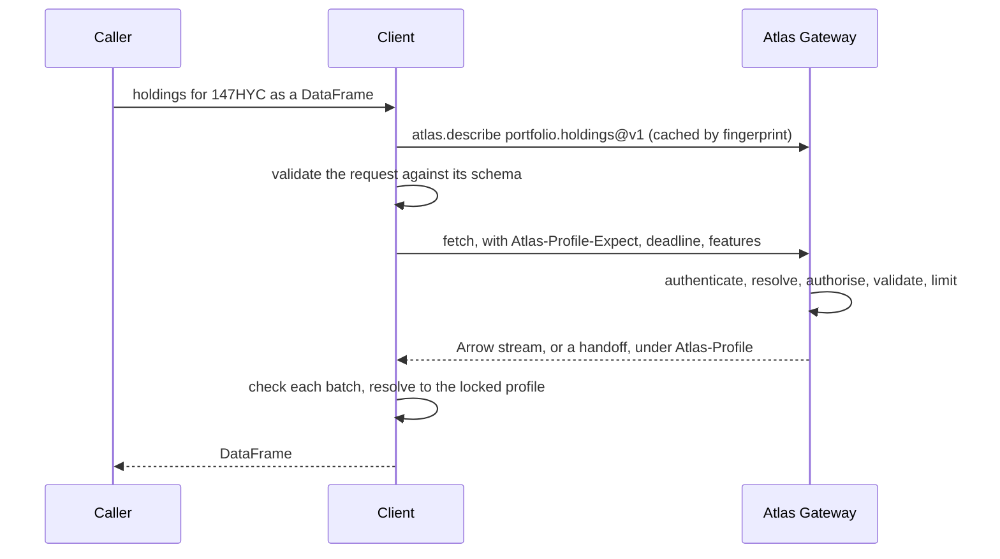
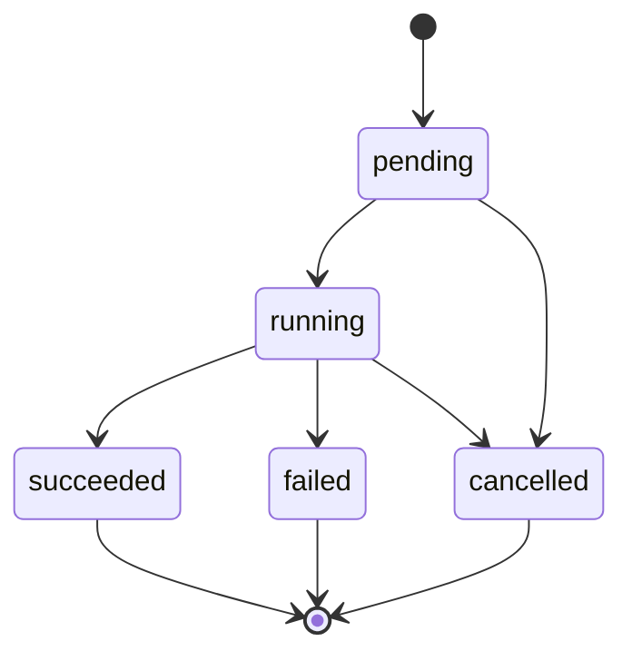
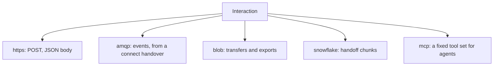

# 4. Plugging in

`spec/plugging-in.md` · proposed

How any client, in any language, plugs into the Atlas Gateway's surfaces: find the gateway, read the profile, validate, call, travel over a binding, be decided, answer, read; what a client does for each surface; and the levels it declares.

### In short

- **Two halves of every contract:** the gateway writes (describes, serves, guarantees); the client reads (resolves, formats). A client holds no code for any capability.
- A client finds the gateway of its environment (given, `ATLAS_URL`, `ATLAS_ENV`, its configuration, else Production), reads `/.well-known/atlas`, and signs in from the shared token store.
- Every call is eight steps: find, understand, validate, call, travel, decide, answer, read.
- A client declares its **levels** (Core always; Streaming, Columnar, Bulk, Handoff as it implements them) and is served the next way down where it lacks one, never refused.

### Picture

### How it works

| Surface | The client sends | It gets back | It then |
|---|---|---|---|
| Data | `fetch` with parameters and columns | A stream (Arrow, NDJSON) or a handoff | Downloads (handoff), checks, resolves, converts to the caller's format |
| Resources | `get`, `list`, `create`, `update` with a mask and ETag, `delete` | A resource or a page | Resolves; keeps the ETag |
| Actions | `plan`, then the verb with an idempotency key | A plan; an operation | Shows the plan; follows the operation to its receipt |
| Events | `subscribe` with a filter, or `publish` | A handover to connect to Service Bus | Gets its own token, connects, resolves each event, drops duplicates, reconnects |
| Built-ins | `whoami`, `catalog`, `search`, `describe`, `access`, `usage` | Fixed documents | Drives everything above |

### Seams

| Seam | Client | Atlas Gateway | Defined in |
|---|---|---|---|
| Discovery | Shows only the working view | Filters by context | §2.6 |
| The call | Validates; sends protocol headers | Decides, answers, problems | §4.1, §9.6 |
| The bytes | Follows a binding | Serves it | §4.2 |
| Reading | Resolves | Names the writer fingerprint | §3.4 |

### Rules

- Every client plugs into every surface the same way, as §9.7 defines.
- A client never contains behaviour for one capability, other than the built-ins, and never builds an address.

### Go deeper

§4.1 Calls and answers · §4.2 Bindings · §5 Clients · normative: §9.6, §9.7, §9.8

## 4.1 Calls and answers

`spec/plugging-in/protocol.md` · proposed

What every call carries and every answer looks like, independent of transport: the request, the result, problems, the five deliveries, operations for long-running work, deadlines and retries; explained here, defined exactly in §9.

### In short

- A request: the address, parameters (valid against the request schema), the expected fingerprint, a deadline, an idempotency key for any change; protocol options in headers.

- A result names its writer fingerprint and the schema of what it returned; a failure is an RFC 9457 problem with a stable `code`, `retryable`, a `target` and a `next` step.

- Five deliveries: `single`, `chunked`, `subscription`, `operation`, `transfer` (and the data handoff).

- Long work is one operation resource: `202`, `Operation-Location`, poll, watch or cancel.

- Retry only what is retryable and replayable, at one hop, within the deadline.

### Picture

### How it works

`yieldbook.scenarios@v1:fetch` answers `202 Accepted` with `Operation-Location: …/operations/op-91` and `Retry-After: 2`. The client polls, waiting 2, 4, 8 seconds, until `succeeded`, then reads the result. A second call hits the vendor's limit: `429`, `Atlas-Error-Code: limit_exceeded`, `retryable: true`, `retry_after: 30`.

### Seams

| Seam | One side | Other side | Where |
|---|---|---|---|
| Explanation and definition | This page: why and how | §9: exactly | §9.3, §9.6 |

### Rules

1. Every binding carries every part of the request and result above, in its own framing (bindings).
2. Errors are never in the data: a binding that cannot use status codes (a stream, an event) carries a problem frame.
3. The gateway never buffers a whole chunked answer; it passes chunks on as they arrive.

- **ATLAS-PROTOCOL-001.** Every failure on every binding is a problem with a registered `code`, the `request_id` and a `next` step.
- **ATLAS-PROTOCOL-002.** Every result names its writer profile's fingerprint and the schema of what it returned.
- **ATLAS-PROTOCOL-003.** Work past its deadline stops in every downstream service, and a cancelled call is cancelled downstream.
- **ATLAS-PROTOCOL-005.** A problem marked `retryable` is never returned for a request that changed something and cannot be repeated safely; every problem's `Atlas-Error-Code` header equals its `code`.
- **ATLAS-PROTOCOL-006.** No downstream service works past the caller's deadline (a test with a two-second deadline on a ten-second query).
- **ATLAS-PROTOCOL-004.** Every long-running interaction returns an `atlas.operation`, which can be polled, watched and cancelled.

### Detail

#### A request

| Part | Holds |
|---|---|
| Address | `id@vN:interaction` (a bare `id` resolves to the current stable version) |
| Parameters | Typed by the profile's request |
| Selection | `columns` or field paths, where `Projectable` |
| Filters, order, cursor | Where the profile declares them |
| Execution preference | `gateway`, `handoff` or `client`, where offered (`Atlas-Execution`) |
| Idempotency key | On every write |
| ETag | On every update or delete of a resource |
| Deadline | An absolute time after which the caller no longer wants the answer |
| Expected profile | The fingerprint the request was written under |
| Client | Its name, version, protocol version and features |

#### A result

| Part | Holds |
|---|---|
| The data | In the interaction's result shape, under the writer profile |
| Profile | The writer profile's fingerprint |
| Result schema | The schema of exactly what was returned (the selected columns, their types and units); for tables, in the Arrow schema's metadata |
| Warnings | Deprecations, resolution notes |
| Usage | What this call used, and what is left (`Atlas-Limit-Remaining`) |
| Request id and trace | `X-Request-Id`, `traceparent` |

#### Problems

Every failure is an RFC 9457 problem document (`application/problem+json`). Its members:

| Member | Holds |
|---|---|
| `type`, `title`, `status`, `detail`, `instance` | As RFC 9457 defines them |
| `code` | A stable code from the problem registry, or one the capability's profile declares |
| `retryable` | Whether the same request may succeed if repeated (`true` only when it is safe to repeat) |
| `retry_after` | Seconds to wait, where known (also in the `Retry-After` header) |
| `target` | What the problem is about: a parameter, a field path, a resource name |
| `next` | The step a person or agent can take, in words, and where possible the address to call (`atlas.access`) |
| `details` | Problems behind this one; each hop a call passed through adds itself (`{"hop": "service", …}`), so the caller sees where it failed |
| `request_id` | The call's id, as in `X-Request-Id` |

The `code` is also sent as the header `Atlas-Error-Code`, so proxies and clients act without parsing the body. These members follow the Azure REST API guidelines' error shape (code, target, details) inside RFC 9457's document. A partial answer (a dashboard of independent panels) carries one problem per failed part, each with the part's path, as GraphQL's errors do.

The registry of codes, with each one's status and whether it is retryable, is normative in §9.3.3.

The codes, each with its status and whether it is retryable, are the registry of §9.3.3.

#### Deliveries

- **single:** one answer.

- **chunked:** one answer, sent as it is produced (Arrow record batches, NDJSON lines), ended by a final frame that carries the usage and any problem.

- **subscription:** events until the subscriber stops or a terminal problem ends it (events).

- **operation:** an operation at once, then its progress and result (below).

- **transfer:** a short-lived link the caller uploads to or downloads from by byte range, resumably; an upload ends with an idempotent commit (bindings).

#### Operations

Long-running work (an action's run, a large fetch, a job) returns an operation at once, as Google's long-running operations do.

An operation is a resource, `atlas.operation`:

| Field | Holds |
|---|---|
| `name` | `operations/{id}` |
| `address` | The `id@vN:interaction` it runs |
| `state` | `pending`, `running`, `succeeded`, `failed`, `cancelled` (and `UNKNOWN` for a state a client does not know) |
| `progress` | Optional, in the profile's terms |
| `result` or `problem` | When finished: the result (or a link to it) or the problem |
| `owner`, `created`, `updated` | Who started it and when |

A caller `get`s it (poll), `watch`es it, or subscribes to `atlas.operation.*` events; it MAY `cancel` it. One operation model replaces separate jobs, runs, publications and permits.

On HTTP, starting one answers `202 Accepted` with the operation in the body, an `Operation-Location` header naming it and `Retry-After` saying when to poll, as Azure's long-running operations do. An operation is kept for at least 24 hours after it ends. Cancelling is cooperative: it is acknowledged at once, forwarded to every hop, and the operation reaches `cancelled` within one poll interval. Repeating a start with the same `Idempotency-Key` returns the same operation; the key is kept for 24 hours, the same key with a different request is `idempotency_conflict`, and a repeat while the first is still running (a write answered in one response) is `in_progress`, retryable after `retry_after`. An operation survives the gateway replica running it: another resumes it, or ends it `failed` with `unavailable` and releases its key (§6.1 6.1.13).

#### Deadlines and cancellation

Every request carries an absolute deadline (the caller's, or its interaction's default, never above its maximum). Each hop subtracts its own overhead before passing it on, so no downstream service works past the caller's deadline; work past it stops with `deadline_exceeded`. A caller that disconnects or cancels cancels the work downstream.

#### Retries

A request is retried only when its problem says `retryable` and the request can be replayed: a body already streamed cannot be. Retries use exponential backoff with jitter, honour `Retry-After`, and are limited to a budget (at most one in ten calls to a dependency in a minute). A request is retried at one hop only, never at every hop.

#### Headers

Every request carries `Atlas-Client`, `Atlas-Client-Features`, `Atlas-Profile-Expect`, `Atlas-Deadline` and `traceparent`, an `Idempotency-Key` on any change, and `If-Match` on an update or delete; every answer carries `Atlas-Profile`, `Atlas-Governance-Revision`, `X-Request-Id`, and where they apply `Atlas-Limit-Remaining`, `Atlas-Error-Code`, `Deprecation`, `Sunset`, `Retry-After` and `Operation-Location`. Each one's exact type and grammar: §9.6.3.

### Decisions

**Decided (2026-10-28):** problems stay RFC 9457 documents, extended with the Azure guidelines' useful members (`code`, `target`, `details`) and `retryable` and `retry_after`; long-running work follows Azure's `202` and `Operation-Location` mechanics on one operation resource.

**Open:** - One operation model replacing today's jobs, runs, publications and permits. This changes existing routes, so it is best done before third parties arrive. Recommended: yes, now.

### Go deeper

- §9.3 Documents and the problem registry
- §9.6 The HTTP binding

## 4.2 Bindings

`spec/plugging-in/bindings.md` · proposed

How each interaction travels: HTTP with server-sent events, MCP for agents, Service Bus for events, transfer links and handoffs for bulk bytes; clients follow the bindings a profile serves and never build an address.

### In short

- A binding is a protocol, a server from the bootstrap, an address, encodings and authentication.
- Every binding is the Atlas Gateway's, or a link it issues: HTTPS (`POST` with a JSON body) for every interaction; AMQP to Service Bus for events, which the client opens itself from a connect handover; Blob links for transfers; Snowflake's storage for a handoff. A client that cannot reach Service Bus polls instead.
- Agents get a small fixed set of MCP tools, not one per capability.
- OpenAPI and AsyncAPI descriptions are generated from profiles, never edited.

### Picture

### How it works

`nautilus.dashboard@v1:publish` is served at an HTTPS binding that answers with a transfer: the client `PUT`s the dashboard's ZIP to a Blob link in 8 MiB parts, then commits. Moving that service to a service host of its own inside the gateway changes nothing a client sees.

### Seams

| Seam | One side | Other side | Where |
|---|---|---|---|
| Profile and infrastructure | The profile: which bindings | The front door: routing by binding | §6.1 |

### Rules

1. **Clients never build addresses.** A client reaches an interaction only through a binding served in its profile; the bootstrap `/.well-known/atlas` is the only address a client knows in advance.
2. **No infrastructure parses a name.** The front door routes by binding; every binding's address serves one interaction of one capability.
3. **A binding may change within a version.** Moving a path, a server or a transport is a safe change when every client follows served bindings, and the old binding stays served for a migration window.

- **ATLAS-BINDING-001.** Every interaction in every profile has at least one binding whose server is named in the gateway's bootstrap.
- **ATLAS-BINDING-002.** The same request through any two bindings of one interaction returns the same result, in each binding's encoding.
- **ATLAS-BINDING-003.** The published OpenAPI and AsyncAPI descriptions are regenerated by the gates and fail them when they differ from what is committed.

### Detail

#### A binding

| Field | Holds |
|---|---|
| `protocol` | `https`, `amqp`, `blob`, `snowflake` (a handoff's chunks), `mcp`; `sse` and `wss` are reserved for a later protocol version |
| `server` | A named server from the gateway's bootstrap (the gateway, its stream edge, a Service Bus namespace, a Snowflake account) |
| `address` | A path, channel or topic |
| `method` | For HTTP: the method |
| `encodings` | `json`, `arrow`, `ndjson`, `csv`, `parquet`, `cloudevents+json` |
| `auth` | `bearer` (the caller's sign-in), `entra-scope` (the client gets its own token for the system, as the person) or `ticket` (a credential the gateway issued) |

An interaction may have several bindings; a client picks the first it supports, in the order the profile gives.

**The gateway's addresses** (informative: clients never build them, they follow bindings). The Atlas Gateway serves each interaction at `/v1/<family>/<id>@v<N>:<interaction>` on its `gateway` server (`/v1/data/portfolio.holdings@v1:fetch`, `/v1/resource/nautilus.dashboard@v1:get`, `/v1/action/astronomer.deployment@v1:plan`, `/v1/event/data.landed@v1:subscribe`), the built-ins at `/v1/atlas/<id>:<interaction>` as the bootstrap lists them, and operations at `/v1/operations/<id>`. A binding moved is a safe change (§3.3).

#### HTTP

- Every interaction: `POST` with a JSON body to the binding's address (`GET` only for the bootstrap and polling operations); the result's encoding is negotiated with `Accept` (`application/json`, `application/vnd.apache.arrow.stream`, `application/x-ndjson`, `text/csv`).
- `chunked` delivery: the response body streams (Arrow record batches or NDJSON), ending with a final frame.
- `subscription` delivery: the call answers with a connect handover, and the client connects to Service Bus itself (§2.5); no event travels over HTTP in `atlas/1.0`.
- `operation` delivery: `202 Accepted` and `Operation-Location` (§4.1).
- `transfer` delivery: a short-lived link (below) that the client uploads to or downloads from by byte range.
- Status codes follow the problem's code; the body is the problem document; `Atlas-Error-Code` carries the code.

#### MCP

The gateway serves a **small, fixed set of tools** to agents: `atlas_whoami`, `atlas_search`, `atlas_guide`, `atlas_describe`, `atlas_call` (any available capability and interaction, by address), `atlas_subscribe`, `atlas_operation` and `atlas_access`, through the same pipeline. Each tool's arguments and result are those of the operation of §9.7.1 it is named for (`atlas_call: address, request, options`), and `atlas_whoami`'s answer, with its house rules, is the server's instructions. A harness or role MAY add a few pinned capabilities as tools of their own (`portfolio_holdings_fetch`), described from their profiles. MCP is an edge, not a separate API. The set never changes with the catalogue (a new capability is a new address for `atlas_call`), so no harness's tool list goes stale. One tool per capability is not served: with hundreds of capabilities it would flood an agent's context and change under it (discovery). Long-running calls use MCP's tasks extension, mapped onto `atlas.operation`. Results are JSON (structured content validated against the result schema); bulk data is never sent through MCP: an agent is given an export's links instead. MCP's behaviour hints are filled from each interaction's effect class.

#### Events

CloudEvents over AMQP on Service Bus: a topic per domain or event family, a subscription per durable subscriber, filters on CloudEvents attributes (events).

#### Tickets and transfers

A `ticket` binding names the source the caller connects to directly (a Snowflake account), and the ticket carries the credential and the planned operation; tickets are deferred until their credential meets the credential rule (O54).

A `transfer` binding is a short-lived link: an Azure Blob URL with a SAS. It is bound to the caller and one operation, expires with it, and for uploads is single-use. Each carries the call's trace id, so the transfer appears under the same trace.

#### Later bindings

Added as bindings to existing interactions, changing no contract: **Arrow Flight** for `fetch` (parallel partitions by ticket), and **gRPC** streams where a client needs duplex messages. Neither is the core protocol: browser pages and the thinnest clients need plain HTTP, and profiles are already the schema clients read.

#### Generated descriptions

| Description | Covers | For |
|---|---|---|
| OpenAPI 3.1 | The HTTP bindings | Third parties, documentation, API inventories |
| AsyncAPI 3.0 | The event bindings | Event catalogues, code generators |

Each is generated from the profiles and the protocol, published with every release, and never edited by hand.

### Go deeper

- §9.6 HTTP
- §9.7 Clients
