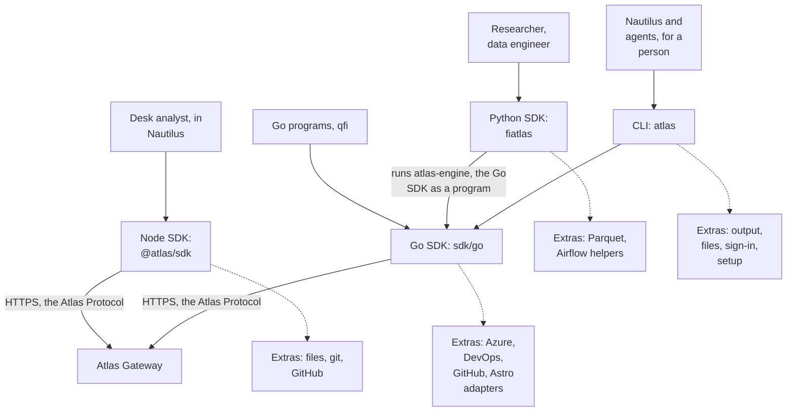
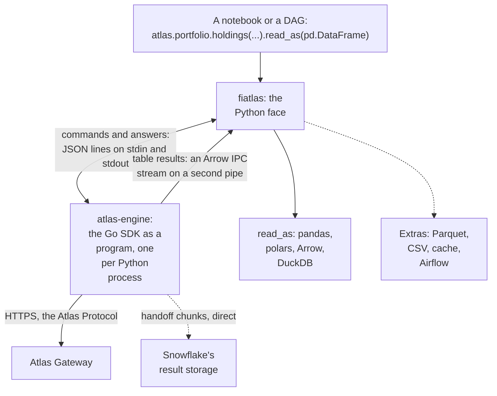
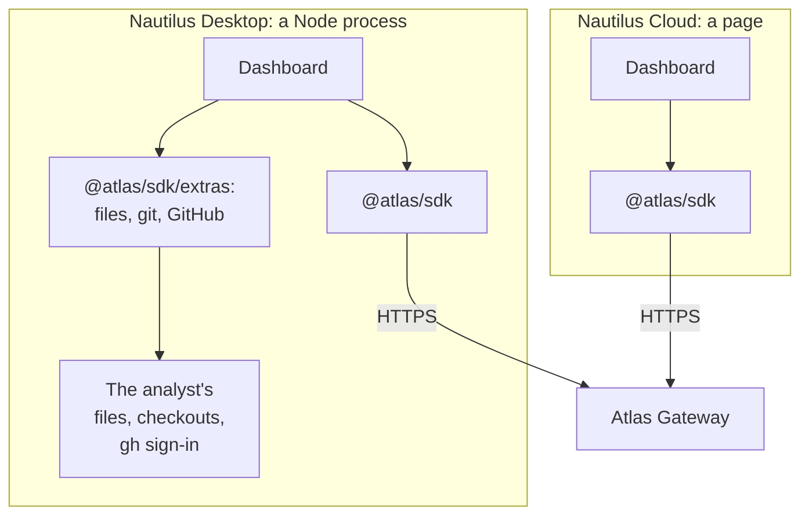
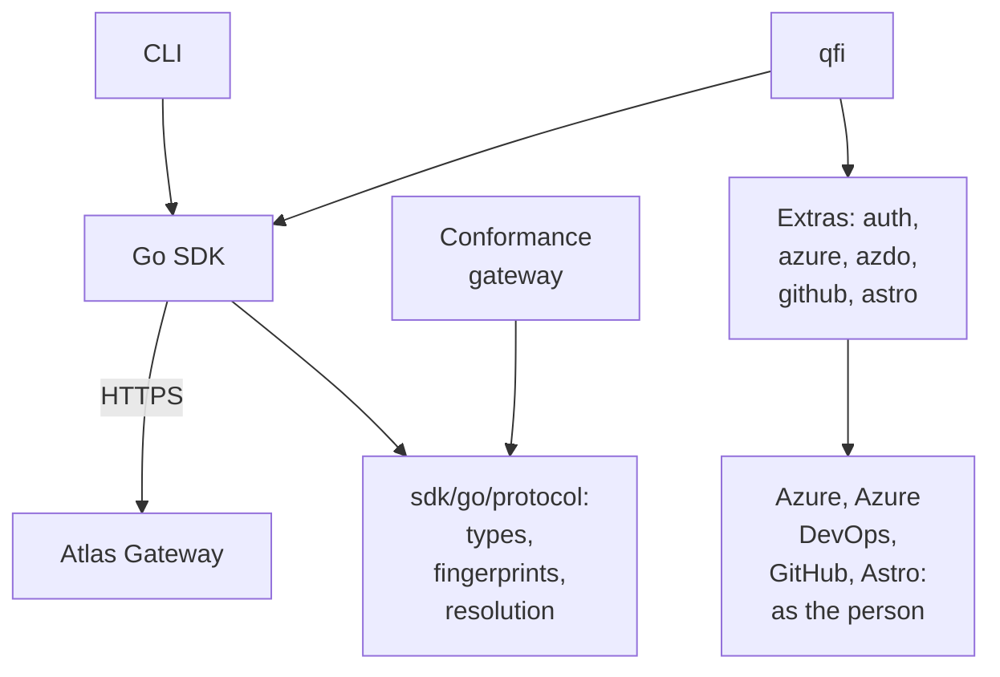

# 5. Clients

Source: `IMG_2138.MOV` 00:12:04–00:14:48.

`spec/clients.md` · proposed

The Atlas clients: each a wrapper over the Atlas Gateway, optimised for its language and the people who use it (the Python SDK for researchers and data engineers, the Node SDK for analysts' dashboards in Nautilus, the CLI for Nautilus and agents, the Go SDK for Go programs), each owning the reader side, and each with extras: work it does on the caller's machine without the gateway.

### In short

- **Every client is a wrapper over the Atlas Gateway.** It speaks the Atlas Protocol to the gateway over HTTPS for every capability, hard-codes only the protocol and the built-ins, and learns everything else from profiles.
- **Each is optimised for its language and its users.** Python for researchers and data engineers; Node for analysts' dashboards in Nautilus; the CLI for Nautilus and agents querying data for a person; Go for Go programs and `qfi`.
- **Each may add extras:** work it does on the caller's machine without the gateway, because its users need it (Node reads the analyst's files and git checkouts for a dashboard; Python writes Parquet). An extra is never a capability.
- Each declares its levels; what it lacks it is served the next way down.
- Typed wrappers may be generated from an application's lock; they call the dynamic core and add only types.
- **One shape:** the same request record, member for member, and the same operation names by fixed rules, in every client (§9.7.1).

### Picture



### How it works

The same question in three clients, the same call to the gateway underneath:

```console
atlas fetch portfolio.holdings --portfolios 147HYC --columns isin,weight --format parquet --out h.parquet
```

```python
atlas.portfolio.holdings(portfolios=["147HYC"], columns=["isin", "weight"]).read_as(pd.DataFrame)
```

```typescript
await a.fetch('portfolio.holdings@v1', { portfolios: ['147HYC'], columns: ['isin', 'weight'] })
```

And three people, each on the client built for them:

1. **A data engineer** writes an Astronomer pipeline in Python. Its tasks read `index.constituents@v1` with the Python SDK under the deployment's workload identity, and write Parquet with its extra; the pipeline's runs are visible to the team through `astronomer.runs@v1`.
2. **A desk analyst** asks Nautilus Desktop for a dashboard of their fund's holdings against a CSV of their own. The dashboard fetches `portfolio.holdings@v1` through the Node SDK, which calls the gateway; it reads the CSV with the Node SDK's file extra, which never touches the gateway.
3. **Nautilus's agent,** asked “what changed in 147HYC's duration this week?”, runs `atlas search`, `atlas describe` and `atlas fetch … --json` through the CLI, as the person, and reads NDJSON and exit codes.

### Seams

| Seam | Client | Other side | Defined in |
|---|---|---|---|
| Caller | The language's own forms and errors | The caller's code | Each client's page |
| Gateway | The reader side | The Atlas Gateway: the writer side | §9.7 |
| Extras | The client's own interface, on the caller's machine | Nothing in Atlas: no gateway, no capability | §9.7.12 |
| Sign-in | The shared token store | Entra | §9.7.3 |

### Rules

- **ATLAS-CLIENTS-001.** Every client passes the conformance suite at its declared levels.
- **ATLAS-CLIENTS-002.** A capability added to the catalogue is callable from every client with no client release.
- **ATLAS-CLIENTS-003.** A client calls every capability through the Atlas Gateway, and only there; it never reaches a capability's source or vendor directly.
- **ATLAS-CLIENTS-004.** An extra is named in its client's own interface, apart from capabilities; it never sends a credential from the caller's machine to the gateway; and its client's page says what it needs to run.
- **ATLAS-CLIENTS-006.** No profile, answer or capability names a path, folder or layout on the caller's machine; what happens to a result here is the client's (checked by the profile lint for path-like members, and by review).
- **ATLAS-CLIENTS-005.** A dashboard declares the extras it uses in its lock. Where one cannot run (a page in Nautilus Cloud has no person's file system), the panels that need it say what they need and where they can run, and every other panel renders.

### Detail

#### Who each client is for

| People | What they do | Client | Why that client |
|---|---|---|---|
| Researchers, data engineers | Analyse data in notebooks; build datasets; publish pipelines on Astronomer | Python SDK | DataFrames with exact types, handoffs for large results, helpers for Airflow |
| Desk analysts | Ask Nautilus for a dashboard, and use it | Node SDK | The language of Nautilus's applications; files and git for dashboards on Desktop |
| Nautilus, and agents working for a person | Find, describe and fetch data in a session | CLI | One generic command per verb; JSON, NDJSON and exit codes an agent reads |
| Platform engineers | Write Go programs and tools (`qfi`, the conformance gateway) | Go SDK | One Go implementation of the protocol, under the CLI as well |

#### The clients side by side

| | Python | Node | CLI | Go SDK |
|---|---|---|---|---|
| Lives in | `clients/python` | `clients/node` | `clients/cli` | `sdk/go` |
| Language | Python | TypeScript | Go (binary `atlas`) | Go |
| Protocol | The Go engine it ships (`atlas-engine`) | `@atlas/protocol` (TypeScript) | The Go SDK | `sdk/go/protocol` |
| Levels | Core, Streaming, Columnar, Bulk, Events, **Handoff** (Broker deferred) | Core, Streaming, Columnar, Bulk, Events in a Node process (Handoff later) | Core, Streaming, Columnar, Bulk, Events, Handoff | Core, Streaming, Columnar, Bulk, Events, Handoff |
| Returns | Arrow, pandas, polars, DuckDB, files, records | Arrow tables, rows, files | Tables; JSON, NDJSON; files | Arrow readers, structs |
| Extras | Parquet and CSV writing, a result cache, Airflow helpers | Files, git, GitHub (in a Node process) | Output formats, writing files, sign-in, setup, update, harness commands | Read-only adapters for Azure, Azure DevOps, GitHub and Astro, as the person |

#### Who does what: out there, here, and where it goes

A capability is the client's reach into the cloud: it changes and returns things out there. Bringing the result here, and putting it where the caller's context needs it, is the client's. Three parts, each with one job:

| Part | Its job | Never | Changes need |
|---|---|---|---|
| **The capability** (in the gateway) | The state and the rules out there: who owns what, who it is shared with, access, limits, audit; the data or the bytes themselves | Knows anything about the caller's machine: no local path, harness layout or file format choice in a profile or an answer | A gateway deployment only (ATLAS-CORE-009) |
| **The engine** (the Go SDK, which the CLI, Go programs and the Python SDK run; `@atlas/protocol` in Node) | Moves the result here, landed in its agreed form (§9.7.13): records as the language's values and tables as Arrow batches, **in memory**; content in memory, or on disk at the agreed place with a manifest when saved or large; transfers and exports on disk | Decides what the result is for | A protocol change only |
| **The client package and its extras** (Python, Node, the CLI, a Go program) | Turns what landed into what this context needs: a DataFrame (`read_as`), a dashboard panel, a Parquet file, a skill placed in a harness's folder, a file opened in an editor | Changes anything out there except through a capability | A release of **that** client only, never the gateway or any other client |

**For example, a skill.** Sharing it, who owns it and which version is current are `nautilus.skill`'s: state out there. `download` returns its bytes; the engine lands them (in memory, or at the agreed disk place when asked to save). Placing them in Claude Code's `.claude/skills/` or OpenCode's `.opencode/skills/` is the CLI's harness extra (`atlas skill install`), which knows each harness's layout. A new harness, or a harness that moves its folder, is a release of the CLI's harness extra alone. Installing a skill into a person's **Nautilus Cloud** agent home is a capability (`nautilus.skill:install`), because that place is out there: the line is where the destination lives, not what the data is.

#### Extras

An **extra** is work a client does on the caller's machine without the gateway, because the people it serves need it there: Node's dashboards on Nautilus Desktop read the analyst's files; a notebook writes a Parquet file. Extras keep a client fast where the work is local, and keep Atlas's catalogue to what the gateway serves.

1. An extra is part of its client's own interface, in a namespace of its own (`extras` in Python and Node), never named as a capability, and never in `atlas.catalog`.
2. It reaches Atlas only through its client's ordinary calls, decided and audited by the gateway like any other.
3. It runs as the caller, with the caller's own sign-ins on their machine (git's credentials, `gh`, `az`), and never sends them to the gateway.
4. It is documented on its client's page, with what it needs (a file system, a signed-in `gh`), and tested by its client's own tests.
5. It starts from what the engine landed, in its agreed form (values, Arrow batches in memory, content in memory or on disk with its manifest), never from its own call to a source.

#### The engine in the cloud (open, O61)

Today each client does its reader-side work on the caller's machine: the Go engine for Python, the CLI and Go, `@atlas/protocol` for Node. The direction is for the gateway to do that work for every client, so that a client only asks for what it wants and gets it back exactly as asked. Because the gateway and the engine are both built from `sdk/go`, this is the gateway running the same shaping code per request, not a second system.

| Rule | Why |
|---|---|
| **Stateless, per request.** The caller's reader profile, format and features travel in the request (`Atlas-Profile-Expect`, `Atlas-Client-Features`, `Accept`); no engine process exists per user | Scales by adding copies of the gateway: 1,000 users never means 1,000 engines |
| **Only work that streams.** The engine converts types, resolves versions and encodes a batch at a time; sorting, filtering and column choice are in the SQL: anything needing the whole result (a sort not in the SQL, a join across capabilities, a pivot) is done by Snowflake or on the caller's machine | Memory per call stays a batch or two, whatever the result's size |
| **Very large results through storage.** Above the export threshold of §2.2.1.7, the gateway writes Parquet in the caller's shape to Blob storage and answers with links (§6.3) | The gateway never carries the largest results; Python and Node read Parquet natively, so no client needs Snowflake's chunk decoder |
| **The warehouse is what is protected.** Limits, budgets, confirmation and result reuse (§6.2.6, O60) apply wherever the engine runs | Snowflake queueing and cost, not the engine, are the limit at Atlas's scale |

The sizing it rests on, as measured on 2026-10-14 for all of QFI's Snowflake use (a ceiling for 1,000 users): about 130,000 queries and 226 million rows a day; half of service queries return 5 rows or fewer; about 72 results a day exceed a million rows; 72% of service queries repeat an identical statement. The figures and their working are in `kb/sessions/2026-10-30-one-go-codebase/`. It is decided by the M9.5 load test and the same test against Development.

### Decisions

**Decided (2026-10-29):** one host. Every client calls the Atlas Gateway for every capability; each client is built for its language and its users; work on the caller's machine is a client extra, not a capability.

**Open:**
- The CLI's Go module is still `github.com/jhgonline/fi-app-atlas/cli`. Recommended: rename to `github.com/jhgonline/fi-app-atlas/clients/cli`.
- `sdk/go` as the Go client, rather than a separate library. Recommended: yes.
- Extras that read what a capability also serves (the Go SDK's `azure` and `astro` adapters, for `qfi`). Recommended: allowed for a person's own tools with their own access; an application for other people calls the capability.
- Nautilus Desktop embeds the Node SDK for its dashboards and their extras. Recommended: yes; to confirm with Nautilus.

### Go deeper

§5.1 Python SDK · §5.2 Node SDK · §5.3 The CLI · §5.4 Go SDK · normative: §9.7

## 5.1 Python SDK

`spec/clients/python.md` · proposed

Atlas Python (fiatlas), built for researchers and data engineers: a Python face over the Go client engine it ships, so every protocol rule runs in the one Go implementation while the caller gets the Atlas Gateway's data in the form they work with (pandas, polars, Arrow, DuckDB) with exact types, pipelines on Astronomer that call Atlas as their workload, and extras for files, caching and Airflow.

### In short

- For **researchers and data engineers:** notebooks, datasets and pipelines on Astronomer.
- `clients/python`, package `fi-lib-atlas`, import `fiatlas`.
- **A Python face over the Go client engine.** The wheel carries `atlas-engine`, the Go SDK built as a small program (§5.4). Python starts it on first use and gives it every protocol job: sign-in, discovery, validation, fingerprints, calls, retries, resolution, handoffs, events, transfers. Python does what Python users need: the attribute form, `read_as`, exceptions, `async`, extras.
- Levels: the engine's. Core, Streaming, Columnar, Bulk, Events, **Handoff**; Broker deferred (O54).
- One wheel per platform, with no Python dependencies; `pyarrow`, `pandas` and `polars` are optional extras.

### Picture



### How it works

`atlas.portfolio.holdings(portfolios=["147HYC"]).read_as(pd.DataFrame)` on a 30-million-row request:

1. The face starts `atlas-engine` (a few milliseconds, once per process) and sends one command: the address, the request, the options.
2. The engine reads the token store, finds the profile, validates the request, and calls the gateway.
3. The gateway chooses a handoff. The engine downloads the 41 chunks eight at a time, decodes and checks each, and resolves them to the locked profile.
4. The engine writes Arrow batches to the result pipe; the face reads them with pyarrow, a batch at a time, and builds the DataFrame with Arrow-backed dtypes.

`ref.via` says `"handoff"`.

In a pipeline on Astronomer, the same call runs under the deployment's workload identity: the task's token is passed to `FIAtlas(token=…)` (or `ATLAS_TOKEN`), and the engine uses it.

### Seams

| Seam | One side | Other side | Where |
|---|---|---|---|
| Face and engine | `fiatlas`: the Python interface, conversions, extras | `atlas-engine`: every protocol rule | The engine protocol (Detail) |
| Engine and gateway | The Go SDK: the reader side | The gateway: the writer side | §9 |
| SDK and its extras | `fiatlas`: calls and results | `fiatlas.extras`: work on the machine | §5 |
| SDK and a pipeline | The SDK: the call | The pipeline: its schedule, its workload identity | §6.2 |

### Rules

1. The face holds no protocol logic: every rule of §9 runs in the engine. The face may convert, name and present, never decide.
2. **One engine per process, never shared across a fork.** A process starts its engine on first use; a child forked after that starts its own, and never writes to its parent's pipes. No engine outlives its Python process.
3. Ctrl+C, a deadline or an `asyncio` cancellation cancels the engine's work for that call, at once.
4. The engine and the face speak only through inherited pipes, never a network port.
5. Free-form SQL (`atlas.sql`) is the capability `snowflake.query`, behind its named grant. A capability's own SQL is read with `explain` (§2.2).
6. Extras live under `fiatlas.extras` and never call the gateway except through `fiatlas`'s ordinary calls.

- **ATLAS-PY-001.** The Python SDK passes the conformance suite at its levels, through its runner driving the face.
- **ATLAS-PY-002.** `read_as` returns every column with the type its profile declares (no decimal becomes a float).
- **ATLAS-PY-003.** A pipeline task calls Atlas with its workload's token and never with a person's.
- **ATLAS-PY-004.** A process forked after its engine started gets an engine of its own on its first call, and no call hangs, in `fork`, `spawn` and `forkserver` pools, Celery's prefork pool, Airflow's executors and gunicorn with `--preload`.
- **ATLAS-PY-005.** Ctrl+C, a deadline or an `asyncio` cancellation ends a call within one second, and the engine stops its work.
- **ATLAS-PY-006.** The wheel installs and passes the vectors on Python 3.11 to 3.14 on every platform it is built for, with no Go and no compiler present.
- **ATLAS-PY-007.** No engine process outlives the Python process that started it.

### Detail

#### What it is

| | |
|---|---|
| Built for | Researchers and data engineers: notebooks, datasets, pipelines on Astronomer |
| Lives in | `clients/python` (package `fi-lib-atlas`, import `fiatlas`) |
| Protocol | None of its own: `atlas-engine` (`sdk/go/cmd/atlas-engine`), the Go SDK as a program (§5.4) |
| Calls | The Atlas Gateway over HTTPS, through the engine |
| Levels | The engine's: Core, Streaming, Columnar, Bulk, Events, **Handoff**; Broker deferred (O54) |
| Released | To the FIQ feed: one wheel per platform (`py3-none-<platform>`, every Python 3), the engine built by pure Go cross-compilation for Linux (x86 and ARM), macOS (Intel and Apple silicon) and Windows; optional dependencies `[arrow]`, `[pandas]`, `[polars]`, `[airflow]` |

#### The engine protocol

The face and the engine speak the **runner protocol** of §9.8.3: one JSON command per line on the engine's standard input, one JSON answer per line on its standard output, for every operation of §9.7.1. The engine is also the Go reference runner, so the protocol is proven by the conformance suite.

The engine adds two things for the face:

| Addition | What it does |
|---|---|
| Arrow results | A command may ask for `"results": "arrow"`. A table then comes back as an answer naming a stream, and the batches follow as an Arrow IPC stream on a second pipe the face passed in at start, ended by the protocol's final zero-row batch (§9.6.5). Records, documents and problems stay JSON |
| Cancel | `{"op": "cancel", "id": n}` cancels the work of command `n`; its answer is the problem `deadline_exceeded` or the cancellation |

#### Using each surface from Python

```python
from fiatlas import FIAtlas
atlas = FIAtlas()                                      # the gateway and sign-in by §9.7.2, in the engine
atlas.search("credit curves for US IG")                # the working view
atlas.guide("portfolio.holdings")                      # how to use it: words, parameters, examples
ref = atlas.portfolio.holdings(portfolios=["147HYC"], columns=["portfolio", "isin", "weight"])
ref.explain()                                          # the exact SQL this call would run, its estimate
df = ref.read_as(pd.DataFrame)                         # streamed or handed off: the gateway chooses
ref.via                                                # "gateway" or "handoff"
runs = atlas.astronomer.runs(deployment="dv-harbour").read_as(pd.DataFrame)
async for e in atlas.data.landed.subscribe(filter={"source": "index"}): ...
atlas.access("yieldbook")                              # what I have and lack, and why
```

`atlas.<domain>.<name>` attributes come from the working view; a lock makes them typed (`.pyi` stubs that `atlas lock gen python` writes).

#### Formats it returns

`read_as(kind)` turns the Arrow batches into: a `pyarrow.Table` or a batch iterator; a `pandas.DataFrame`, with Arrow-backed dtypes so decimals and nullable integers stay exact; a `polars.DataFrame`, with no copy; a DuckDB relation; a `list` of records, or a `dict` of columns.

Memory stays bounded unless the caller asks for the whole result at once.

#### Extras

| Extra | Does | Needs |
|---|---|---|
| `extras.write_parquet(ref, path)`, `extras.write_csv(ref, path)` | Writes a result to a file as its batches arrive, with the profile's types | A file system |
| `extras.cache` | Keeps results in memory or on disk for a session, keyed by address, request and fingerprint | A file system for the disk cache |
| `extras.airflow` | An Atlas hook and operator for DAGs: the task's workload token, deadlines from the task's timeout, results to XCom or files | Airflow (`[airflow]`) |

None is a capability; each is tested by the SDK's own tests.

### Decisions

**Decided (2026-10-30):** the Python SDK is a Python face over the Go client engine, which it ships and runs as a separate process speaking the runner protocol with Arrow results on a second pipe (D43).

**Open:**
- The engine in the cloud, so that the Python and Node SDKs become thin (§5, O61). Recommended: after Phase 2, decided on the measured load test.
- Which Airflow helpers are worth keeping in the SDK, rather than in the pipelines' own repository. Recommended: the hook and operator only (O47).

### Go deeper

- §5.4 Go SDK
- §9.8.3 The runner protocol
- §2.2.1 Snowflake data

## 5.2 Node SDK

`spec/clients/node.md` · proposed

The Atlas Node SDK (`@atlas/sdk`), built for analysts' dashboards and the Nautilus applications: the whole of the Atlas Gateway over HTTPS with one API, from a Node process or a page, and extras for the analyst's own files, git checkouts and GitHub that make dashboards on Nautilus Desktop fast without the gateway.

### In short

- For desk analysts' dashboards and the Nautilus applications that build and show them.
- `clients/node`, package `@atlas/sdk`; its protocol is `@atlas/protocol`, types generated from §9.3's schemas.
- Calls the Atlas Gateway over HTTPS, from a Node process (Nautilus Desktop) or a page (Nautilus Cloud).
- Levels: Core, Streaming, Columnar, Bulk, Events (in a Node process); Handoff later.
- Extras (`@atlas/sdk/extras`): the analyst's files, git checkouts and GitHub, in a Node process only, never through the gateway.

### Picture



### How it works

An analyst asks Nautilus Desktop for a dashboard of 147HYC's holdings beside their own target weights. The dashboard has three panels:

1. Holdings: `a.fetch('portfolio.holdings@v1', …)`, a call to the gateway.
2. Targets: `extras.files.read('~/desk/targets-147HYC.csv')`, read from the analyst's own folder.
3. Changes: `extras.git.log('~/desk/models')`, the analyst's model checkout.

Its lock declares the capability and the two extras. Shared to a colleague in Nautilus Cloud, the holdings panel renders; the other two say "needs files and git on Nautilus Desktop".

### Seams

| Seam | One side | Other side | Where |
|---|---|---|---|
| SDK and page | The SDK: calls, types | The page: rendering | §5 |
| SDK and its extras | `@atlas/sdk`: the gateway | `@atlas/sdk/extras`: the machine | §9.7.12 |

### Rules

1. The SDK never holds a Snowflake or vendor credential.
2. Extras are imported from `@atlas/sdk/extras` and never from `@atlas/sdk`; they run only in a Node process, and a page that imports one fails at build, not at run time.
3. An extra uses the analyst's own sign-ins (`gh`, git's credentials) and never sends them to the gateway.

- **ATLAS-NODE-001.** The Node SDK passes the conformance suite at its levels.
- **ATLAS-NODE-002.** A dashboard whose lock declares an extra that cannot run where it is opened renders every other panel.

### Detail

#### What it is

| | |
|---|---|
| Built for | Analysts' dashboards, and the Nautilus applications |
| Lives in | `clients/node` (package `@atlas/sdk`) |
| Protocol | `@atlas/protocol`, the TypeScript implementation of §9, its types generated from §9.3's JSON Schemas |
| Calls | The Atlas Gateway over HTTPS, from a Node process or a page (the gateway allows the Nautilus applications' origins) |
| Levels | Core, Streaming, Columnar (Apache Arrow for JavaScript), Bulk, Events (in a Node process: a page polls); Handoff later |
| Released | To the internal npm registry |

#### Using each surface from TypeScript

```typescript
import { atlas } from '@atlas/sdk';
const a = await atlas.connect();                        // the gateway and sign-in by §9.7.2
const rows = await a.fetch('portfolio.holdings@v1', { portfolios: ['147HYC'], columns: ['isin', 'weight'] });
for await (const e of a.subscribe('data.landed@v1', { filter: { source: 'index' } })) panel.refresh(e);
const runs = await a.fetch('astronomer.runs@v1', { deployment: 'dv-harbour' });
```

Types are generated from an application's lock at its build; they call `call` and add only types.

#### Extras

```typescript
import { extras } from '@atlas/sdk/extras';                 // Node only
const targets = await extras.files.read('~/desk/targets-147HYC.csv');
const log = await extras.git.log('~/desk/models', { limit: 20 });
const prs = await extras.github.pullRequests('jhgonline/fi-app-atlas'); // the analyst's own gh sign-in
```

| Extra | Does | Needs |
|---|---|---|
| `extras.files` | Lists, reads, describes and searches files and folders, as the analyst | A Node process, the file system |
| `extras.git` | A checkout's status and commits | A Node process, `git` |
| `extras.github` | Repositories, pull requests and checks the analyst can see | A Node process, a signed-in `gh` |

They are fast because nothing leaves the machine; none is a capability, and the gateway never sees them.

#### Dashboards and extras

A dashboard declares, per panel, the capabilities and extras it uses, in its lock. Its build checks them and records where it can run in full: anywhere (capabilities only) or on Nautilus Desktop (extras too). At run time each panel resolves on its own (ATLAS-CLIENTS-005).

### Decisions

**Open:**
- Part of the SDK is generated from `gateway/openapi/ui.json`; the profile-driven core replaces it.
- Nautilus Desktop embeds the Node SDK. Recommended: yes; to confirm with Nautilus.

### Go deeper

- §5 Clients
- §9.7 Clients, normative

## 5.3 The CLI

`spec/clients/cli.md` · proposed

The `atlas` command line, built for Nautilus and the agents that query data for a person, and for people in a shell: generic commands built from profiles over the Atlas Gateway (no command for any one capability), output for programs and for people, fixed exit codes, and extras for output, files, sign-in, setup, self-update and harness sessions.

### In short

- For **Nautilus and agents** querying data for a person, and for people in a shell.
- Every command is a surface verb over any address (`fetch`, `get`, `run`, `subscribe`) or a built-in (`search`, `describe`, `access`, `usage`); flags come from the request schema.
- `--json` and NDJSON for programs, tables for people; problems on standard error with fixed exit codes.
- Built on the Go SDK; calls the Atlas Gateway over HTTPS.
- **Extras:** output formats and files, sign-in, setup, self-update and harness sessions, none through a capability.

### Picture

```mermaid
flowchart TB
    person["Nautilus's agent,<br/>or a person"] --> command["atlas fetch portfolio.holdings<br/>--portfolios 147HYC --json"]
    command --> profile["Profile: request<br/>schema"]
    profile --> flags["Flags,<br/>completion<br/>from references"]
    flags --> call["One call,<br/>through the Go SDK"]
    call --> gateway["Atlas Gateway"]
    call --> output["JSON, NDJSON,<br/>a table or a file"]
    call --> problem["Problem on<br/>stderr, exit code"]
```

### How it works

Nautilus's agent, working for a person, runs `atlas search "fund holdings" --json`, then `atlas describe portfolio.holdings --json`, then `atlas fetch portfolio.holdings --portfolios 147HYC --json`, and reads NDJSON rows from standard output.

Without a grant, the CLI prints the problem `not_granted` with its `next` step and exits 4; the agent reads the code, not the words.

### Seams

| Seam | One side | Other side | Where |
|---|---|---|---|
| CLI and its callers | The CLI: output, exit codes | Nautilus, agents, scripts | §9.7.6 |
| CLI and Go SDK | The CLI: commands and output | The Go SDK: the protocol | §5.4 |

### Rules

1. No command, flag or completion is written for one capability: `atlas <verb> <id>`'s flags and `--help` are built from the capability's profile when the command runs, so a capability deployed a minute ago has them.
2. With `--json`, or when standard output is not a terminal, output is the protocol's documents unchanged (NDJSON for streams), so an agent never parses a table.

- **ATLAS-CLI-001.** The CLI passes the conformance suite at its levels.
- **ATLAS-CLI-002.** A capability added to the catalogue is callable with `atlas fetch|get|run` and its flags, with no release.

### Detail

#### What it is

| | |
|---|---|
| Built for | Nautilus and agents querying data for a person; people in a shell; CI |
| Lives in | `clients/cli` (Go; the binary `atlas`) |
| Built on | The Go SDK (§5.4) |
| Calls | The Atlas Gateway over HTTPS |
| Levels | Core, Streaming, Columnar, Bulk, Events |
| Released | Signed builds published by the gateway; `atlas update` verifies and installs them |

#### Generic commands

Every command is a surface verb over any address, or a built-in:

| Command | Does |
|---|---|
| `atlas whoami`, `atlas search <words>`, `atlas catalog [--domain d]`, `atlas describe <id>`, `atlas guide <id>` | Discovery: only what the caller can use (§2.6) |
| `atlas explain <id> [--param v …]` | What a `fetch` with these parameters would do: the exact SQL, the columns, the estimate |
| `atlas access [<id>]`, `atlas usage` | The access view; usage and limits |
| `atlas fetch <id> [--param v …] [--columns a,b] [--format table\|json\|ndjson\|csv\|arrow\|parquet] [--out file]` | Data |
| `atlas export <id> --format parquet --out dir/` | Data, as files |
| `atlas get\|list\|create\|update\|delete <id> …` | Resources |
| `atlas plan <id>:<verb> …`, `atlas run <id>:<verb> …`, `atlas approve <operation>` | Actions |
| `atlas subscribe <id> [--filter k=v]`, `atlas publish <id> --payload <json>` | Events: subscribed as NDJSON on standard output |
| `atlas call <address> --request <json>` | Any interaction, by address, with the request as JSON |
| `atlas operation get\|watch\|cancel <name>` | Operations |
| `atlas lock`, `atlas lock upgrade` | An application's lock |
| `atlas admin …` | Administration (`Gateway.Admin`): grants, roles, limits, managed context |

Each command's flags are built from the capability's request schema; enums and references complete from their lookup capabilities. Helpers such as `atlas sql` are aliases over a capability's interaction, never separate logic.

#### Output and exit codes

`--json` (or a pipe) gives the documents unchanged, NDJSON for streams; a table for people on a terminal. Problems go to standard error, as JSON with `--json`, and set the exit codes of §9.7.6. Deprecations print a warning on standard error.

#### Extras

| Extra | Does | Needs |
|---|---|---|
| Output formats, `--out` | Writes a result as a table, CSV, Arrow or Parquet, to standard output or a file | A file system for `--out` |
| `atlas login`, `atlas logout`, `atlas env` | Signs in to Entra and keeps the shared token store; chooses the environment | A browser or a device code |
| `atlas setup`, `atlas doctor` | Sets this machine and its harness up for Atlas, and checks it | The machine |
| `atlas update`, `atlas version` | Verifies and installs a signed build | The machine |
| Harness commands (`new`, `resume`, `session`, `init`, `agent`, `skill`, `mcp`, `package`, `harness`, `exec`) | Manage coding-harness sessions, from the shared harness core in `sdk/go/harness` | The machine |

None is a capability. The harness commands are specified with the developer tools, not here.

### Decisions

**Open:**
- The commands in the code (`search`, `describe`, `invoke`, `usage`) become the surface verbs above, with `invoke` kept as an alias. Recommended: yes.
- The Go module is named `github.com/jhgonline/fi-app-atlas/cli`. Recommended: rename to `github.com/jhgonline/fi-app-atlas/clients/cli`.
- Where the harness commands are specified. Recommended: a tool concept under `spec/tools/`.

### Go deeper

- §9.7.6 exit codes
- §5 Clients

## 5.4 Go SDK

`spec/clients/go-sdk.md` · proposed

The Go SDK, `sdk/go`: Atlas's one Go implementation of the protocol and the client, used by the gateway, the conformance gateway, the CLI, `qfi` and Go programs, and shipped to Python as `atlas-engine`; with the platform's read-only adapters (Azure, Azure DevOps, GitHub, Astro) as its extras.

### In short

- **The one Go core.** `sdk/go/protocol` is the Go implementation of §9 (its types generated from §9.3's schemas); the client in `sdk/go` implements §9.7. The gateway, the conformance gateway (`sdk/go/conformance`), the CLI, `qfi` and Go programs use them; the Python SDK runs them as `atlas-engine` (`sdk/go/cmd/atlas-engine`).
- Calls the Atlas Gateway over HTTPS. Levels: Core, Streaming, Columnar, Bulk, Events, **Handoff** (it decodes `snowflake-arrow/1` for every client built on it).
- **Extras:** the platform's read-only adapters (`auth`, `azure`, `azdo`, `github`, `astro`), which `qfi` uses with the person's own `az` and `gh` sessions, without the gateway.

### Picture



### How it works

`c.Fetch(ctx, "portfolio.holdings@v1", atlas.Request{"portfolios": []string{"147HYC"}, "columns": []string{"isin", "weight"}})` returns an Arrow record reader; a problem comes back as `*atlas.Problem`, matched with `errors.As`. `qfi platform changes` reads a branch's pipeline runs with the `azdo` adapter and the person's own `az` session, and never asks the gateway.

### Seams

| Seam | One side | Other side | Where |
|---|---|---|---|
| Go SDK and its users | The SDK: the protocol | CLI, `qfi`: their own concerns | §5.3 |
| Go SDK and its extras | The client: the gateway | The adapters: the person's own sessions | §9.7.12 |

### Rules

1. The gateway, the CLI, `qfi`, the conformance gateway and `atlas-engine` use `sdk/go/protocol` for every protocol rule and never a second implementation; the CLI, `qfi` and `atlas-engine` make every Atlas call through the Go SDK.
2. `sdk/go/protocol` imports nothing from the gateway; the gateway imports it. It changes only by the protocol.
3. The adapters never import the client and never call the gateway; they are read-only, use only the person's own sessions, and never sign anyone in or store a secret.

- **ATLAS-GO-001.** The Go SDK passes the conformance suite at its levels.
- **ATLAS-GO-002.** `atlas-engine` is built for every platform the Python SDK ships, by pure Go cross-compilation (no C compiler), from one Linux machine.

### Detail

#### What it is

| | |
|---|---|
| Built for | Go programs and platform tools |
| Lives in | `sdk/go` (module `github.com/jhgonline/fi-app-atlas/sdk/go`) |
| Protocol | `sdk/go/protocol`: the Go implementation of §9, its document types generated from §9.3's JSON Schemas; shared with the gateway (§6.5.6) |
| Also builds | `atlas-engine`, the program the Python SDK ships (§5.1): the client behind the runner protocol of §9.8.3, with Arrow results on a second pipe; and the code generator for locks (`atlas lock gen go|python|ts`) |
| Calls | The Atlas Gateway over HTTPS |
| Levels | Core, Streaming, Columnar (Apache Arrow for Go), Bulk, Events, Handoff |
| Released | With the platform: a Go module tag; consumers pin it in `go.mod` |

#### Using each surface from Go

```go
c, err := atlas.Connect(ctx, atlas.Options{})              // the gateway and sign-in by §9.7.2
items, err := c.Search(ctx, "credit curves")               // the working view
rows, err := c.Fetch(ctx, "portfolio.holdings@v1",         // data: an Arrow record reader
    atlas.Request{"portfolios": []string{"147HYC"}, "columns": []string{"portfolio", "isin", "weight"}})
runs, err := c.Fetch(ctx, "astronomer.runs@v1", atlas.Request{"deployment": "dv-harbour"})
events, err := c.Subscribe(ctx, "data.landed@v1", atlas.Filter{"source": "index"})       // a channel of events
var p *atlas.Problem; if errors.As(err, &p) { _ = p.Code, p.Next }                      // problems
```

Typed structs MAY be generated from an application's lock (`atlas lock gen go`); they call `Call` and add only types.

#### Extras

| Extra | Does | Needs |
|---|---|---|
| `auth` | Finds the person's Azure CLI session and GitHub CLI sign-in; names the one command to run when there are none | `az`, `gh` |
| `azure` | Subscriptions, resource groups and resources by environment and product; a site's or app's state and metrics | An `az` session |
| `azdo` | Pipeline definitions and runs, environments and their deployment records | An `az` session |
| `github` | Branches, pull requests with their review state, checks, Actions runs | A `gh` sign-in |
| `astro` | Astro deployments and their Airflow, through the person's own CLI session | An Astro CLI session |

### Decisions

**Decided (2026-10-30):** `sdk/go` is the Go client and the one Go implementation of the protocol, shared with the gateway (D20, closing O27), and the Python SDK's engine (D43).

**Open:**
- The client half (`Connect`, `Call`, `Fetch`) and `sdk/go/protocol` are still to build.
- The `azure` and `astro` extras read what `azure.resource-graph` and `astronomer.*` also serve. Recommended: `qfi` keeps them, for platform engineers reading their own resources with their own access; any application for other people calls the capabilities.

### Go deeper

- §9.7 Clients, normative
- §5 Clients


