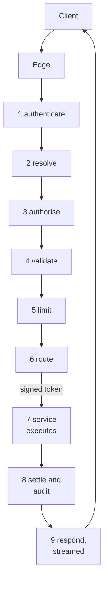
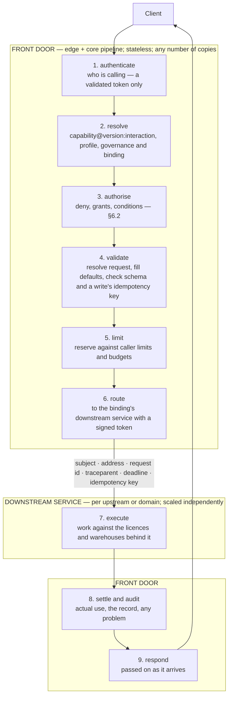

# 6.1 Front door and services

`spec/gateway/front-door.md` · proposed

The Atlas Gateway as a front door of edges over one pipeline that decides every call and routes it to downstream services by a signed token; control and data planes; state and events; how services register and stay movable; resilience; deployables, compute and ingress; observability.

### In short

- Control plane always the gateway; data plane wherever bytes travel best (streamed, handed off, exported).
- One pipeline behind every edge; an edge per transport class; nothing buffered.
- Services register like aggregated API servers: profiles checked, own domain only, conformance passed.
- Movable by construction: serialisable ports, no state in a process, a signed token, safe-to-repeat writes.
- Resilience: retries only when replayable, breakers per service, a shared throttle per upstream, load shedding.
- Nothing outside the gateway is changed inside a call: controllers converge it from the state the call wrote.

### Picture

### How it works

`svc/yieldbook` is moved to its own service host because its vendor calls are slow: its conformance batteries pass through the service protocol on loopback, configuration names the host, the host registers its profiles, and the front door routes to it by the same bindings. No client and no profile changes.

### Seams

| Seam | One side | Other side | Where |
|---|---|---|---|
| Front door and services | The pipeline | The service protocol | §6.1.6 below |

### Rules

1. Every call through every edge passes steps 1 to 9 of §6.1.2, in that order.
2. Only the front door decides access; only services do domain work.
3. A service that fails registration, its conformance batteries or its loopback run is not served.

- **ATLAS-GATEWAY-001.** The front door holds no state that matters in its process: killing any copy mid-request loses nothing a retry with the same idempotency key does not recover.
- **ATLAS-GATEWAY-002.** A service refuses a call whose token is unsigned, expired, or scoped to another address.
- **ATLAS-GATEWAY-003.** Every service passes its conformance batteries in process and through the service protocol.
- **ATLAS-GATEWAY-004.** Every event the gateway publishes about its own state comes from the change feed.
- **ATLAS-GATEWAY-005.** No edge buffers a chunked answer whole; gateway memory stays flat while a result larger than its memory limit streams or is exported.
- **ATLAS-GATEWAY-006.** A service that crashes makes its capabilities `unavailable` within five seconds, and nothing else.
- **ATLAS-GATEWAY-007.** A service claiming an id outside its domain is refused at registration.
- **ATLAS-GATEWAY-008.** A replica started while Cosmos DB is unreachable is ready within 45 seconds, serving the last-known-good snapshot, and says so in readiness with the snapshot's revision and age.
- **ATLAS-GATEWAY-009.** While Cosmos DB is unreachable, calls are answered as §6.1.14's table says: unbudgeted reads on per-replica limits, audited as degraded; everything else `unavailable`, naming Cosmos DB; after 60 minutes, everything but health and the bootstrap.
- **ATLAS-GATEWAY-010.** A snapshot that fails its checks is never published; the one serving keeps serving, and the failure is in readiness and the audit.
- **ATLAS-GATEWAY-011.** A switch turned off reaches every replica within 60 seconds without a deploy: its target's calls are `unavailable` with the switch's reason, and its capabilities' availability says so; turned on, or past its `until`, they serve again.
- **ATLAS-GATEWAY-012.** Every row of §6.1.16 has a fault-injection test (the dependency's fake made to fail) asserting what fails and what keeps working; a new dependency adds its row and its test before it is used.
- **ATLAS-GATEWAY-013.** A step repeated after a crash creates nothing twice in a system that accepts a key (a fake per system counting what it received).
- **ATLAS-GATEWAY-014.** A service whose admission fails serves none of its capabilities, every capability admitted before keeps serving, and the failed condition and its reason are in readiness and the audit.
- **ATLAS-OPERATION-001.** When the replica running an operation is killed, within one minute another replica resumes it, if its work can resume, or ends it `failed` with `unavailable`; no operation stays `running` without a live lease for longer.
- **ATLAS-OPERATION-002.** An operation ended by a takeover releases its idempotency key: repeating its start with the same key starts a new operation.
- **ATLAS-OPERATION-003.** Before a taken-over operation is ended, its upstream work is cancelled by its tag (a Snowflake query by `QUERY_TAG`), so nothing it started keeps running.

### Detail

### 6.1.1 Control plane and data plane

- **Control plane** (always the gateway): the catalogue of profiles, identity, the access decision, limits, audit, tickets and scoped tokens. It carries small messages.
- **Data plane** (wherever the bytes travel best): the gateway's own streamed answers, a downstream service in its own resource, or the source and storage directly, through a ticket or a transfer link. The control plane authorises the data plane and never has to carry its bytes: Tailscale's rule, that the control plane carries keys and policy and the data takes the shortest path, is the test for every new data path.

### 6.1.2 The path of a call

A handed-off call ends at step 6 with a handoff document, and an export with transfer links; settlement happens when the source reports what ran. Why the steps are in this order is §6.2.3; what each refuses with, and how each is measured, is §6.7.3.

### 6.1.3 Edges

Every transport class has its own edge: a thin adapter in front of the same core pipeline (a library), against the same state. HTTP, server-sent events and WebSockets, MCP and events are all edges; none is a separate API.

| Transport class | Edge | Scales on | Needs |
|---|---|---|---|
| Request and response (HTTP, MCP) | `edge` | Requests and latency | Nothing in the process |
| Long-lived streams (SSE, WebSockets; not in `atlas/cli`) | `stream-edge` | Open connections and memory | Authorise at open and again on change; limits on time, messages and bytes; a shared backplane so any copy serves any subscriber; resume tokens and heartbeats; draining on deploy; a ceiling per copy and a bounded buffer per reader ending in a terminal problem |
| Long-running work | `edge`, then `worker` | Queue length | Operations idempotent and kept in the store |
| Events in (`publish`) and out (change feed) | `edge`; `events-publisher` | Message rate; change-feed leases | An idempotency id per event; leases |
| Handed off and exported | `edge` (issues and settles) | Requests | The bytes are not the gateway's to carry |

Until load says otherwise, the edges run in one deployable with separate worker pools and connection limits per transport class, so streams never starve requests.

### 6.1.4 Keeping the front door thin

1. Stream, never buffer: chunks pass through as they arrive.
2. The deadline travels with the call; each hop subtracts its overhead; a cancelled caller cancels downstream.
3. Backpressure: a saturated downstream answers at once (`limit_exceeded`, or 503 with `Retry-After`).
4. No domain logic: the front door applies the protocol (envelope, problems, resolution of requests, aliases); the work is downstream.

### 6.1.5 State and events

**The rule.** The gateway's database owns the state the gateway decides with. It owns nothing the gateway only reports, and nothing that says who a person is or which people belong together. Three tests, in order, place any state:

| Test | The state | Owned by |
|---|---|---|
| **Access:** does it say who a person is, which people belong together, or who requested, approved or reviewed access? | People; group membership; app roles; access requests and reviews | **Entra ID:** users, security groups, app roles, later access packages. Atlas's policy names groups by object id (§6.2.4) and never copies their members |
| **Telemetry:** is it a record of something that already happened, kept to report, debug, analyse, bill or prove? | Traces, logs, metrics; the audit trail; usage history | **Azure Monitor** (Application Insights, Log Analytics) and **immutable Blob storage** for the audit (§6.2.8), plus each system's own trail (Snowflake's query history by `QUERY_TAG`, Entra's sign-in logs). Never the gateway's database |
| **Decision:** does the gateway read it to admit, refuse, limit, resume or replay a call, exactly, under concurrency? | Limit counters and reservations; budgets; grants, denies and limit definitions; house rules and settings; operations; idempotency keys; durable subscriptions; registered services; the resources Atlas keeps (dashboards, knowledge-base records, settings) | **Cosmos DB** |

Anything that passes none of the three (a copy of an upstream's data, content, another product's state) does not belong in the gateway's database; it stays upstream, in Blob storage, or in its own product's store.

**Cosmos DB, used for decision state:**

| Practice | Why |
|---|---|
| A call's limits are reserved together in **one transactional batch of conditional patches** (each adds `n` only if its counter stays within its limit; if one fails, none applies), and settled the same way; no read first | Every window a call draws on (the minute's rate, the day's budget, the contract period) is reserved at once or not at all, exactly across every copy of the front door (ATLAS-ACCESS-003), with no lock and no read-modify-write retries under a burst |
| Session consistency; exactness comes from conditional writes and ETags, never from strong reads | Strong reads cost twice as much and add nothing a conditional write does not already guarantee |
| The request path's containers (counters, idempotency, operations) have throughput of **their own**, apart from administration, resources and the catalogue | Nothing can starve a limit check: the earlier gateway's Production database saturated when reporting shared its throughput (2026-10-23) |
| Grants, roles, profiles and house rules are **held in memory** in every copy and cleared by the change feed | Per call, the database sees one reserve, one settle, and an idempotency record for a write; nothing a cache can answer |
| **Partition by what is read together:** a caller's counters for one capability (every window of it) in one partition, so one batch can reserve them all, since a transactional batch spans one partition only; operations by id; idempotency by principal and key; time-to-live on everything that expires | No cross-partition query on the request path; no sweeper; the partition stays small (a handful of counters per period) |

**Events.** **The change feed is the outbox.** A publisher reads it and publishes CloudEvents to Service Bus (`nautilus.dashboard.updated`, `atlas.operation.succeeded`, `atlas.grant.changed`, the catalogue's change). Gateway events come only from its state, so the store and the events never disagree. `watch` reads the same feed. The publisher scales by leases. Events never pass through the front door: it brokers them (§2.5); the gateway's own events are published from its state, as above.

**Every store is behind a port** (`Store`, `Limits`, `Operations`, `AuditSink`, `AuditReader`, §6.5); the data and its schema are Atlas's, in its own subscription, and moving engine is a new adapter and a migration.

### 6.1.6 Services and how they register

A **downstream service** serves the capabilities of one upstream or domain. It runs in the gateway's process or in a **service host** of its own (§6.5); the front door cannot tell the difference.

**Registration** (as Kubernetes registers an aggregated API server): a service declares its domain, its version, where it is served (in process, or a service host's address and trust material), its health, and its profiles. The gateway admits it only when:

1. its profiles pass the lint and the compatibility check against what is already served (§3.3, §3.3.12);
2. it claims only its own domain's ids: no service may serve another's;
3. it passes its family conformance batteries (in its own CI, and for a service host before it is placed in an environment).

Admission is atomic: all of a service's capabilities are admitted, or none, and the reason is reported in the gateway's readiness and its audit. It is the catalogue controller's work (§6.1.13): a service's declaration is desired state; the controller checks it, with the conditions `accepted` (its domain), `compatible` (lint and classification) and `conformant` (its batteries), and publishes it in the next snapshot only when all three are true. A service's **availability condition** (healthy, unhealthy, unreachable) sets its capabilities' availability (§3.1, §3.1.1).

**The service protocol** (between the front door and a service host; in process, the same calls are Go calls on the ports):

| Call | Purpose |
|---|---|
| `describe` | The service's declaration and every profile; called at registration and when the service says it changed |
| `health` | Liveness, readiness, and availability per capability (a suspended warehouse) |
| `invoke` | A single answer, with the signed token and the request |
| `start`, `get`, `cancel` | An operation |
| `stream` | A chunked answer or a subscription, with resumption |
| `plan` | A handoff document, or an export's links |
| `settle` | A handed-off or exported call's actual use, from the source's record |

A service never authenticates a person: it verifies the front door's signed token (signature, audience, address, expiry) and acts. It holds its own credentials to its upstream, never another service's. The front door and service hosts speak protocol versions N and N-1, so they deploy independently.

### 6.1.7 Staying movable

Every downstream service, and every edge, MUST be able to run in a resource of its own at any time without a code change:

1. Talk only through ports (§6.5).
2. Everything crossing a port is serialisable (typed records, Arrow, bytes); no live objects, callbacks or shared handles. A deadline crosses as an absolute time; identity crosses as a signed token; credentials never cross: each runtime fetches its own with its own identity.
3. No state that matters lives in a process; caches are an optimisation.
4. Access is decided once, at the front door; a service checks the token and never decides access itself.
5. Every write is safe to repeat (idempotency keys, ETags); no transaction spans a boundary. The key travels downstream: a service passes the call's idempotency key, or its operation's name, to every system that accepts one (a Snowflake `QUERY_TAG` checked before a statement is run again; a Service Bus `MessageId` with duplicate detection; a vendor's request id; a blob written only if absent), so a repeated step does nothing twice there.
6. Every runtime has its own health, settings, secrets and identity.

**Movable is tested:** every service's conformance batteries run twice, in process and through the service protocol on loopback. A service that passes both can be moved by configuration.

### 6.1.8 Resilience

| Concern | Rule |
|---|---|
| Retries | Only `retryable` problems, only replayable requests, with backoff, jitter and `Retry-After`, within a retry budget, at one hop only (§4.1) |
| Circuit breakers | Per service and per upstream: open after five consecutive failures in 30 seconds, probe every 15 seconds; while open, the capabilities are `unavailable` |
| Upstream throttle | One concurrency and rate limit per upstream, shared across every copy of its service |
| Load shedding | A queue no deeper than twice the concurrency limit; beyond it, 503 with `Retry-After` |
| Isolation | Each service host with its own memory and CPU limits; restarted with backoff; re-registered on restart |
| Readiness | The front door is ready when a snapshot is loaded, live or last-known-good (§6.1.14); a service when `describe` succeeds |
| Version skew | Service protocol N and N-1; clients below the protocol's minimum get 426 |
| Rollout | One revision at a time with traffic splitting; profiles and conformance checked before a service reaches an environment; make-before-break: the new revision ready before the old drains (§6.7, §6.7.15) |
| Kill switches | A capability, a domain, a service or a gateway behaviour turned off without a deploy (§6.1.15) |
| Blast radius | Written down per dependency and tested (§6.1.16); a dependency whose failure stops every call is a defect, listed in §8.4 with its fix |

### 6.1.9 Deployables, compute and ingress

A **deployable** is a composition root in the workspace (§6.5) with its own image and pipeline, and no logic of its own.

| Deployable | Runs | Scales on |
|---|---|---|
| `gateway` | Every edge, the core pipeline, every service in process (today's shape) | Requests |
| `service-host` | The service protocol's server and chosen services | That upstream's load, licence or isolation |
| `stream-edge` | The streaming edges and the core pipeline | Connections |
| `worker` | Operations, jobs and the controllers (§6.1.13) | Queue length |
| `events-publisher` | The change feed to Service Bus | Writes to state |

All share the store and the catalogue, so together they are one gateway. The direction for compute is **Azure Container Apps** (revisions, traffic splitting, managed identity, scale rules per deployable, internal ingress for service hosts), from today's App Service. Ingress is **Azure Front Door or Application Gateway** (TLS, web application firewall, DDoS protection). **Azure API Management is not in the request path:** the front door already decides access, limits and quotas, and a second policy layer doubles the places a limit can be wrong; API Management may import the published OpenAPI for its developer portal.

### 6.1.10 When to split

The gateway is a modular monolith today, which is right for one team. A part moves to its own deployable when it has a different scaling profile (long-lived connections), a different owner (Nautilus's services), a different runtime, a need for isolation (actions on Astronomer or Azure), or heavy compute (jobs).

### 6.1.11 Upstreams

Each upstream's capacity (licences, warehouses, rate limits) is managed with its owner behind its service, invisible to callers, under the shared throttle and breaker above.

### 6.1.12 Observability

Every hop propagates W3C `traceparent` and adds a span carrying the address, the delivery, the fingerprint and the decision; tickets and transfer links carry the trace id, so direct fetches appear in the same trace. Logs are structured, with the trace id and a hash of the caller, never a token.

Operational telemetry (traces, logs, metrics) is written through the OpenTelemetry API and `log/slog`, never a port of Atlas's own; they are already vendor-neutral. The deployables configure the exporter: OTLP to a collector, which forwards to Application Insights. It may be sampled. The audit is not telemetry of this kind: it is complete, one record per call, through its own port (§6.2.8). Objectives: catalogue availability 99.9%; control-plane latency at the 99th percentile under 300 ms excluding the service's own time; a catalogue change reaching long-lived clients within 60 seconds.

### 6.1.13 Controllers

The rule (§6.6, principle 02): no call changes anything outside the gateway while the caller waits. The call writes the desired state to Cosmos DB and answers; a controller converges the outside world to it and reports what it observed, in status for a resource (§9.3, §9.3.4) or in the operation for work. A failure halfway is a state, retried by the controller, never an inconsistency left behind. Every controller follows the contract of §6.7, §6.7.6, runs in the worker deployable (today in the gateway's process, §6.1.9), and has one leader across replicas.

| Controller | Desired state (Cosmos DB) | Converges | Woken by | Resync |
|---|---|---|---|---|
| `catalogue` | Registered services and their profiles; governance; house rules; switches | The snapshot: each service admitted whole or not at all (§6.1.6), the snapshot checked, published and saved as last-known-good | The change feed; a service reporting it changed | 1 minute |
| `event-entities` | `event.topic`, `event.queue` and `event.subscription` records; registered event types | Service Bus topics, queues, subscriptions and their filters | The change feed | 10 minutes |
| `event-rights` | The grants and denies reaching each event entity's `publish` and `subscribe`; each subscription's owner | The Service Bus data roles the gateway assigned: missing ones added, any no grant backs removed | `atlas.grant.changed`; a subscription created or deleted | 5 minutes (group membership changes in Entra have no event) |
| `operations` | Each operation `pending` or `running` | Its work, on one replica under a lease (§6.7, §6.7.7) | An operation started; a lease lapsing | 30 seconds |
| `settlement` | Each handed-off or exported call's reservation | Settled from the source's own record of what ran (§6.2.6) | A handover issued | 5 minutes |
| `publications` | Each `nautilus.dashboard`, its visibility and published revision | Its public copy in the static website's storage | The change feed | 10 minutes |

A call that needs the outcome waits for it, boundedly. `subscribe` writes the desired subscription and waits up to 10 seconds for its `ready` condition, then answers the connect handover; if it is not ready by then, it answers `unavailable` with `retry_after`, and the repeat finds the same durable subscription by its name. A `create` of a converged resource answers at once with the record, `ready` false until it converges.

Operations survive their replica. A running operation's lease is renewed every 10 seconds and lapses after 30. The `operations` controller takes over an operation whose lease has lapsed: if its service declares the work resumable (a Snowflake query found again by its tag), it resumes from its last checkpoint, at most three times; otherwise it cancels the upstream work by its tag and ends the operation `failed` with `unavailable`, releasing its idempotency key so the caller's repeat starts afresh.

### 6.1.14 The snapshot, last-known-good, and Cosmos DB down

The request path reads one immutable snapshot (profiles, governance, house rules, switches, admitted services), built and checked by the `catalogue` controller (§6.7, §6.7.10). Each published snapshot is also written to Blob storage (container `atlas-snapshots`, readable and writable by the gateway's identity only) as last-known-good, with its revision and SHA-256.

Starting. A replica waits up to 30 seconds for the live snapshot; if Cosmos DB does not answer, it loads last-known-good, checks its hash, and becomes ready, reporting the source and the snapshot's age in readiness. It keeps trying Cosmos DB and switches to the live snapshot when it can.

While Cosmos DB is unreachable (degraded mode), calls are answered by what they need:

| Call | Answered |
|---|---|
| Built-ins answered from the snapshot (`atlas whoami`, `catalog`, `search`, `describe`, `guide`, `access`, `clients`, `setup`) | Served |
| A `read` interaction with no budget, not `Metered`, and below no confirmation threshold | Served, its rate and concurrency limits kept per replica (each limit divided by the replicas the snapshot last counted, rounded up); its audit record marked `degraded: ["limits_local"]`; not settled |
| A `read` with a budget, `Metered`, or subject to confirmation | `unavailable`, `detail` naming Cosmos DB; an exact limit cannot be reserved |
| Any write, action, operation start or poll, resource read, `subscribe` or `publish`, `atlas.usage` | `unavailable`: the state it needs is in Cosmos DB |

Degraded mode lasts at most 60 minutes from the last moment the snapshot was known current; after that every call but health and the bootstrap is `unavailable`, so a grant revoked during the outage is never honoured for long. The switch `degraded_mode` (§6.1.15) turns degraded serving off, so every call fails closed at once.

### 6.1.15 Kill switches

An administrator turns things off without a deploy, through `atlas.switch` (confidential, `Gateway.Admin`, §9.3, §9.3.2): one resource per switch, with the envelope, naming its `target`, its `state` (`on`, `off`), a `reason`, and an optional `until` after which it turns back on by itself. Switches travel in the snapshot, so one reaches every replica within 60 seconds, and each change is audited.

| Target | Turned off |
|---|---|
| A capability (`creditrisk.realised`), one interaction (`…:fetch`), a domain (`creditflow.*`) or a service (`service/yieldbook`) | Its calls are `unavailable` with the switch's reason; its availability is `unavailable`, with the reason in `describe`'s `availability.detail` |
| `execution.handoff`, `execution.export` | That execution is withdrawn from `describe`'s eligibility, so clients take the next (§9.7) |
| `edge.mcp` | The MCP edge refuses new sessions |
| `degraded_mode` | §6.1.14's degraded serving is off |
| `controller.<name>` | That controller pauses; resync resumes it when turned on |

Anything new that can be turned off ships with its switch: a new execution, edge, controller or service is `off` in Production until it has passed in Acceptance.

### 6.1.16 Blast radius

What fails when each dependency is down for an hour. A row is added, with its test (ATLAS-GATEWAY-012), before a new dependency is used.

| Dependency | What fails | What keeps working | Who notices | Mitigation |
|---|---|---|---|---|
| Entra ID | New sign-ins and refreshes; On-Behalf-Of, so systems reached as the person; group overage lookups after their 10-minute cache | Calls with tokens already held (verified with cached keys) to systems reached as the gateway or a workload | Everyone, as their tokens expire | None: the firm's identity |
| Cosmos DB | Writes, budgeted and metered calls, operations, resources, events' handovers | Built-ins and unbudgeted reads for 60 minutes (§6.1.14) | Writers; vendor and warehouse-heavy callers | `degraded_mode` |
| Blob storage, the audit's WORM container | Every call: none may go unaudited (ATLAS-ACCESS-004) | Health | Everyone | A defect: a second audit container in another storage account (Q62) |
| Blob storage, other containers | Transfers and exports; last-known-good not refreshed | Everything else | Uploaders, exporters | None needed |
| Log Analytics | `atlas.audit` and usage history; ingestion resumes from the blobs | Every call | Administrators | None needed |
| Application Insights or the collector | Telemetry past the collector's buffer | Every call | Operators | None needed |
| Service Bus | Events: connections, and the controllers converging entities and roles; the gateway's own events wait in the change feed | Everything not an event; clients poll each event's history capability (§2.5) | Event users | `controller.event-entities`, `controller.event-rights` |
| Key Vault | New replicas start (no secrets); cursor key rotation | Running replicas, with secrets read at start | Nobody, unless scaling or restarting | Alert on it |
| Snowflake | Every Snowflake-backed capability, including handoffs | Everything else | Data users | The domain's switch; breaker |
| Each vendor API | That vendor's capabilities | Everything else | Its users | Its service's switch; breaker |
| Astronomer, Azure management | Their actions and platform capabilities | Everything else | Developers, operators | Their switches |
| Microsoft Graph | `sharepoint.*`, `atlas.directory`, group overage | Everything else | Their users | Their switches |
| `tars-kb` | `kb.*` | Everything else | Knowledge-base users | Its switch |
| Ingress, Container Apps | Everything | — | Everyone | None: the platform |

### Decisions

**Decided (2026-10-30):** last-known-good and the fail modes while Cosmos DB is down (D51); kill switches and the written blast radius (D52).

**Decided (2026-10-30):** controllers converge everything the gateway changes outside itself, and operations are leased (D50).

**Decided (2026-10-30):** the three owners of state, and how Cosmos DB is used for the state the gateway decides with (D45).

**Decided (2026-10-28):**
- The gateway is a front door over services, in process by default and in service hosts when a split criterion is met (the aggregated-API model with every service already behind the out-of-process protocol's shape), not one out-of-process provider per capability from the start.
- Registration follows Kubernetes' aggregated APIs; long-running work and errors follow Azure's conventions (§4.1).
- No service mesh, sidecar framework or overlay network; API Management only for its portal; Container Apps as the direction for compute (§8).

**Open:**
- The service protocol's transport. Recommended: HTTP/2 with Arrow and JSON (one toolchain); gRPC would add a second schema language beside profiles.
- The signed token between front door and services. Recommended: Entra between services (managed identities), with Atlas's scope (address, subject, deadline) as a signed claim.
- Whether jobs and operations run in the gateway's process today; if so, they move first, behind a queue, into `worker`.
- When to move from App Service to Container Apps (an infrastructure change, in `fi-infra`).

### Go deeper

- §6.5 Packages
- §6.2 Access
