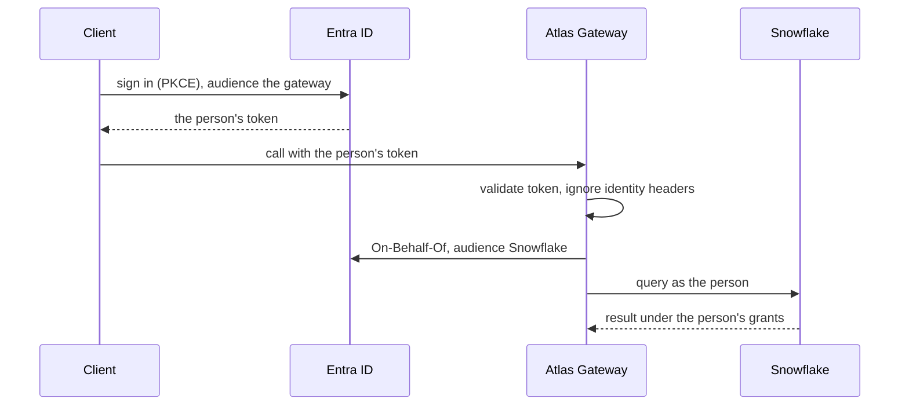
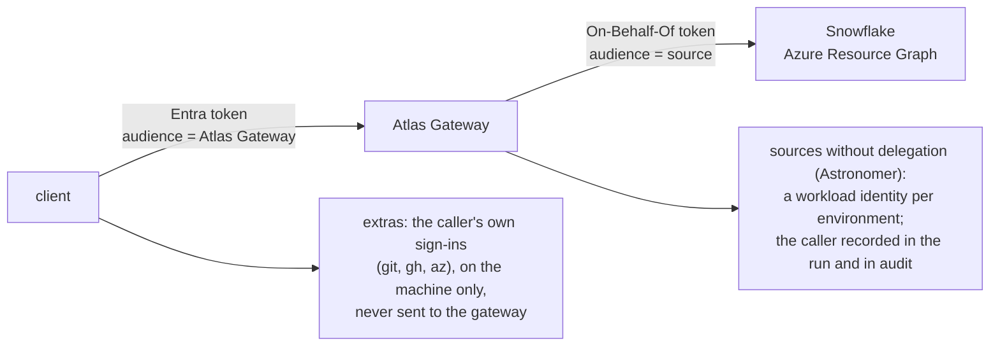

# 6.2 Access, limits and audit

Source: `IMG_2139.MOV` 00:00:00–00:00:46.

`spec/gateway/access.md` · proposed

Who is calling and how each hop proves it; how a call is decided (deny, grants, conditions, then validation, then limits); limits and budgets reserved before work and settled after; the enforcement points; the audit record; and the attacks these must defeat.

### In short

- Identity only from validated tokens: an Entra token for the Atlas Gateway from every client; On-Behalf-Of to sources that accept it; a workload identity per environment where they do not; credentials on the caller's machine never leave it.
- Decided in order: authenticate, resolve, deny, grant, conditions, validate, limits: nobody learns a request's errors without a grant, and an invalid request spends no limit.
- Family grants and `everyone` reach only `read`; some interactions are named-grant only; a deny always wins.
- Limits reserve before and settle after, exact across every copy; one audit record per call.

### Picture

### How it works

A notebook's call carries the person's Entra token for the Atlas Gateway; an `x-atlas-on-behalf-of` header is ignored and recorded. The gateway exchanges the token for a Snowflake one, so Snowflake's own grants for that person are the final limit; the audit record names both hops. A pipeline on Astronomer makes the same call with its workload's token, and the record names the workload.

### Seams

| Seam | One side | Other side | Where |
|---|---|---|---|
| Client and gateway | The client: the person's or workload's token | The gateway: every decision | §6.2.2 below |
| Atlas and the source | Atlas's decision first | The source's own grants last | §6.2.5 below |
| Extras and Atlas | The caller's own sign-ins, on their machine | Nothing: the gateway never receives them | §5 |

### Rules

1. Identity comes from validated tokens only, at every hop.
2. Access is decided at the gateway's front door, by the order in §6.2.3; downstream services only verify.
3. A grant revoked while a stream or subscription is open ends it with a problem.
4. Every refusal names what is missing and what to do next; a refusal of a listed capability names `atlas.access`.
5. Atlas never relaxes a source's own limits.

- **ATLAS-ACCESS-001.** A deny on a capability or interaction refuses it whatever grants the caller holds.
- **ATLAS-ACCESS-002.** A family grant never reaches an interaction whose effect class is not `read`, nor a named-grant-only interaction.
- **ATLAS-ACCESS-003.** Limits hold exactly when many copies of the front door serve the same caller at once; a burst of twenty parallel calls starts at most what the budget allows.
- **ATLAS-ACCESS-004.** Every call, refused or not, leaves exactly one audit record, durable before the call's answer ends, in the immutable store, and readable in Log Analytics within minutes.
- **ATLAS-ACCESS-005.** The same call with the same token gives identical decisions, problems and results through every client and every edge.
- **ATLAS-ACCESS-006.** No credential from the caller's machine, other than its token for the gateway, appears in any traffic from a client to the gateway (a conformance test capturing a client's traffic while its extras run).
- **ATLAS-ACCESS-007.** An identity header on a request changes nothing and is recorded.
- **ATLAS-ACCESS-008.** No token appears in any log, trace or audit record (a test searching every sink for token prefixes).
- **ATLAS-ACCESS-009.** An invalid request from a caller who holds no grant for its interaction is refused with `not_granted` (or `denied`), never `invalid_request` or `resolution_failed`.
- **ATLAS-ACCESS-010.** An invalid request from a caller who holds the grant is refused with `invalid_request` (or `resolution_failed`), reserves no limit, and leaves nothing to settle.

### Detail

### 6.2.1 Identities

| Kind | Who | How they sign in |
|---|---|---|
| Person | A member of the firm | Entra ID, through a client's browser sign-in (PKCE) or device code, shared by every client on the machine; in a Nautilus page, the application's own Entra sign-in |
| Agent for a person | An agent acting in a person's session | The person's sign-in; an agent never holds more than its person |
| Workload | A service, pipeline or Astronomer deployment | An Entra service principal or managed identity |

Entra app roles are coarse (`Gateway.User`, `Gateway.Admin`); everything finer is Atlas's.

### 6.2.2 How each hop proves who is calling

1. **The caller to Entra.** Every client is a *public client*: it signs the person in through the system browser with PKCE and a loopback redirect (RFC 8252), or a device code, and asks for a token whose **audience is the Atlas Gateway**. Tokens are kept in the shared token store (§9.7.3), so one sign-in serves every client. A workload (a pipeline, a service) gets its own token from its managed identity or service principal and passes it to the client.
2. **Client to the Atlas Gateway.** Every call carries that token. The gateway validates issuer, audience, signature and expiry and builds the caller from the token's claims alone. **No identity header is trusted:** a header naming another identity is ignored and recorded.
3. **The gateway to a system.** How the gateway reaches each system, and as whom (itself, a workload or the person), now and in the target, is the register in §6.3. As the person, it exchanges the caller's token for one whose audience is the system (**On-Behalf-Of**), so the system's own grants apply to the person. As itself, it records the person in the audit trail and, where the system keeps one, in its own record (a DAG run's `conf`). A claims challenge from Entra (conditional access) is returned to the client as `401` with `WWW-Authenticate`, so the person can sign in again.
4. **The caller's own credentials stay on their machine.** A client's extras use the caller's own sign-ins there (git's credential store, `gh`, `az`). A client never sends them, in any form, to the gateway.

### 6.2.3 The decision, in order

For every call, the gateway's front door evaluates in this order (as Azure RBAC does), and refuses at the first step that fails:

1. **Authenticate:** the identity, from a validated token only.
2. **Resolve:** the address `id@vN:interaction`, its profile and its governance.
3. **Deny:** a deny on the capability, the interaction or its family refuses it, whatever else the caller holds.
4. **Grant:** a role, the caller's own grant, or `everyone`, reaching this interaction (rules below).
5. **Conditions:** the action's environment policy (refused in Production unless a person runs it); approval required and not yet given; later, conditions on the resource the request names (§6.2.5).
6. **Validate:** the request is resolved to the current profile (§9.5) and its defaults filled, then checked against its schema and the profile's invariants; for a write, its idempotency key is checked (§6.7, §6.7.8).
7. **Limits:** rate, concurrency, output caps and budgets (§6.2.6), reserved before the work starts.

**Why this order** (each position follows from what the step needs, as Kubernetes orders authorisation before admission): a step that needs the caller follows authentication; one that needs the profile follows resolution; validation follows authorisation, so a caller without a grant learns nothing about a request's shape; defaults are filled before validation, so the validator sees the final request; limits follow validation, so an invalid request never spends one; and the idempotency check comes before limits, so a replay spends nothing twice.

### 6.2.4 Grants

- **Roles** are named sets of grants with limits. A role's members are **Entra security groups**, named by object id; Atlas never stores who is in a group, and adding a person to a role is adding them to its group in Entra. A grant to one person (`user:<oid>`) or one workload is the named exception (§6.1.5).
- A **grant** names a capability (every interaction), one interaction (`nautilus.dashboard:delete`), or a domain or family by namespace (`portfolio.*`).
- A deny always wins over a grant.
- Family grants and the `everyone` role reach only interactions whose effect class is `read`. Anything else is granted by exact address.
- Some interactions are **named-grant only** (free-form SQL, holding a durable subscription, tickets): never reached by a family grant or a role, only by a grant naming them.
- A caller is told how they hold each capability and who set each limit, and nothing about anyone else.
- What a caller cannot use is hidden from everything they see while working; only `atlas.access` shows what they lack, why, and how to get it (§2.6).

### 6.2.5 Conditions on the resource (later)

Some decisions depend on what the request names: a Snowflake query's database, a repository, a path. A capability may declare how its request names a resource (`resource_scope`), and policy may then hold conditions on it. Until it does, and even after, **the source's own controls are the final authority** (Snowflake grants, GitHub token permissions, Azure RBAC): Atlas's checks come first and are set at or below them, so a refusal by the source is rare and, when it happens, is recorded as a policy mismatch. A policy language with principal, action and resource and a deny that overrides (Cedar) is the chosen direction when conditions are needed; until then, the access engine of today decides.

### 6.2.6 Limits and budgets

| Limit | Holds | Refusal |
|---|---|---|
| **Rate** | Calls per period per caller and interaction (a token bucket) | `limit_exceeded` (429) with `Retry-After` |
| **Concurrency** | Calls in flight per caller, interaction and upstream | `limit_exceeded` (429), or `503` with `Retry-After` when a service sheds load |
| **Output** | Rows and bytes per answer | The answer is truncated and says so (`output_limit_exceeded`) |
| **Budget** | A metered quantity (Snowflake credits, a vendor's billed calls) per caller, pool or the firm, per period | `budget_exceeded` (403) |
| **Confirmation** | A threshold on one call's estimated cost, per caller and metered capability, set like any limit | `confirmation_required` (428) with the estimate, until the person confirms it (`Atlas-Confirm`) |

Limits are allowances (per caller), pools (shared, firm-wide) and ceilings (hard maxima), inherited down from the firm to a domain to a capability to an interaction, and an override may only tighten. A call **reserves** its upper bound before it starts, acts, then **settles** its actual use (for Snowflake, from the warehouse's own record), so a burst of parallel calls cannot each pass, and limits hold exactly across every copy of the front door. Streams and subscriptions count connection time, messages and bytes. Every answer reports what is left (`Atlas-Limit-Remaining`).

`atlas.usage` answers in two halves: **what is left** is read from the limit counters (live and exact), and **what has been used over time** from the audit's settled records (minutes behind, for reporting).

### 6.2.7 Enforcement points

| Point | Enforces | Cannot be bypassed because |
|---|---|---|
| The Atlas Gateway's front door | Every decision above, for every call | Every capability is served only behind it, and every call needs a token for the gateway |
| Downstream services | The signed token's signature, audience, address and deadline | A service decides nothing itself and serves nothing without the token (§6.1) |
| Tickets and transfer links | Signature, caller, operation, expiry, caps embedded in the ticket | Without a valid ticket the source or storage serves nothing |
| The source | Its own grants and limits | They exist regardless of Atlas, and are never relaxed by it |

A client's extras are outside these points: they reach nothing of Atlas's except through the client's ordinary calls, and what they do on the machine is bounded by the caller's own sign-ins there.

### 6.2.8 Audit

Every call, allowed or refused, leaves one record (the `audit_record` of §9.3.2). It holds: the address, the caller, the client and edge, each hop; the decision and its reason; the writer and expected fingerprints, the governance revision; the limits it reserved and settled; the execution, rows, bytes and duration; the source's own record of the work (query id, warehouse time, bytes scanned, cost, whether the source's result cache answered), copied in at settlement; the data version the answer was computed from; the outcome and, for actions, the receipt.

The request itself is recorded as a hash of its canonical form unless its capability's profile says otherwise; results are never recorded. It is the call's attestation (what ran, for whom, under which contract and which rules) and what usage and caching are measured from.

**Where it lives** (§6.1.5: telemetry is never in the gateway's database):

1. **Kept first:** each record is appended, as one JSON line, to an append blob in an **immutable (WORM) container**: one blob per copy of the gateway per hour. Records finishing together share one append (group commit), so a call waits only for that append, and a record once acknowledged survives a crash. That container is the permanent record.
2. **Then shipped:** the same batches go to a **Log Analytics table** through the Logs Ingestion API, retried, resuming from the blobs after an outage. `atlas.audit` and the history half of `atlas.usage` read from there, de-duplicated by `request_id`. An outage of Log Analytics never slows or fails a call.

Its access and retention are its own, apart from operational logs.

### 6.2.9 Attacks these must defeat

| Attack | Defeated by |
|---|---|
| A forged identity header on a call | Identity comes only from validated tokens |
| A replayed ticket or transfer link | Bound to caller, operation and expiry; uploads single-use |
| A query aimed at a database the caller should not read | The source's own grants; later, conditions on the resource |
| A process calling a service behind the front door directly | Services serve nothing without the front door's signed token |
| A web page on another origin calling the gateway | Only the Nautilus applications' origins; tokens never in a cookie; no wildcard CORS |
| A burst of parallel calls to exhaust a budget | Reservation before start; concurrency limits |
| A credential from the caller's machine leaking to the gateway | Extras never send one; a conformance test captures a client's traffic and finds none |

### Decisions

**Decided (2026-10-28):**
- Delegation is an Entra token for the Atlas Gateway, then On-Behalf-Of to sources that accept it; identity headers are never trusted; credentials on the caller's machine never leave it.
- The evaluation order follows Azure RBAC's: deny, then grants, then conditions, then limits.
- Today's access engine stays; Cedar is the chosen direction once conditions on resources are needed. A policy engine in the request path is not added now.

**Open:**
- On-Behalf-Of to Snowflake exists (`atlas_snowflake/obo.py`, verified against the tenant on 2026-09-08); its only scope is `SESSION:ROLE-ANY`, so the person's own roles apply. Whether the gateway executes as the person by default (rather than its service identity) is open. Recommended: as the person, for data capabilities.
- Whether recording the person in an Astronomer run's `conf` is enough attribution, or a plugin must verify it.
- Grants per interaction (today grants name capabilities). Recommended: yes; a grant on a capability keeps meaning every interaction.
- Who reviews a loosened limit or approval policy, and whether `irreversible` actions need two people. Recommended: the domain's owner; two people for `irreversible` in Production.

### Go deeper

- §2.6 Discovery
