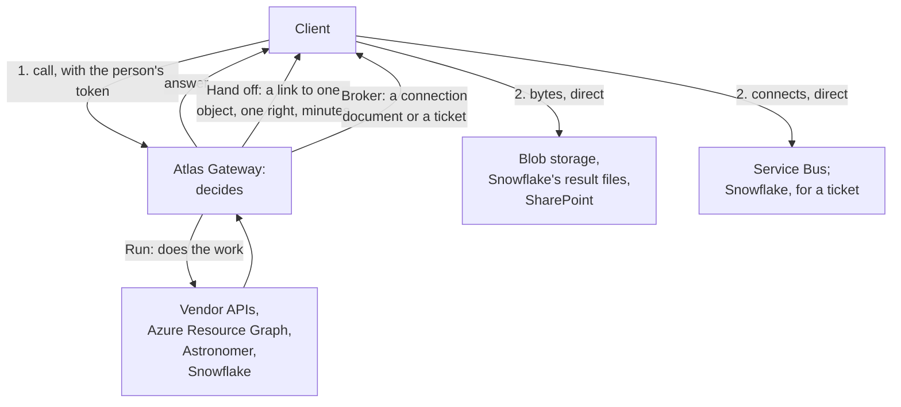

# 6.3 Reaching systems

Source: `IMG_2139.MOV` 00:00:46–00:01:28.

`spec/gateway/systems.md` · proposed

How the Atlas Gateway reaches every system behind it: in one of three patterns (it runs the work, it hands the bytes off, or it brokers a connection the client makes), as one of three identities (its own, a workload's, or the person's), for each system now and in the target; the one rule every credential that leaves the gateway obeys; and the one exchange that lets the gateway act as the person.

### In short

- **Three patterns.** The gateway **runs** the work and returns the answer; or it does the work or the handshake and **hands off** the bytes, which go direct; or it **brokers**: it authorises and plans, and hands the client what it needs to connect to the system itself.
- **Three identities.** The gateway reaches a system as **itself** (its managed identity, or a credential it holds), as a **workload**, or as **the person**: On-Behalf-Of (OBO) in the gateway, or the client's own token from the same sign-in.
- **Every system has a pattern and an identity now, and a target.** The target is “as the person” wherever the system accepts it.
- **One rule for every credential that leaves the gateway:** it may let its holder do nothing they could not do through the gateway at that moment. Where a system does not yet meet it, the exception is listed here, with what closes it.
- **OBO is built once** and reused for every system that accepts Entra tokens: one exchange, one scope per system, one admin consent per system.

### Picture

### How it works

A researcher uploads a 40 GB Parquet file and queries it.

1. The Python SDK calls `dataset.upload@v1:create`. The gateway decides, and answers with a **handover**: an upload link to one blob in the staging container, create and write only, valid for 15 minutes, signed with the gateway's Entra identity (a user delegation SAS), so no storage key exists anywhere.
2. The SDK uploads the file directly to storage in 100 MB blocks, eight at a time, and resumes after a dropped connection. The gateway never sees a byte (**hand off**).
3. The SDK calls `:commit`. The gateway checks the size and checksums and asks Snowflake to load the file from storage (**run**). The answer is an operation.
4. When it succeeds, `fetch` on the new data returns a handoff of Snowflake's result files.

### Seams

| Seam | One side | Other side | Where |
|---|---|---|---|
| The gateway and a system | The gateway: the decision, the identity, the handshake | The system: its own permissions, the last word | The register below |
| The gateway and the client | The gateway: a handover, never a broader credential | The client: moving the bytes, or connecting | §6.3.4 |
| The gateway and Entra | The gateway: one OBO exchange | Entra: tokens, consent, conditional access | §6.3.5 |

### Rules

1. **The credential rule.** A credential that leaves the gateway lets its holder do nothing they could not do through the gateway at that moment. It is narrowed by identity (the person's own wherever possible, never the gateway's), scope (one object or entity), right (only the granted interaction), time (minutes, never longer than its operation) and revocation (a stated bound).
2. **Tokens the gateway obtains by OBO never leave it.** The gateway uses them; a client that needs a token for a system gets its own, from its own sign-in.
3. **A system reached as the gateway's own identity** cannot narrow by person, so the gateway's grant is the only limit: its capabilities are granted by name only, never by a family grant or `everyone`, and the scope of the gateway's identity there is recorded beside the system.
4. **Every system is in the register,** with its pattern and identity now and its target. Changing either is a decision in §8; an exception to rule 1 is listed with what closes it.

- **ATLAS-REACH-001.** Every credential a handover carries is within rule 1, or is a listed exception.
- **ATLAS-REACH-002.** Every kind of credential that leaves the gateway has an escalation test: used on another object, for another right, after it expires, after a revoke (once the stated bound has passed) and by another person, it fails every time.
- **ATLAS-REACH-003.** No token obtained by OBO appears in any answer, log or trace.
- **ATLAS-REACH-004.** A listed exception blocks release beyond Development until it is closed.

### Detail

### 6.3.1 The patterns

| Pattern | The gateway | The bytes | The profile says | Used when |
|---|---|---|---|---|
| **Run** | Does the work, with the system's credential, and answers | Through the gateway | `execution: gateway` | The credential must stay (vendor keys); every call is metered or reshaped; the answer is small or streamed |
| **Hand off** | Decides, does any work, then issues a link to one object | Direct, between the client and storage | `execution: handoff`; a `transfer` delivery | Results or files of any size, where a link can be narrowed to one object |
| **Broker** | Decides, sets up and plans, and hands over what the client needs to connect | Direct, between the client and the system | `execution: client` (a ticket); an `amqp` binding (events) | The system can check the client itself, per message, as the person |

### 6.3.2 The identities

| Identity | What it is | Narrowed by person? |
|---|---|---|
| **The gateway** | Its managed identity, or a credential it holds (a vendor key, an Astronomer API token) | No: Atlas's grant is the only limit (rule 3) |
| **A workload** | A pipeline's or service's own managed identity, when it is the caller | Not a person: the workload's own roles |
| **The person** | OBO in the gateway (§6.3.5), or the client's own token for the system from the same sign-in | Yes: the system's own permissions for that person apply, after Atlas's |

### 6.3.3 The register

| System | Pattern now | As whom now | Target | Credential to the client now | Within rule 1 now? |
|---|---|---|---|---|---|
| **Snowflake** | Run (streamed); hand off (result files); broker (a ticket: the planned SQL, its writer schema and a credential) | The gateway's service identity | Every connection as the person, by OBO | Hand off: links to one result's files. Ticket: **the gateway's own token, with every role of its identity** (`SESSION:ROLE-ANY`) | Hand off: yes. **Ticket: no, a listed exception** |
| **Azure Resource Graph** | Run | The gateway's managed identity, with Reader where it is assigned | Run, as the person, by OBO, so each caller sees exactly what their own Azure roles allow | None | Yes (rule 3 applies) |
| **Astronomer** | Run | The gateway, with an Astronomer API token per environment | As the person, if Astronomer accepts delegated identity | None | Yes (rule 3 applies) |
| **Service Bus** | Broker: the gateway creates entities and assigns roles as its managed identity; the client connects itself | The person: the client's own Entra token for Service Bus | The same | None: a connection document with no secret | Yes |
| **Blob storage** (Atlas's files) | Hand off: the gateway only does the handshake | The gateway signs a user delegation SAS with its Entra identity | The same | A link to one blob, one right, minutes | Yes |
| **SharePoint** (proposed) | Hand off: Microsoft Graph's download link or upload session | The person, by OBO to Graph | The same | A link or session for one file | Yes |
| **Vendor APIs** (Bloomberg, Yield Book, Intex, Citi, DataQuery, S&P, CreditFlow) | Run | The gateway, with the firm's vendor credential | The same: vendors know no person | None | Yes (rule 3 applies) |

**The one exception.** A Snowflake ticket carries the gateway's own token, so its holder can do anything the gateway's identity can in Snowflake (92 roles in Development). It closes in two steps: the ticket carries **the person's own token**, by OBO (built: `atlas_snowflake/obo.py`), so the person's own Snowflake roles are the limit; then a **read-only scope** on Snowflake's app (`SESSION:ROLE:<read role>`) narrows it to reading, which meets rule 1 in full.

### 6.3.4 The handover

Every hand-off and broker answer is one document, the **handover**: what the client needs, and nothing broader.

| Member | Holds |
|---|---|
| `kind` | `download`, `upload`, `connect` or `ticket` |
| `protocol` | How the client moves the bytes or connects: `azure-blob`, `http-range`, `graph-upload-session`, `amqp`, `snowflake` |
| `target` | The one object, entity or account |
| `auth` | `sas-url` or `preauthenticated-url` (the link is the credential), `entra-scope` (the client gets its own token for that scope), or `token` (a ticket's credential, carried) |
| `rights`, `expires` | The rights it carries, and when it stops working |
| `chunking` | Block size, parallelism, checksum, for files |
| `renew`, `commit` | The address that renews it, and the one that finishes the work |
| `planned` | For a ticket: the statement, its writer schema and its query tag |

On the wire it is one of the documents of §9.3: a transfer (`download`, `upload`), a handoff (a data result's chunks), a connect (an event entity), or a ticket (deferred).

### 6.3.5 Acting as the person: one exchange

The gateway exchanges the caller's token for one whose audience is the system (OBO). It is built once, as one identity port, and each system adds only its scope and one admin consent:

| System | Scope |
|---|---|
| Azure Resource Manager, Resource Graph | `https://management.azure.com/user_impersonation` |
| Storage | `https://storage.azure.com/user_impersonation` |
| Service Bus | `https://servicebus.azure.net/user_impersonation` |
| Microsoft Graph (SharePoint) | Graph's delegated permissions (`Files.ReadWrite.All`, or narrower) |
| Snowflake | `api://<Snowflake's app>/SESSION:ROLE-ANY` (a read-only scope to request) |

| Once | Per system | Per person |
|---|---|---|
| The gateway's app can make the exchange (a certificate or a federated managed identity); the exchange's code | Its delegated permission on the gateway's app (or the clients' app, for a client's own token) and a tenant admin's consent | Nothing |

It gives identity, not rights: the system's own permissions for the person still decide. Where Entra asks the person to sign in again (conditional access), the exchange fails with a challenge, which the gateway returns to the client. An exchanged token lasts about an hour, so long operations refresh it, or run as a workload with the person recorded.

### 6.3.6 What it takes outside code

| Needed | Where | Who |
|---|---|---|
| Service Bus: Data Receiver and Data Sender per entity; the gateway's identity as Role Based Access Control Administrator on the namespace, limited to those two roles; SAS keys off | `fi-infra` Terraform, applied by its pipeline | The resource group's owners (the pipelines) |
| Blob: a storage account with shared keys off and a staging container that deletes stale files; the gateway's identity as Storage Blob Data Contributor and Storage Blob Delegator | `fi-infra` Terraform | The same |
| Resource Graph: Reader for the gateway's identity where callers may look | Role assignments at those scopes | Each scope's owners |
| The delegated permissions and consents in §6.3.5 | Entra | **One admin request**, for every system together (O42) |
| A read-only scope on Snowflake's app | Snowflake's Entra integration | Its owners |

### Decisions

**Decided (2026-10-29):** the register above, now and target (D33); the credential rule and its exception register (D34); one OBO exchange in the gateway, its tokens never leaving it (D35).

**Open:**
- The Snowflake ticket's credential. Recommended: the person's own token by OBO now; a read-only scope next (O54).
- Whether Astronomer accepts a delegated identity. Recommended: ask Astronomer; until then, run as the gateway (O55).
- One admin request for every consent in §6.3.5. Recommended: one request, sent once (O42).

### Go deeper

- §6.2 Access, limits and audit: who is calling, and the decision
- §2.2.1 Snowflake data, §2.5 Events
- §8 Design decisions
