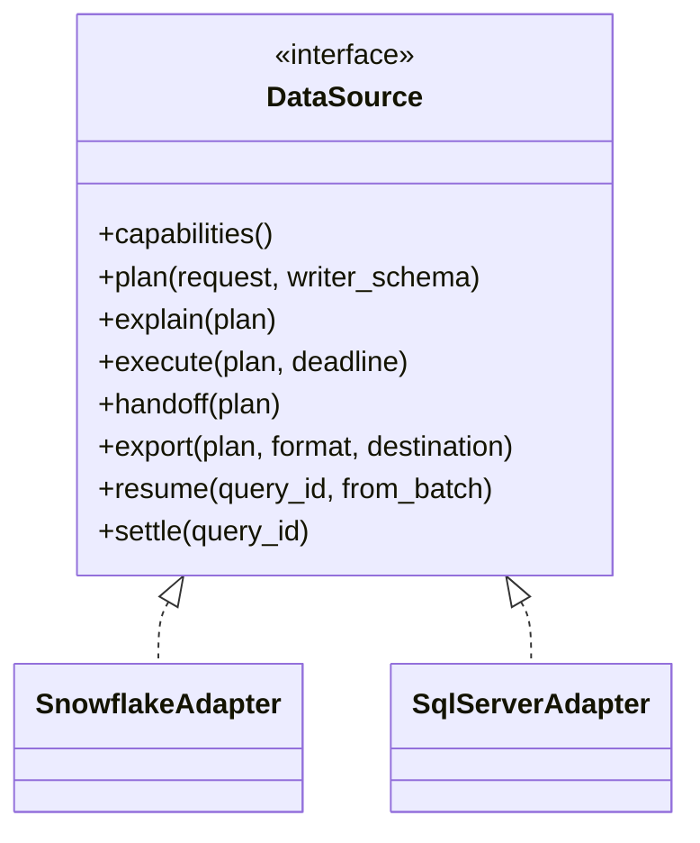

# 6.4 Data sources

`spec/gateway/data-sources.md` · proposed

> Engines behind the data surface sit behind one DataSource port (plan, explain, execute as Arrow in the writer schema, handoff, export, resume, settle), one adapter per engine, the Go SQL library for every dialect and for the read-only guard, ADBC where it serves, so an engine can be replaced without any client noticing.

## In short

- One port: `plan` the writer contract as one statement; `explain` its size; `execute` as Arrow batches already in the writer schema; `handoff`, `export`, `resume`, `settle` where the engine supports them.
- Snowflake's adapter today; SQL Server or Postgres would be new adapters, with no handoff.
- Every plan is built as one typed SQL tree by **the Go SQL library**, rendered in the engine's dialect (Snowflake; DuckDB for the hermetic fake), and passed by its read-only guard; a read-only role sits underneath.
- Nothing about an engine leaves its adapter but its own provider domain (`snowflake.query`) and a handoff's format.
- The proof: a capability's fingerprint is identical under every adapter that serves it.

## Picture

## How it works

Were Harbour to move to SQL Server, `adapter/sqlserver` would implement the port (the Go SQL library's T-SQL dialect, its type mapping, Parquet written by the gateway for export, no handoff). Every Harbour capability's battery runs against it; its fingerprints match Snowflake's; clients notice only the engine's speed.

## Seams

| Seam | One side | Other side | Where |
|---|---|---|---|
| Service and engine | The service: the capability | The adapter: the engine | The port |

## Rules

1. Services reach engines only through the `DataSource` port.
2. An adapter's `execute` yields batches in the writer schema; a batch that is not is a fault of the adapter.

- **ATLAS-SOURCE-001.** A data capability's conformance battery passes against every adapter it can be served by, and its profile's fingerprint is identical under each: a different fingerprint means an engine leaked into the contract.

## Detail

### 6.4.1 The `DataSource` port

A port in `ports` (§6.5), a Go interface, implemented once per engine:

| Operation | Does |
|---|---|
| `capabilities()` | What the engine supports: native Arrow results, handoff (and its chunk format version), export, estimates, client execution and its driver kind |
| `plan(request, writer_schema)` | Renders the request as the writer contract: one statement, every column aliased to its contract name and cast to its contract type, filters and limits pushed down; checks it with the read-only guard |
| `explain(plan)` | The plan as it would run (the statement) and its estimated size, for choosing the execution |
| `execute(plan, deadline)` | A stream of Arrow record batches **already in the writer schema**, with the engine's query id |
| `handoff(plan)` | Where supported: the handoff document for the result |
| `export(plan, format, destination)` | Writes the result as files and returns their links |
| `resume(query_id, from_batch)` | Where supported: the rest of a stream, from the engine's persisted result |
| `settle(query_id)` | Rows, bytes and cost, from the engine's own record |

### 6.4.2 Adapters

| Engine | Adapter | Handoff | Export | Arrow natively | Status |
|---|---|---|---|---|---|
| Snowflake | `adapter/snowflake` (on `gosnowflake`) | Yes (result chunks) | `COPY INTO` Parquet | Yes | Today |
| SQL Server, Postgres, others | `adapter/sqlserver`, `adapter/postgres`, ... | No | The gateway writes Parquet | Through ADBC where a driver exists; otherwise converted once per batch | If needed |

### 6.4.3 Tools

- **The Go SQL library** (Atlas's own replacement for sqlglot, written in Go; its module path is recorded in `plan/stack.md`) builds each plan as one typed syntax tree and renders it in the engine's dialect, so moving engine is a new dialect and type mapping, not rewritten queries. Snowflake is the engine's dialect; DuckDB is rendered for the hermetic `DataSource` fake, so every Snowflake capability's SQL runs in tests without Snowflake.
- **The read-only guard.** Every statement is parsed by the library's Snowflake parser before it runs, and refused unless it is one read-only query over the objects its capability may read (`snowflake.query`: the registered schemas). The guard is never the only line: the connection's role can only read. The guard's cases are language-neutral vectors (accepted and refused statements), generated in `tools/spec/`.
- **ADBC** (Apache Arrow Database Connectivity) returns results as Arrow from many engines through one API, with Go drivers. It is used where its driver serves as well as the engine's native one; for Snowflake, `gosnowflake` is the native driver, and the spike compares them (§2.2.1).

### 6.4.4 What an engine may not reach

Nothing about an engine leaves its adapter, except: the provider domain for that engine's own free-form SQL (`snowflake.query`, `snowflake.schema`), and a handoff's chunk format, named and versioned in the handoff document so a client knows which decoder it needs. Profiles, fingerprints, subject capability ids, the protocol and every client are engine-neutral.

## Decisions

**Decided (2026-10-28):** one `DataSource` port; engine details only in adapters; ADBC where it serves. Moving engine is a gateway change that no client sees, apart from the speed of the engine.

**Decided (2026-10-30):** the Go SQL library builds and renders every plan and guards every statement, with a read-only role underneath; sqlglot is no longer used (D28).

**Open:**

- ADBC for Snowflake, against the native connector. Recommended: decide by the spike.

## Go deeper

- §2.2.1 Snowflake data
