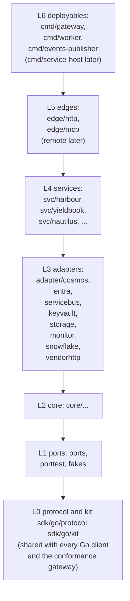
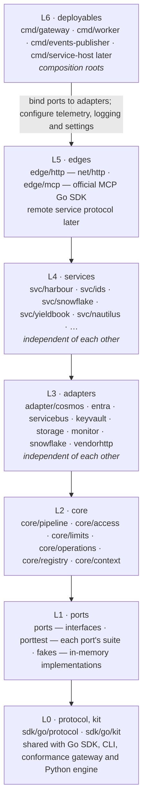

# 6.5 Packages

`spec/gateway/packages.md` · proposed

> The gateway as one Go module in six layers, so each piece of logic is written once behind an interface, imported wherever needed, implemented by whichever technology a deployment chooses, and moved or replaced without touching anything else; the protocol written once, in sdk/go, for the gateway and the Go clients alike.

## In short

- The gateway is one Go module, `gateway/`, in six layers:
  - L0 the protocol, `sdk/go/protocol` (shared with the clients);
  - L1 ports and their test kit;
  - L2 core;
  - L3 adapters by external system;
  - L4 services;
  - L5 edges;
  - L6 deployables that wire them.
- Dependencies point inwards and down; adapters and services never import each other.
- A new package only for a new external system, a new deployable, or something an outside user needs alone.
- Each package's layer is declared in one file, and a test fails the build on any import that breaks the layers.

## Picture

## How it works

Replacing the access engine with Cedar is a new adapter package that passes the `PolicyEngine` suite in `porttest`, and one line in `cmd/gateway`'s wiring; nothing else changes.

## Seams

| Seam | One side | Other side | Where |
|---|---|---|---|
| Ports and adapters | Interfaces in `ports` | Technologies in `adapter/...` | 6.5.7 below |
| The gateway and the clients | The gateway module | `sdk/go/protocol`, the one protocol implementation in Go | 6.5.6 below |

## Rules

1. A package depends only on lower layers; adapters never import each other; services never import each other or `core`.
2. Only deployables import adapters.
3. A new package meets 6.5.5.

- **ATLAS-PACKAGES-001.** The layer check passes for every package of the gateway module.
- **ATLAS-PACKAGES-002.** Every implementation of a port passes that port's suite in `porttest`.
- **ATLAS-PACKAGES-003.** The gateway, the conformance gateway, the Go SDK, the CLI and the Python SDK's engine use `sdk/go/protocol` for every protocol rule; nothing in Go implements one a second time.
- **ATLAS-PACKAGES-004.** `go mod tidy` changes nothing in any module (what is declared is exactly what is imported).
- **ATLAS-PACKAGES-005.** Each deployable's image holds its one binary, the CA certificates and nothing else.
- **ATLAS-PACKAGES-006.** Every module a deployable registers implements its namespace's interface, checked at start and in CI; two modules with one id fail at start.
- **ATLAS-PACKAGES-007.** A module failing `Provision` or `Validate` cleans up every module of its generation already provisioned, and the generation serving before keeps serving (or, at start, the deployable never becomes ready).
- **ATLAS-PACKAGES-008.** No package of the gateway registers anything from an `init` function (a vet check).
- **ATLAS-PACKAGES-009.** A service's `StateHandle` refuses every key outside its own domain, and no service imports another domain's service or reaches its containers.

## Detail

### 6.5.1 The principles applied

| Principle | Source | What it means here |
|---|---|---|
| Dependencies point inwards | Hexagonal architecture (ports and adapters) | Interfaces in the middle, drivers outside; nothing inside imports the Cosmos SDK, `net/http` handlers or the Snowflake driver |
| No cycles | Acyclic Dependencies Principle (Martin) | Go refuses import cycles; the layer check refuses an import that points up |
| Depend towards stability | Stable Dependencies Principle | A package depends only on packages that change less often than it does |
| Stable means abstract | Stable Abstractions Principle | The most depended-on packages hold types and interfaces, not changing logic |
| Group what changes together | Common Closure Principle | Adapters are grouped by external system: an SDK upgrade changes everything using that SDK at once |
| Don't make users take what they don't use | Common Reuse Principle | A package splits only when someone needs part of it without the rest; never “one package per concern” |
| Wire in one place | Composition root | Only deployables choose which implementation backs which interface, explicitly in code: no service locator or injection framework |
| Libraries use APIs; applications choose implementations | OpenTelemetry's and `log/slog`'s guidance | Packages use the OpenTelemetry API and `log/slog`; only deployables configure exporters and handlers |
| One version of everything | Go modules (minimal version selection) | One `go.mod` per module, a `go.work` at the repository root joining `sdk/go`, `gateway` and `clients/cli` for development |
| No grab-bags | — | No `common` or `util` package: each package has one stated purpose |

### 6.5.2 The layers

A package may depend only on packages in lower layers. Packages marked independent never import each other.

### 6.5.3 The packages

| Package | Layer | Solves | May depend on |
|---|---:|---|---|
| `sdk/go/protocol` | L0 | The Go implementation of §9 the Atlas Protocol: its documents (types generated from §9.3's JSON Schemas), grammars, validation in the Atlas Schema profile, canonical JSON and fingerprints, resolution and lenses, headers, framing, problems; change classification and the readiness check for the gate | The standard library; Apache Arrow for Go |
| `sdk/go/kit/...` | L0 | The mechanics every Atlas server and client shares, so they behave the same: problems, serving (lifecycle, server, health, middleware, telemetry), retries and breakers, operations, idempotency, paging, hot snapshots, caches, bounded concurrency, limit arithmetic, token verification, resource stores, reconciling controllers. Adapted from the pattern library in `patterns/`: no Atlas decision (no access, no catalogue, no capability) | `sdk/go/protocol`; the standard library |
| `ports` | L1 | Every port, as a Go interface: the service ports (`Adapter`, `Publisher`, `Operator`, `CredentialProvider`, `StateHandle`) and the infrastructure ports (`Store`, `PolicyEngine`, `Limits`, `Operations`, `EventBus`, `TicketIssuer`, `TransferLinks`, `AuditSink`, `AuditReader`, `Secrets`, `IdentityVerifier`, `OnBehalfOf`, `ServiceRegistry`, `DataSource` (§6.4)) | `sdk/go/protocol` |
| `porttest` | L1 | One suite per port, an exported function any implementation's test calls (`porttest.Store(t, newStore)`); the family batteries | `ports`, `testing` |
| `fakes` | L1 | The in-memory implementations that pass the suites, among them a `DataSource` that runs the planned SQL on DuckDB and a token issuer with its own keys | `ports` |
| `core/...` | L2 | The application: the pipeline, the access engine, limit and budget logic, resilience (breaker, bulkhead, rate limit, deadline, retry budget), operations, the registry of modules (6.5.12) and the catalogue, the controllers (§6.1 6.1.13), switches, managed context and house rules | Ports, protocol, the OpenTelemetry API |
| `adapter/cosmos` | L3 | Every port backed by Cosmos DB: the store, limit counters, operations and idempotency keys, the registry, the change feed as outbox | Ports, `azcosmos` |
| `adapter/entra` | L3 | Token validation, group lookup, the On-Behalf-Of exchange, the signed token between front door and services | Ports, MSAL for Go, a JWT library |
| `adapter/servicebus` | L3 | Entities, role assignments and connect handovers for events; publishing the gateway's own events | Ports, `azservicebus`, `armservicebus`, `armauthorization` |
| `adapter/keyvault` | L3 | Secrets | Ports, `azsecrets` |
| `adapter/monitor` | L3 | `AuditSink` and `AuditReader` (§6.2.8): audit records appended to immutable Blob storage by group commit, shipped to Log Analytics through the Logs Ingestion API, read back with the Logs Query API | Ports, `azblob`, `azure-sdk-for-go/sdk/monitor/ingestion/azlogs`, `.../monitor/query/azlogs` |
| `adapter/storage` | L3 | Transfer links (user delegation SAS), export files, later immutable audit | Ports, `azblob` |
| `adapter/snowflake` | L3 | The Snowflake `DataSource` (§6.4): planning through the Go SQL library, the read-only guard, Arrow batches in the writer schema, handoff documents, exports, settlement | Ports, `gosnowflake`, the Go SQL library |
| `adapter/vendorhttp` | L3 | The one HTTP client for vendors: retry, OAuth2, a shared throttle per vendor, redaction | Ports, `net/http` |
| `svc/...` | L4 | Each upstream's or domain's capabilities, with their profiles embedded in the binary (`embed`) | Ports, protocol, the L3 adapters they need, through ports only |
| `edge/http` | L5 | The HTTP binding of §9.6: the bootstrap, every interaction, streamed answers, problems, CORS | Core, ports, protocol, `net/http` |
| `edge/mcp` | L5 | The MCP edge's fixed tools (§4.2) | Core, ports, protocol, the official MCP Go SDK |
| Deployables (`cmd/gateway`, `cmd/worker`, `cmd/events-publisher`) | L6 | Composition roots: choose adapters, register modules, mount edges, configure telemetry, logging and settings | Anything below |
| `cmd/atlas-new` | L6 | The generator (§6.7 6.7.18): a developer tool, with no image and no pipeline | Its templates; `sdk/go/protocol` |

Where the earlier code's ideas go (it is read, never ported line by line; `legacy/README.md` maps it): `atlas_core/store/cosmos.py` → `adapter/cosmos`; `atlas_core/identity` → `adapter/entra`; `atlas_core/problem.py`, `transport/`, the fingerprint and resolution → `sdk/go/protocol`; `atlas_core/store/memory.py` → `fakes`; `atlas_core/access`, `admission`, `metering`, `jobs`, `managed`, `pipeline`, `registry` → `core/...`; each `svc_*` package → `svc/...`, its SQL rebuilt on the Go SQL library.

### 6.5.4 What is not a package

| Not a package | Where it lives | Why |
|---|---|---|
| One interface package per concern | `ports` | Interfaces with no drivers cost nothing to group; splitting decouples nothing |
| One implementation package per port (`cosmosstore`, `cosmoslimits`, ...) | `adapter/cosmos` | They share the Cosmos SDK, so they change together |
| A Go copy of the protocol inside the gateway | `sdk/go/protocol` | One implementation, shared (6.5.6) |
| An adapter for operational telemetry | Deployables configure the OpenTelemetry SDK | Packages use only the API; the audit is not this, and has its port and `adapter/monitor` |
| Resilience | `core/...` | No driver, one user; it becomes a package only if a client needs it alone |

### 6.5.5 When something becomes a package

A new package is created only for:

1. **a new external system** (an adapter, in L3);
2. **a new deployable** (L6);
3. **something an outside user needs without the rest of its package:** a client, or a deployable that should not carry the rest (`sdk/go/kit` is one: the conformance gateway and the client need it without the gateway).

Anything else is a file in an existing package.

### 6.5.6 The shared protocol module

The protocol is written once **in Go**, in `sdk/go/protocol` (§5.4), its own module. The gateway, the conformance gateway, the Go SDK and the CLI import it, and the Python SDK reaches it through the engine it ships (§5.1). TypeScript keeps its own implementation, because it runs in a browser.

It is an **implementation, not the reference**: the protocol is defined by §9's text, schemas and vectors, and `sdk/go/protocol` passes §9.8's vectors like any other implementation. Its document types are generated from §9.3's JSON Schemas, never written by hand.

Written once means a mistake is made once and reaches everything that uses it. Three checks stay independent of the Go code (§9):

1. the vectors, generated from the spec by `tools/spec/` (Python, with its own small reference implementations);
2. the TypeScript implementation, compared with Go case by case;
3. a client written from §9 alone (AP-003).

### 6.5.7 Ports and conformance

Every port is a Go interface in `ports`, taking a `context.Context` where it does I/O, with only serialisable arguments (§6.1 6.1.7). Every port has a suite in `porttest`, and every implementation, the fakes included, runs it in its own tests: an implementation is accepted when it passes. Replacing a technology (Postgres for Cosmos, Cedar for today's access engine, Event Hubs for audit) is a new adapter package that passes the suite, and one line in a deployable.

### 6.5.8 Composition roots

Each deployable's `main` builds its object graph:

1. it reads its settings (from the environment, with defaults);
2. it constructs the Azure credential (managed identity in Azure, the developer's sign-in locally);
3. it creates each adapter;
4. it registers each module (services, data sources, encodings, audit sinks, controllers) explicitly, in one list, so the registered set is visible in one place, never from an `init` function (6.5.12);
5. it passes them to the core and mounts its edges.

The `local` root wires the fakes and the emulators instead of Azure. A service's profiles are files in its package, embedded in the binary, so a binary serves exactly the profiles it was built with.

### 6.5.9 Enforcement

1. **Declared layers.** `gateway/layers.toml` gives each package path its layer and the independent groups.
2. **The layer check.** A test (`go test ./tools/layercheck`) reads every package's imports with `go list` and fails on any import that points up a layer, crosses an independent group, or reaches an adapter from anything but a deployable. Go's `internal/` directories keep what a package does not export out of reach.
3. **Declared equals imported.** `go mod tidy` is run in the gates and must change nothing.
4. **One version of everything.** Every module agrees on its dependencies through minimal version selection.
5. **Vetted.** `go vet`, `staticcheck` and `gofmt` in every module.
6. **Third-party code.** Code adapted from another project keeps its licence header and is listed in the module's `THIRD_PARTY_NOTICES` (third-party code).

### 6.5.10 Every language

Two implementations of §9, each with its document types generated from the same JSON Schemas, each passing the same vectors and scenarios (§9.8):

| Implementation | Language | Used by |
|---|---|---|
| `sdk/go/protocol` and the Go client | Go | The gateway, the conformance gateway, the Go SDK, the CLI, `qfi`; the Python SDK through its engine |
| `@atlas/protocol` (in `clients/node`) | TypeScript | The Node SDK; Nautilus's pages (it runs in a browser) |

### 6.5.11 Order of work

The module is built bottom-up, one layer at a time, each layer's suites passing before the next begins:

1. L0 `sdk/go/protocol`, passing every vector in `spec/protocol/references/vectors/`.
2. L1 `ports`, `porttest` and `fakes`, with an in-memory fake for every port, each asserted by its port's suite.
3. L2 `core`: the pipeline, against the fakes only.
4. L3 the adapters, each passing its port's suite against an emulator or a recorded exchange.
5. L4 the services, each passing its family's battery in process.
6. L5 the edges; L6 the deployables and the layer check.

### 6.5.12 Modules and their lifecycle

What a deployable is built from is a set of **modules in named namespaces**, as Caddy builds a server from modules and Kubernetes from registered admission plugins and storage. New behaviour arrives as a new module in an existing namespace, never as a condition added to the core.

| Namespace | Interface | Modules today |
|---|---|---|
| `service` | The service ports (`Adapter`, `Publisher`, `Operator`) | `service.harbour`, `service.yieldbook`, `service.nautilus`, ... |
| `datasource` | `DataSource` (§6.4) | `datasource.snowflake`, `datasource.duckdb` (tests) |
| `encoding` | Writing an answer in one encoding | `encoding.json`, `encoding.ndjson`, `encoding.arrow`, `encoding.csv`, `encoding.parquet` |
| `auditsink` | `AuditSink` | `auditsink.monitor`, `auditsink.memory` (tests) |
| `controller` | A `kit/reconcile` controller (§6.1 6.1.13) | `controller.catalogue`, `controller.event-entities`, ... |

Each module is constructed with no side effects, then **provisioned** (its connections, credentials and goroutines), **validated** (fast checks of its configuration and declarations), used, and **cleaned up** in reverse order. A configuration's modules are loaded as one **generation**: all provisioned and validated, then activated together; if one fails, the ones already provisioned are cleaned up and the previous generation keeps serving. A service's admission (6.1.6) is this lifecycle, with the profile checks as its validation. `core/registry` holds the namespaces and the generations; §6.7 6.7.17 gives its mechanics.

### 6.5.13 State by domain

A domain owns its state as it owns its capabilities (§2.1). A service reaches state only through the `StateHandle` it is given, scoped to its domain (its partition key prefix and its containers); it reaches another domain's data only through that domain's capabilities or events, and refers to another domain's things by name, never by a join. The core's own state (limit counters, idempotency records, operations, grants, the catalogue) is the core's alone; no service reads it. Moving a domain to a store of its own is then an adapter change.

## Decisions

**Decided (2026-10-30):** modules in namespaces with one lifecycle, loaded by generation; state owned by domain (D48).

**Decided (2026-10-28):** the layers and rules above; adapters grouped by external system; ports in one package; fakes with their suites; telemetry through the OpenTelemetry API.

**Decided (2026-10-30):** the gateway is written in Go, in these six layers, sharing `sdk/go/protocol` with every Go client (D19, D20).

**Open:**

- When `cmd/service-host` and the service protocol are built. Recommended: when a split criterion of §6.1.10 is met (O21, O22).

## Go deeper

- §6.1 Front door and services
- §6.4 Data sources
