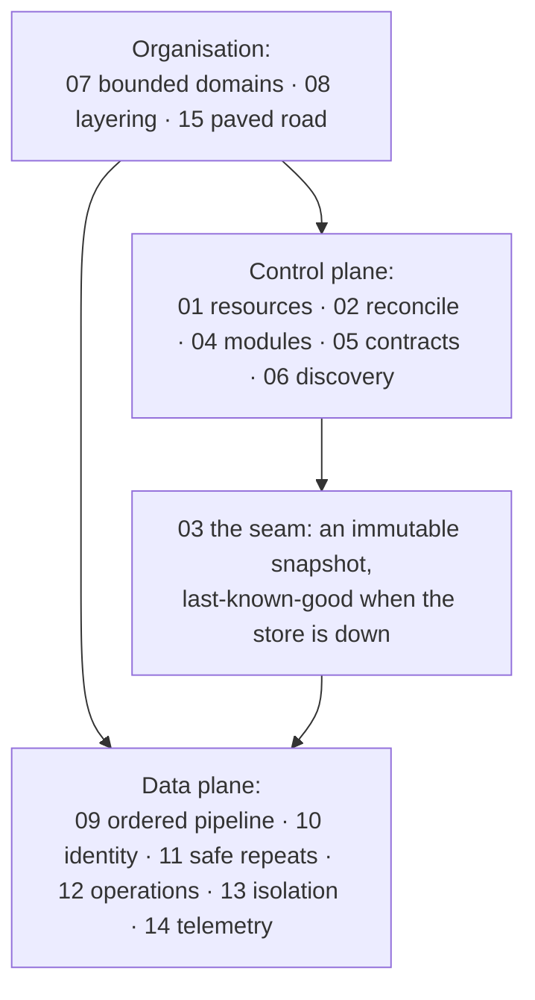

# 6.6 Principles

`spec/gateway/principles.md` · proposed

> The fifteen architectural principles every part of the Atlas Gateway and every service behind it obeys, taken from the systems that add their two-hundredth service at the cost of the second (Kubernetes, Azure Resource Manager, Envoy, Caddy, Dapr, Terraform): for each, the rule Atlas holds, where it is applied and tested, and where Atlas differs on purpose; the constitution; and the review every service and stable profile passes.

## In short

- Fifteen principles bind the gateway, every service in it, and anything another team adds later. Each one is stated here as Atlas's rule, and applied in its home section, which holds its requirements and tests.
- Control plane: resources, reconciliation, the registry of modules, contracts first, discovery.
- Data plane: one ordered pipeline, identity and policy, safe repeats, explicit operations, failure isolation, telemetry as a contract.
- Organisation: bounded domains, inward layering, one paved road.
- Atlas differs from its sources on purpose in six places (6.6.2); §9 wins wherever anything crosses the wire.
- A service, and a profile reaching `stable`, passes the review of 6.6.3 first.

## Picture

## How it works

A team adds `creditflow.deals@v1`. It runs the generator for pattern P05 (15), which writes the service, its profile and its test cases; the profile is written and linted before the code (05). The service is a module in the `service` namespace (04), claiming only the `creditflow` domain (07), in the layers of §6.5 (08). The admission controller converges it into the next catalogue snapshot as one generation, or not at all, and reports why (02); the snapshot is checked, swapped in with one atomic load, and saved as last-known-good (03). An agent finds it in the working view (06). Each call passes the nine steps of the pipeline (09): the caller is refused for lack of a grant before learning anything about the request (10); a write is repeatable by its key (11); a long call is an operation leased by one replica (12). When the vendor fails, its breaker opens and only `creditflow.*` is unavailable; an administrator can suspend it without a deploy (13). Every call leaves one audit record, written by the pipeline (14).

## Seams

| Seam | One side | Other side | Where |
|---|---|---|---|
| Principle and its home | This page: the rule and the review question | The home section: the requirements and the tests | 6.6.1 |
| Principle and mechanism | This page | The implementation patterns: how each is built, with its values | §6.7 |

## Rules

1. Every package of the gateway and every service obeys the principles as 6.6.1 states them. Where the pattern library and a principle differ, the principle wins; where a principle and §9 differ, §9 wins.
2. A change that would break a principle is first a decision in §8, with its reason.
3. Each principle's requirements live in its home section, never here.

- **ATLAS-PRINCIPLES-001.** Every service, before it is admitted beyond `local`, and every profile, before it becomes `stable`, has the review of 6.6.3 recorded with each question answered yes, or answered no with the decision in §8 that allows it (checked by review).
- **ATLAS-PRINCIPLES-002.** Every principle in 6.6.1 names at least one requirement that a test checks (checked by `make requirements`).

## Detail

### 6.6.1 The principles in Atlas

| # | Principle | Atlas's rule | Home | Tested by |
|---|---|---|---|---|
| 01 | One resource model | Everything Atlas keeps with a name and a lifecycle is a resource: standard methods, a custom verb (`:publish`) only where none fits, one envelope (`name`, `metadata`, its desired fields, `status`), one problem shape, one page shape | §2.3, §9.3 9.3.4 | ATLAS-RESOURCE-001 to 007, AP-DOC-003 |
| 02 | Declare, then converge | What the gateway changes outside itself (Service Bus entities and roles, public copies, admitted services, running work), it changes through a controller that converges a desired state it keeps: level-triggered, idempotent, one key at a time, retried with backoff, resynced; never inline in a call | §6.1 6.1.13, §6.7 6.7.6 | ATLAS-RECONCILE-001 to 006, ATLAS-EVENT-005, 006 |
| 03 | Control plane apart from data plane | Profiles, governance, house rules, switches and admitted services form one immutable snapshot, checked before it is published, read with one atomic load per call, and saved as last-known-good; the request path never reads them from the store; the bytes of the largest results never pass through the gateway | §6.1 6.1.1, 6.1.14 | ATLAS-GATEWAY-005, 008 to 010 |
| 04 | Extension points, not forks | New behaviour is a module in a named namespace (`service`, `datasource`, `encoding`, `auditsink`, `controller`), built, provisioned, validated, used and cleaned up, loaded as one generation; never a condition added to the core | §6.5 6.5.12 | ATLAS-PACKAGES-006 to 008 |
| 05 | Contracts first, compatibility as rules | The profile is written before the code; every change is classified by §3.3's rules; `preview`, `stable`, `deprecated`, `retired`, announced in-band; a previous gateway release reads what the new one stored | §3.3 | ATLAS-VERSION-001 to 010 |
| 06 | Discovery and self-description | Four levels: the working view, `atlas.describe`, `atlas.guide`, `explain`; all derived from profiles; whatever is served is discoverable, and nothing a client needs is hard-coded | §2.6 | ATLAS-DISCOVERY-001 to 010 |
| 07 | Bounded domains | A domain owns its capabilities and its state; a service reaches only its own domain's state, and another domain's only through its capabilities or events; references cross by name, never by a join | §2.1, §6.5 6.5.13 | ATLAS-GATEWAY-007, ATLAS-PACKAGES-009 |
| 08 | Inward layering | Six layers; dependencies point inward and down; adapters and services never import each other | §6.5 | ATLAS-PACKAGES-001 |
| 09 | Cross-cutting concerns as one ordered chain | Every concern that applies to every call is one middleware of the edge or one step of the pipeline, at a written position with its reason; defaults before validation; no handler re-implements one; each step is named and timed, and the step that refuses is recorded | §6.1 6.1.2, §6.7 6.7.2, 6.7.3 | ATLAS-ACCESS-009, 010, ATLAS-MECH-001 to 004 |
| 10 | Identity and policy as platform services | Authenticate once; services trust the front door's signed token, never the caller's; deny first; authorise before validating; every decision audited; no credential crosses a boundary it should not | §6.2, §6.3 | ATLAS-ACCESS-001 to 010, ATLAS-REACH-001 to 004 |
| 11 | Every write repeatable, every update conditional | Idempotency keys on every write, ETags on every update and delete, the key passed downstream wherever the system accepts one; the server says what is retryable | §2.3, §4.1, §6.1 6.1.7 | ATLAS-RESOURCE-001, 002, ATLAS-GATEWAY-013, ATLAS-MECH-008 |
| 12 | Asynchrony is explicit | Anything that may outlive its deadline is an operation; a running operation is leased by one replica and heartbeated, and taken over or failed when the lease lapses | §4.1, §6.1 6.1.13 | ATLAS-OPERATION-001 to 003 |
| 13 | Failure is isolated, its radius written down | A bulkhead per dependency; fail fast; shed before collapse; budgeted retries; make-before-break; kill switches without a deploy; a table of what fails when each dependency is down for an hour, each row tested | §6.1 6.1.8, 6.1.15, 6.1.16 | ATLAS-GATEWAY-006, 011, 012 |
| 14 | Observability is a contract | Request id and trace context on every hop; the audit record a versioned schema written by the pipeline, not the handler; metrics with bounded labels; health that names its checks | §6.1 6.1.12, §6.2 6.2.8, §6.7 6.7.16 | ATLAS-MECH-014, 015 |
| 15 | One paved road | One generator per pattern, one conformance suite, decisions in §8, rules agents read (`AGENTS.md`), exceptions recorded with an owner and a date | §6.7 6.7.18, §9.8, §8 | ATLAS-MECH-018, ATLAS-PRINCIPLES-001 |

### 6.6.2 Where Atlas differs on purpose

| Principle | Its sources do | Atlas does | Why |
|---|---|---|---|
| 01 | Standard HTTP verbs on resource URLs; names in the path | Every interaction is a `POST` to its binding, with the name in the body (§9.6) | Bindings, not URL templates: an interaction may be served anywhere, and every client calls one way (D4) |
| 01 | The desired state under `spec` | Desired fields at the top of the record, beside `name`, `metadata` and `status` (§9.3.4) | Field masks and profiles' resource schemas stay flat; `status` is still written only by the gateway |
| 01, 12 | States in Pascal case (`Succeeded`, `Canceled`) | Lowercase (`succeeded`, `cancelled`), and `UNKNOWN` for one a client does not know (§9.2) | Atlas's names are lowercase throughout; `UNKNOWN` is the one upper-case value, so it can never clash with a real one |
| 10 | Not found when the caller may not see it | A **listed** capability the caller lacks is `not_granted`, learnable through `atlas.access`; only a confidential one is `not_found` | An agent should learn how to get access, not that a thing does not exist (D13) |
| 11 | A key reused with a different request is 422; a stale version 409 | `idempotency_conflict` (409); `precondition_failed` (412) | RFC 9110's meaning of 412; one conflict status for keys (§9.3 9.3.3) |
| 04 | Modules register themselves at start-up (`init`) | Each deployable registers its modules in one list | What a deployable is built from is visible in one place (§6.5.8) |

### 6.6.3 The review

A service, and a profile before `stable`, is ready when every answer is yes. The answers are recorded with the work: in phase 1, in the work package's ledger notes; after it, in the pull request that admits the service.

1. Is everything it keeps with a name and a lifecycle a resource with the envelope, and is every other operation a standard method or a declared custom verb? (01)
2. Does everything it changes outside the gateway converge through a controller, reporting `status` with `observed_generation` and conditions? (02)
3. Do its capabilities keep their declared behaviour, or fail closed as 6.1.14 says, while Cosmos DB is down for an hour? (03)
4. Is it a module in a namespace, with provision, validate and cleanup, listed by its namespace? (04)
5. Was the profile written first, linted, and classified against the previous one? (05)
6. Can an agent that has never seen it find it, read its contract and guide, and `explain` a call, from the working view alone? (06)
7. Does it claim only its own domain, and reach another domain's data only through that domain's capabilities? (07)
8. Does the layer check pass, with every vendor shape converted at its adapter? (08)
9. Does it re-implement no step of the pipeline (no token parsing, no limits, no retries outside its adapter)? (09)
10. Does it act only on the front door's signed token, and is every credential it holds its own? (10)
11. Can every request be repeated by a caller that lost the answer, and does each downstream step take the key? (11)
12. Is everything that can exceed its deadline an operation, leased, cancellable and kept for its retention? (12)
13. Is its row in the blast-radius table written and tested, does only its own domain fail when its upstream does, and can it be switched off without a deploy? (13)
14. Does every hop carry the request id and trace context, with no secret, body or query string in a log? (14)
15. Was it generated from its pattern, and does it pass its conformance batteries in process and on loopback? (15)

### 6.6.4 The constitution

What every agent and person building in this repository holds in mind:

1. If it has a name and a lifecycle, it is a resource with the envelope.
2. Callers declare what they want; the gateway converges. No call means “do step three”.
3. The request path reads a snapshot, never the store; bytes take the shortest path.
4. New behaviour is a new module in a namespace, never a condition in the core.
5. The contract comes first, and every change is classified.
6. If a client has to hard-code it, the gateway has failed to describe it.
7. A domain owns its data; others reach it through its capabilities.
8. Dependencies point inward.
9. A cross-cutting concern is a step at a written position; a handler never repeats it.
10. The front door authenticates and decides; everything behind it trusts the signed token.
11. Every write can be repeated; every update is conditional.
12. Anything slower than its deadline is an operation with a name, an end and a retention.
13. A dependency's failure costs its own capabilities, never the catalogue.
14. Every hop carries the same ids; the audit record is a schema.
15. One generator, one review, one conformance suite, one register of decisions.

## Decisions

**Decided (2026-10-30):** the fifteen principles bind the gateway and its services, with the changes they brought: validation after authorisation (D17), one resource envelope (D49), controllers instead of inline changes (D50), last-known-good and fail modes (D51), kill switches and the written blast radius (D52) (D48).

## Go deeper

- §6.7 Implementation patterns: how each mechanism is built, with its values
- §6.1 Front door and services, §6.2 Access, §6.5 Packages
- The principles' sources, with their evidence at pinned commits: `patterns/cloud-gateway-patterns-go/docs/00-principles/` in the repository
