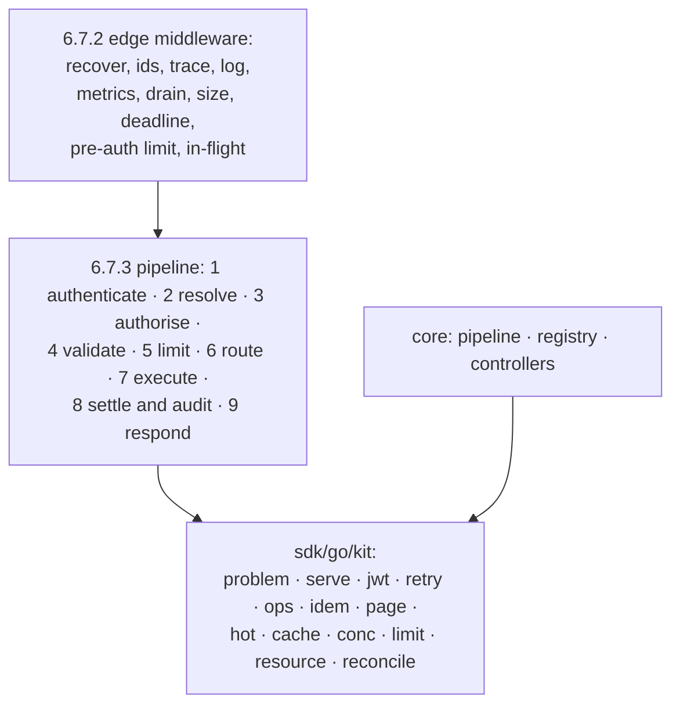

# 6.7 Implementation patterns

`spec/gateway/patterns.md` · proposed

> How the gateway's general machinery is built, as requirements with their values: the edge's middleware and the pipeline's steps in order, token verification, retries and breakers, controllers, operations, idempotency, paging, the snapshot, caches, concurrency, limits, the resource store, serving and draining, telemetry, modules, and the generator that starts every capability; each adapted from a tested pattern and written once in sdk/go/kit or the core.

## In short

- Each mechanism here is built **once**: in `sdk/go/kit` when the conformance gateway or the Go client needs it too, otherwise in the gateway's core; services and adapters use it and never write their own.
- Each starts from a tested pattern (Kubernetes, Envoy, Caddy, grpc-go, the Azure SDK, through the pattern library), adapted to §9; the values below are requirements, not defaults to tune.
- Transport concerns are the edge's middleware; access, limits and idempotency are the pipeline's steps, so every edge passes the same decision.
- Controllers converge the outside world; operations are leased; the snapshot is read with one load per call.
- Every capability starts from its pattern's generator.

## Picture

## How it works

A write reaches `edge/http`. `Recover`, `RequestID` and `Propagate` run first, so even a panic answers with a request id in the trace. `MaxBytes` refuses a 3 MiB body as `invalid_request` before any token is read. The pipeline verifies the token with `kit/jwt` (step 1), loads the snapshot once (step 2), decides access (step 3), resolves and validates the request and begins its idempotency record (step 4), reserves limits in one Cosmos batch (step 5), and routes with a signed token (step 6). The service's adapter retries a `503` from the vendor once, within the budget (step 7). The answer is settled and audited (step 8), its audit record naming every step's time. If the caller repeats the call with the same key, step 4 answers the stored result and nothing else runs.

## Seams

| Seam | One side | Other side | Where |
|---|---|---|---|
| Library and Atlas | The pattern library: the mechanism and its tests | This page: what Atlas requires of it | `plan/mechanics.md` maps each pattern to its package and work package |
| `kit` and the gateway | `sdk/go/kit`: mechanics, no Atlas decision | The core and adapters: the decisions | §6.5 |

## Rules

1. A mechanism on this page is used from its one home; a package that needs it imports it and never re-implements it.
2. `kit` holds no Atlas decision: no access, no catalogue, no capability; it imports only `sdk/go/protocol` and the standard library.
3. Every copied pattern keeps its MIT notice in the receiving module's `THIRD_PARTY_NOTICES`, and its tests come with it.

- **ATLAS-MECH-001.** The edge's middleware is declared in one list in the order of 6.7.2, and a test asserts the order.
- **ATLAS-MECH-002.** A request body over 1 MiB is refused with `invalid_request` before step 1 runs.
- **ATLAS-MECH-003.** Every pipeline step is a named span with its own duration metric, and every refused call's audit record names the step that refused it.
- **ATLAS-MECH-004.** No service imports `kit/jwt`, `kit/limit` or `kit/idem`, and only adapters import `kit/retry` (the layer check).
- **ATLAS-MECH-005.** The gateway refuses to start without an issuer; a token with `alg: none`, an unlisted algorithm, an unknown `crit` header or no `kid` is `unauthenticated`; the principal is the token's `oid`.
- **ATLAS-MECH-006.** Of 1,000 calls to a dependency with half failing, retries never exceed one in ten calls in any minute; a caller's fault (`invalid_request`, `not_found`) never counts toward a breaker.
- **ATLAS-MECH-007.** A caller asking for another principal's operation gets `not_found`; a panic in an operation's work becomes its problem `internal`, and the process lives.
- **ATLAS-MECH-008.** Two requests differing only in member order or whitespace have the same idempotency fingerprint; keys are scoped to the principal and the address.
- **ATLAS-MECH-009.** A cursor used by another principal, with another request, or after an hour is `invalid_request`, target `/cursor`.
- **ATLAS-MECH-010.** After start, the request path never reads profiles, governance, house rules or switches from the store: a store fake that fails every such read leaves every call's answer unchanged.
- **ATLAS-MECH-011.** No result is cached until O60 is decided; a grant change clears every copy's cached grants within 60 seconds.
- **ATLAS-MECH-012.** Every goroutine the gateway starts goes through `kit/conc`'s `Go`, so a panic is recovered and reported (a vet check refuses a bare `go` statement outside `kit`).
- **ATLAS-MECH-013.** A rate limit is a token bucket on the stored counter: a burst of its size passes, the next call is `limit_exceeded` with `retry_after` equal to the time to one token.
- **ATLAS-MECH-014.** No log line, span or metric of the hermetic suite contains a token, a key, a request body or a query string planted in it.
- **ATLAS-MECH-015.** Every metric's labels come from bounded sets (the address, never the path; the code, never the message), and `/readyz` names each check it ran and its result.
- **ATLAS-MECH-016.** On shutdown, readiness turns false first; requests already running finish within 30 seconds; new ones get `unavailable` with `Retry-After: 2`.
- **ATLAS-MECH-017.** A deployable with two modules of one id, or a module that does not implement its namespace's interface, fails at start, before readiness.
- **ATLAS-MECH-018.** For every pattern P01 to P19, the generator's output builds, its profile passes the lint, and its generated tests run in CI.

- **ATLAS-RECONCILE-001.** A second sync of a converged key writes nothing, inside or outside the gateway (a counting fake).
- **ATLAS-RECONCILE-002.** With the event that should wake it dropped, every controller converges within one resync period.
- **ATLAS-RECONCILE-003.** A sync that fails is retried with growing delay and never in a tight loop; one failing key never delays another.
- **ATLAS-RECONCILE-004.** Deleting a resource whose controller made something outside leaves nothing behind once it is gone; while cleanup fails it stays `deleting`.
- **ATLAS-RECONCILE-005.** A write of desired fields never changes `status`, and a controller's status write never changes desired fields or the ETag.
- **ATLAS-RECONCILE-006.** With two replicas running, each controller syncs on one only; killing that one moves it to the other within 20 seconds.

## Detail

### 6.7.1 Where the mechanics live

| Package | Mechanism | From the pattern library | Used by |
|---|---|---|---|
| `kit/problem` | Problems (6.7.3) | `apierror` | Every server; the client's error decoding |
| `kit/serve` | Process, server, health, middleware, telemetry (6.7.2, 6.7.15, 6.7.16) | `lifecycle`, `httpserver`, `health`, `middleware`, `telemetry` | Every deployable; the conformance gateway |
| `kit/jwt` | Token verification (6.7.4) | `auth` | `adapter/entra`; `fakes/issuer` |
| `kit/retry` | Retries, budgets, breakers (6.7.5) | `resilience` | The client; adapters |
| `kit/reconcile` | Controllers (6.7.6) | `reconcile` | The core's and adapters' controllers |
| `kit/ops` | Operations (6.7.7) | `lro` | `core/operations`; the conformance gateway |
| `kit/idem` | Idempotency (6.7.8) | `idempotency` | The pipeline; the conformance gateway |
| `kit/page` | Paging (6.7.9) | `pagination` | Every `collection` answer |
| `kit/hot` | The snapshot (6.7.10) | `config` | `core/catalog` |
| `kit/cache` | Caches (6.7.11) | `cache` | The client; `adapter/entra`; `core/access` |
| `kit/conc` | Bounded concurrency (6.7.12) | `concurrency` | The client; worker pools |
| `kit/limit` | Limit arithmetic (6.7.13) | `ratelimit` | `adapter/cosmos`; the pre-auth limit |
| `kit/resource` | The resource store's contract (6.7.14) | `resource` | Every resource the gateway keeps; `conformance.thing` |
| `core/registry` | Modules (6.7.17) | `registry` | Every deployable |
| `cmd/atlas-new` | The generator (6.7.18) | — | People and agents adding a capability |

Not used in `atlas/1.0`: `proxy` and `lb` (until a service host, O21), `sse` (D41), `session` (tokens are never in a cookie).

### 6.7.2 The edge's middleware

Outermost first. Transport only: nothing here decides access.

| # | Middleware | Requirement | Why here |
|---|---|---|---|
| 1 | Recover | A panic answers `internal`; after streaming began, the end line carries it | Outermost, so nothing escapes it |
| 2 | Request id | `X-Request-Id` on every answer, errors and `202` included (§9.6.3) | Before anything that logs |
| 3 | Real client address | From `X-Azure-ClientIP` only when the peer is in the ingress's ranges | Before the pre-auth limit, which keys on it |
| 4 | Trace context | Continue the caller's `traceparent` (§6.1.12) | Before the access log, which records the trace id |
| 5 | Access log | Request id, trace id, address, status, bytes, duration, the caller's hash; probes skipped | Wraps the writer to see status and bytes |
| 6 | Request metrics | Rate, errors, duration per address | As the access log |
| 7 | Draining | While shutting down: `unavailable`, `Retry-After: 2`, `Connection: close` | Before any work starts |
| 8 | Body size | 1 MiB (uploads go to transfer links); the bootstrap and probes exempt | Before reading the body |
| 9 | Outer deadline | `Atlas-Deadline` (an RFC 9651 Date), capped by the largest interaction maximum; narrowed by the pipeline after step 2 (§9.7.4) | Before any I/O |
| 10 | Pre-auth limit | Per client address, protecting token verification from unauthenticated floods; `limit_exceeded` | Before step 1's work |
| 11 | In flight | One limit per replica; a stream counts by connection; over it, `unavailable` with `Retry-After` | Last, so only admitted work counts |

### 6.7.3 The pipeline's steps

The steps of §6.1.2, in order, in `core/pipeline`, run for every edge:

| Step | Does | Refuses with |
|---|---|---|
| 1 authenticate | Verifies the token (6.7.4); builds the principal | `unauthenticated` |
| 2 resolve | Finds the address in the snapshot: profile, governance, binding; narrows the deadline | `not_found`, `not_in_environment`, `retired`, `upgrade_required`, `critical_trait_unsupported` |
| 3 authorise | Deny, grants, conditions (§6.2.3) | `denied`, `not_granted`, `approval_required` |
| 4 validate | Resolves the request to the current profile (§9.5) and fills defaults, then checks it against its schema and the profile's invariants; for a write, begins its idempotency record (6.7.8) | `resolution_failed`, `invalid_request`, `idempotency_conflict`, `in_progress` |
| 5 limit | Reserves every window in one batch (6.7.13); the confirmation threshold | `limit_exceeded`, `budget_exceeded`, `confirmation_required` |
| 6 route | Signs the token for the service (address, subject, deadline, request id, idempotency key, trace) | `unavailable` |
| 7 execute | The service's work | Its declared errors; `upstream_failed`, `deadline_exceeded` |
| 8 settle and audit | Settles the reservation; writes the audit record | — |
| 9 respond | Streams the answer as it arrives | — |

A problem is built by `kit/problem` only: the body of §9.3, `Atlas-Error-Code` in the header, causes kept for the log and never in the body, `Retry-After` in seconds, and a problem after streaming began in the end line, never as a status. A caller that went away is logged as 499 and answered nothing.

### 6.7.4 Verifying tokens

| Setting | Value |
|---|---|
| Issuer | Required; the tenant's v2.0 issuer (and v1 only if the gateway's app registration issues v1 tokens) |
| Audiences | The gateway's application id URI and its client id |
| Algorithms | `RS256` only |
| Keys | The tenant's JWKS from OIDC discovery, fetched at start, refreshed on an unknown `kid` (one fetch for many callers) |
| Leeway | 5 minutes |
| Principal | `oid`, never `sub`; `idtyp: app` means a workload (§6.2.1) |
| Groups | From the token; on overage, from Microsoft Graph, cached for 10 minutes |
| Refusal | `401`, `WWW-Authenticate: Bearer realm="atlas"` (with `error="invalid_token"` when expired), `unauthenticated` |

Identity headers on the request are ignored and recorded (ATLAS-ACCESS-007). The hermetic suite's issuer signs its own tokens and serves its own JWKS, so the real verifier runs in every test.

### 6.7.5 Retries, breakers and bulkheads

| Mechanism | Requirement |
|---|---|
| Client retries | §9.7.7 |
| Where the gateway retries | At one hop only, nearest the upstream: in the adapter (the vendor client, the Snowflake adapter); never in the pipeline or an edge |
| Retry budget | One per dependency: retries at most one in ten calls to it in a minute (§4.1) |
| Breaker | One per service and one per upstream: open after five consecutive failures within 30 s; one probe after 15 s; only the upstream's own failures count; open sets the capabilities `unavailable`, closed sets them `available`, within five seconds (§6.1.8) |
| Bulkhead | Each upstream its own connection pool, in-flight limit and bounded queue (twice its concurrency); never shared between a warehouse and a vendor |
| Fail fast | A full bulkhead answers at once (`limit_exceeded` or `unavailable` with `Retry-After`), naming the upstream in `detail` |

### 6.7.6 Controllers

Every controller of §6.1.13 is a `kit/reconcile` controller with this contract:

| Part | Requirement |
|---|---|
| Queue | Keys, not events: an event only adds a key. A key is never processed by two workers at once; a key added while it is processed is processed again after |
| Sync | Reads the desired state and the outside world now, and converges; it never relies on the event that woke it (level-triggered) |
| Idempotent | A sync of a converged key writes nothing: status is compared before it is written |
| Errors | Returned, never swallowed and never slept on: the key is re-added with per-key backoff from 50 ms doubling to 5 minutes, under an overall 10 per second (burst 100); a known wait (`Requeue after`) is not a failure |
| Resync | Every key re-added on a period (10 minutes unless 6.1.13 says otherwise): the floor under a lost event or a bug |
| Status | Written by its own path, never with the desired fields; `observed_generation` set to the generation it acted on; conditions as §9.3.4 |
| Deletion | A finalizer holds a resource in `deleting` until the controller has removed what it made outside; the controller removes its finalizer and tolerates seeing the resource again |
| Ownership | What it creates outside carries its owner's name (a Service Bus entity's user metadata, a role assignment's description, a blob's metadata), so resync can find and remove orphans |
| One leader | Across replicas, one copy runs each controller, by a lease document in Cosmos DB (15 s, renewed every 5 s); another takes over when it lapses |
| Panics | A panic in a sync is a failed sync, retried with backoff |
| Observed | Per controller: queue depth, sync duration, retries, and keys failing for over an hour (an alert) |

Its requirements are ATLAS-RECONCILE-001 to 006, under Rules.

### 6.7.7 Operations

| Part | Requirement |
|---|---|
| The document | `operation.schema.json`; states lowercase (§9.3) |
| Start | Idempotent by key: a repeat returns the same operation (§4.1) |
| The worker | A controller over operation names (§6.1.13): a running operation carries its replica's lease, 30 s, renewed every 10 s, with its progress checkpointed in its record |
| Pools | Bounded, per service and overall (`kit/conc`); a full pool leaves the operation `pending`, never a goroutine waiting |
| Deadline | The interaction's `deadline.max`; past it the work is cancelled and the operation `failed` with `deadline_exceeded` |
| Cancel | `POST <Operation-Location>:cancel`; cooperative: forwarded to every hop (a Snowflake query cancelled by its tag); `cancelled` within one poll interval |
| Results | In the record up to 1 MiB; beyond it, `result_location` |
| Owner | Checked on `get`, `list` and `cancel`: a caller sees only their own |
| Polling | `ETag` and `304` on `get`; `Retry-After` from the poll interval |
| Retention | 24 hours after it ends (§4.1) |

### 6.7.8 Idempotency

| Part | Requirement |
|---|---|
| Where | Step 4, for every call whose effect is not `read`; a missing key is `invalid_request`, target `Idempotency-Key` |
| Scope | The principal (`oid`) and the address |
| Fingerprint | SHA-256 of the request's JCS form (§9.4), so member order and whitespace never matter |
| Same key, other request | `idempotency_conflict` (409) |
| Same key, first still running | `in_progress` (409, retryable, `retry_after`) |
| Replay | The first answer, stored up to 1 MiB; an operation's start answers the same operation |
| Kept | 24 hours, in the `Idempotency` port's store, with a time-to-live |
| Downstream | The key, or the operation's name, goes to every system that accepts one (§6.1.7) |

### 6.7.9 Paging

Cursors are opaque and signed (HMAC, key from Key Vault; the previous key accepted for one lifetime after rotation), bound to the request without its cursor and the principal, hold the store's own continuation, and live one hour. Pages are `page.schema.json`: `items`, and `next_cursor`, `null` at the end. Page sizes are `builtins.schema.json`'s.

### 6.7.10 The snapshot

One immutable value, swapped atomically (`kit/hot`), read once per call:

| Part | Requirement |
|---|---|
| Holds | Every served profile by `exact-id`; governance with its revision; house rules with their revision; switches; admitted services and their bindings |
| Built by | The catalogue controller (§6.1.13), from Cosmos DB's change feed, never by polling |
| Checked before it is published | Every profile lints; every binding names an admitted service; every grant and switch names an existing capability, interaction or namespace; every house rule's capabilities exist; the revision is newer than the one serving. A snapshot that fails is refused, the failure is reported in readiness and the audit, and the previous one keeps serving |
| Saved | Each published snapshot is written to Blob storage as last-known-good, with its revision and SHA-256 (§6.1.14) |
| Version | The catalogue's ETag is its revision; a governance change moves the governance revision, never a fingerprint |

### 6.7.11 Caches

| Where | What | For |
|---|---|---|
| The client | A profile by `exact-id` (never changes); the catalogue | On disk forever; one hour (§9.7.5) |
| `adapter/entra` | JWKS; group overage | Until an unknown `kid`; 10 minutes |
| `core/access` | Resolved grants per principal | Until the change feed clears them |
| Never | Results | Until O60 is decided |

Concurrent misses for one key make one fetch (single flight).

### 6.7.12 Concurrency

| Where | Bound |
|---|---|
| The client's handoff | Eight chunk downloads at a time, each retried as §9.7.7 |
| The client's transfers | Eight parts at a time, each at most 8 MiB |
| Operation workers | 6.7.7 |
| Every goroutine | Started by `kit/conc`'s `Go`, which recovers a panic and reports it |

### 6.7.13 Limits

Atlas's limits (§6.2.6) are reserved before the work and settled after, on shared counters (ATLAS-ACCESS-003): `adapter/cosmos` reserves every window a call draws on in one transactional batch of conditional patches, and settles in another (§6.1.5). The arithmetic of a rate limit is a token bucket on the stored state. A per-replica bucket is used only for the pre-auth limit (6.7.2) and for degraded mode (§6.1.14). The answer carries `Atlas-Limit-Remaining` (§9.6.3).

### 6.7.14 The resource store

The `Store` port's contract, behind every resource the gateway keeps (Cosmos DB; `tars-kb` for `kb.*`):

| Part | Requirement |
|---|---|
| Create | Fails on a name clash; with the same idempotency key, returns the first result |
| Update | Changes only the fields in its mask; needs the ETag it read (`precondition_failed` when stale) |
| Generation | Moves on every change to desired fields or labels, never on a status write |
| ETag | Moves with the generation, never on a status write; internally, every write is conditional on the store's own version |
| Status | Written only through its own path, by a controller |
| Delete | With finalizers, sets `metadata.deleting` and returns; gone when the last finalizer is removed |
| Envelope | Server-owned members (`metadata` except `labels`, and `status`) ignored on input; a field mask naming them is `invalid_request` (§9.3.4) |

### 6.7.15 Serving, health and draining

| Setting | Value | Why |
|---|---|---|
| Address | `:8000` | The image |
| Read and write timeouts | None | Streams and transfers; every call is bounded by its deadline instead |
| Read-header timeout | 10 s | Slow clients holding connections |
| Idle timeout | 5 minutes | Keep-alive behind the ingress |
| Header bytes | 64 KiB | A person's bearer token with many groups |
| HTTP/2 cleartext | On | The ingress terminates TLS |
| Shutdown | Readiness false, wait 5 s, stop accepting, let running requests finish for 30 s, then close | Make-before-break on every deploy |

`GET /healthz` (and `/livez`) is liveness. `GET /readyz` is ready when a snapshot is loaded (live or last-known-good) and names each check: the snapshot and its source, Cosmos DB (2 s), the audit sink. A service's health is not readiness: it sets its capabilities' availability (ATLAS-GATEWAY-006). Reasons are withheld from unauthenticated callers.

Each deployable runs one process group whose first actor to stop stops the rest: the signal handler, the server, the controllers, the settlement loop, and in `events-publisher` the change feed.

### 6.7.16 Telemetry

| Part | Requirement |
|---|---|
| APIs | OpenTelemetry for traces and metrics; `log/slog` for logs; exported by OTLP to a collector (§6.1.12) |
| Ids | Request id and trace id on every log line and span; operations and handovers record the request that made them |
| Redaction | In one place, before anything is written: no token, key, body or query string |
| Metrics | Rate, errors and duration per address and per upstream; saturation per bulkhead; queue depth per controller; labels from bounded sets only |
| Health | Named checks (6.7.15) |
| Audit | Not telemetry: one record per call through `AuditSink` (§6.2.8), written by step 8, never by a handler |

### 6.7.17 Modules

`core/registry` lists what a deployable is built from, by namespace (§6.5.12):

| Part | Requirement |
|---|---|
| Ids | `<namespace>.<name>`, lowercase; duplicates and reserved ids fail at start |
| Registration | In the deployable's one list (§6.5.8); never at `init` |
| Lifecycle | Constructed with no side effects; `Provision` (connections, credentials, its own goroutines); `Validate` (fast checks); used; `Cleanup` in reverse order, also when a later module fails |
| Generations | All modules of a configuration are provisioned and validated, then activated together; a failure cleans up the new generation and leaves the previous one serving |
| Conformance | At start and in CI, every module in a namespace implements its interface |
| Listing | An administrator's health view lists each namespace's modules with their generation and conditions |

### 6.7.18 The paved road: the generator

`cmd/atlas-new` is a developer tool, never deployed. `go run ./gateway/cmd/atlas-new capability --pattern P05 creditflow.deals` writes, from the pattern's recipe (`plan/exemplars.md` in the repository):

- the profile, with the envelope for a resource, the pattern's traits and interactions, the guide's sections to fill;
- the service in its domain's package, implementing its port, registered in the deployable's list;
- its battery cases and its end-to-end case, named by requirement id;
- its row in the blast-radius table, and a switch named for it.

What only a person or agent can write (the statement, the vendor's mapping, the meaning) is left as marked `TODO`s that fail the build until written. A capability built another way records why, as an exception with an owner and a date.

## Decisions

**Decided (2026-10-30):** the mechanics are written once, in `sdk/go/kit` and the core, from the pattern library, adapted to §9 (D48).

**Open:** none.

## Go deeper

- §6.6 Principles: why each mechanism exists
- §6.1 Front door and services, §6.5 Packages
- `plan/mechanics.md` in the repository: which pattern goes where, and which work package builds it
