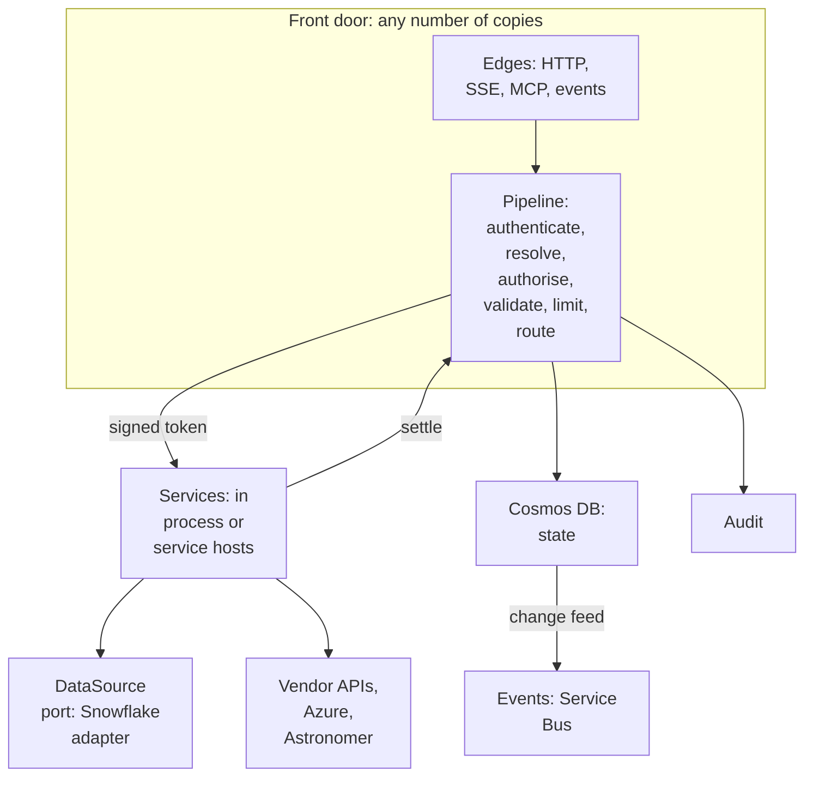

# 6. Inside the gateway

Source: `IMG_2138.MOV` 00:14:48–00:15:12.

`spec/gateway.md` · proposed

How the Atlas Gateway, Atlas's one host, keeps the writer side of every contract for every client: a front door that decides every call once and routes it to services that can be scaled and moved apart, an access decision in a fixed order, engines behind one data-source port, and one Go module in six layers.

### In short

- **One host.** The Atlas Gateway serves every capability to every client, in Azure, one per environment (`dv`, `ac`, `pd`).
- **Front door:** edges (HTTP, streams, MCP, events) over one pipeline: authenticate, resolve, authorise, validate, limit, route; then settle and audit. It holds no state that matters and decides access nowhere else.
- **Services** (`svc-*`) do the work, in process or in service hosts, trusting a signed token per call; any of them can move by configuration, which the loopback conformance run proves.
- **Access:** identity from validated tokens only; deny, grants, conditions, validation, limits, in that order; one audit record per call.
- **Reaching systems:** each system run, handed off or brokered, as the gateway, a workload or the person, with one rule for every credential that leaves the gateway.
- **Data sources:** engines behind one `DataSource` port; nothing about an engine leaves its adapter.
- **Packages, principles, patterns:** one Go module in six layers; fifteen principles every part obeys; each mechanism built once, from a tested pattern.

### Picture

### How it works

A call to `portfolio.holdings@v1:fetch` enters the HTTP edge; the pipeline validates the Entra token, resolves the address and its profile, finds the caller's grant (no deny), reserves the limit in Cosmos, and routes to `svc/harbour` with a signed token naming the subject, the address and the deadline. The service plans through the Snowflake adapter and returns a stream (or a handoff); the pipeline settles the actual use and writes one audit record.

### Seams

| Seam | One side | Other side | Defined in |
|---|---|---|---|
| Front door and services | Every decision | The work | §6.1 |
| The gateway and each system | The decision, the identity | The system's own permissions | §6.3 |
| Services and engines | The capability | The engine | §6.4 |
| Ports and adapters | Interfaces | Technologies | §6.5 |
| Principles and mechanisms | Why: the fifteen principles | How: each mechanism with its values | §6.6, §6.7 |
| Clients and the gateway | The reader side, and their extras | The writer side, every capability | §5, §9 |

### Rules

- Only the front door decides access; only services do domain work; only adapters know a source.
- Nothing changes a contract without the gate and registration classifying it.

### Detail

| | The Atlas Gateway |
|---|---|
| Runs | Azure, per environment (`dv`, `ac`, `pd`) |
| Serves | Every capability in the catalogue, to every client |
| Bindings | HTTPS (with SSE), MCP, events; links it issues for transfers and handoffs |
| Identity | Entra tokens for the gateway; each system reached as itself, a workload or the person (§6.3) |
| Built as | A Go module in `gateway/` (§6.5), by fifteen principles (§6.6) and one set of mechanisms (§6.7) |

### Go deeper

§6.1 Front door and services · §6.2 Access, limits and audit · §6.3 Reaching systems · §6.4 Data sources · §6.5 Packages · §6.6 Principles · §6.7 Implementation patterns

