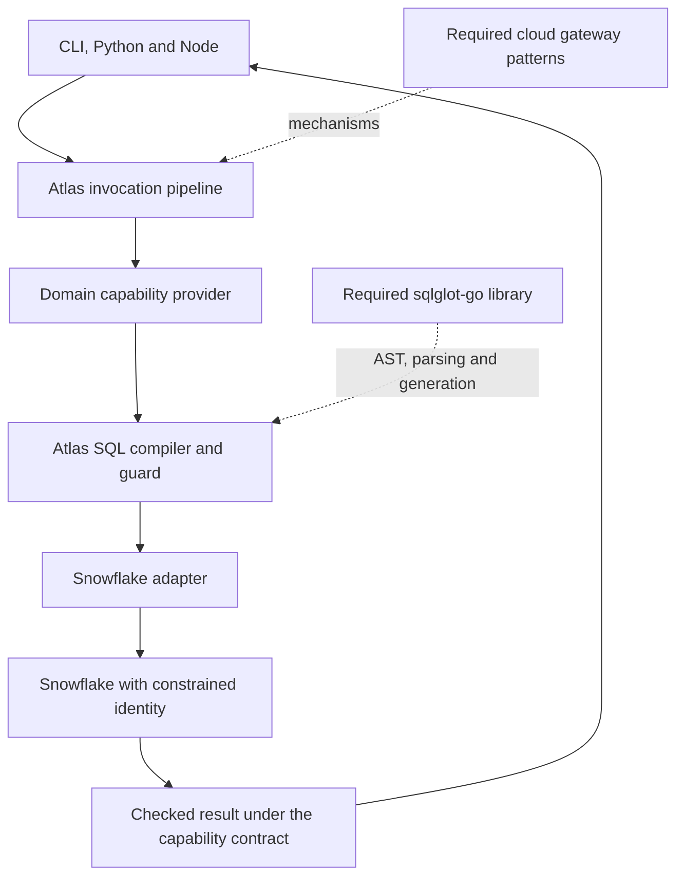

# Required first integrations

**Status: reviewed source and proposed integration plan, 2026-10-31.** Both repositories belong in the first working Atlas data path. Reading them or copying their names into a plan does not itself constitute an implementation integration. No remote repository was changed during this review.

## Reviewed revisions

| Repository | Reviewed commit | Role in Atlas |
|---|---|---|
| [cloud-gateway-patterns-go](https://github.com/cottrellashley/cloud-gateway-patterns-go/tree/44ba81aa92ee901c131c0b80dcadafa25de440a2) | `44ba81aa92ee901c131c0b80dcadafa25de440a2` | Reusable gateway mechanisms behind Atlas's central invocation path |
| [sqlglot-go](https://github.com/cottrellashley/sqlglot-go/tree/3d81e5393850e249136284859f6203a34db29f16) | `3d81e5393850e249136284859f6203a34db29f16` | SQL AST construction, parsing, qualification and strict generation behind the data adapter |

The module declarations are `github.com/cottrellashley/cloud-gateway-patterns-go` with Go 1.25 and `github.com/cottrellashley/sqlglot-go` with Go 1.23. Build the combined integration on a compatible toolchain. [Cloud go.mod](https://github.com/cottrellashley/cloud-gateway-patterns-go/blob/44ba81aa92ee901c131c0b80dcadafa25de440a2/go.mod), [SQL go.mod](https://github.com/cottrellashley/sqlglot-go/blob/3d81e5393850e249136284859f6203a34db29f16/go.mod)

The spec's D28 describes an unnamed Go replacement for SQLGlot. That can be read as replacing the Python library with this Go port. Resolve the ambiguity explicitly: **`sqlglot-go` is that Go SQL dependency**. Keep D28's typed-AST and adapter boundary, without proposing another parser.

`bt-research` remains a future capability implementation. This plan makes no decision about its internal design, operations or schema.

## One first implementation path

The public profile exposes business parameters and types. It does not expose Go AST types or the cloud kit's internal models. Atlas owns the integration interfaces and the semantics promised to callers.

The [existing proof plan](../../atlas-proof-plan.md) chooses copying selected cloud packages into `sdk/go/kit` with notices and tests, avoiding a firm's production build depending on a mutable personal branch. Preserve that approach unless the team chooses a pinned module dependency instead. For either route, record upstream repository, exact commit, imported packages, notices, local modifications and carried tests in a provenance manifest. Pin sqlglot-go similarly through the chosen dependency mechanism; never track an unreviewed branch head in a release.

## Cloud patterns: reuse and adapt

The repository supplies useful mechanisms and runnable wiring examples. It does not already implement Atlas's full identity, profile, authorization, Cosmos or audit contract. Import the mechanisms from the start and test the Atlas-specific adaptations.

| Mechanism and inspected source | Existing value | Atlas responsibility |
|---|---|---|
| [JWT verifier](https://github.com/cottrellashley/cloud-gateway-patterns-go/blob/44ba81aa92ee901c131c0b80dcadafa25de440a2/patterns/auth/verifier.go#L97) and [middleware](https://github.com/cottrellashley/cloud-gateway-patterns-go/blob/44ba81aa92ee901c131c0b80dcadafa25de440a2/patterns/auth/middleware.go#L93) | Signature/claim verification and authentication plumbing | Require configured issuer, audience and tenant; establish stable identity/delegation context; add Entra-specific behavior and OBO where required |
| [Idempotency](https://github.com/cottrellashley/cloud-gateway-patterns-go/blob/44ba81aa92ee901c131c0b80dcadafa25de440a2/patterns/idempotency/idempotency.go#L106) | Request ownership and response replay mechanism | Replace method/path/raw-body identity with caller-scoped canonical business requests; activate by semantic execution needs; retain uncertain effects instead of dropping keys on 5xx or response overflow |
| [Long operations](https://github.com/cottrellashley/cloud-gateway-patterns-go/blob/44ba81aa92ee901c131c0b80dcadafa25de440a2/patterns/lro/lro.go#L142) | An operation manager and lifecycle foundation | Persist key-to-operation ownership, use bounded durable workers and leases/fencing, reconcile on restart; process-local maps and goroutines do not provide restart safety |
| [Rate limiting](https://github.com/cottrellashley/cloud-gateway-patterns-go/blob/44ba81aa92ee901c131c0b80dcadafa25de440a2/patterns/ratelimit/window.go#L68) | Fixed-window counters and local protective primitives | Add the selected hard-budget transaction model, reservations, settlement and shared concurrency semantics |
| [Retries](https://github.com/cottrellashley/cloud-gateway-patterns-go/blob/44ba81aa92ee901c131c0b80dcadafa25de440a2/patterns/resilience/retry.go#L20) | Backoff and retry throttling | Add replay safety, deadline and operation recovery rules; do not claim its token budget is the spec's exact 10%-per-minute rule |
| [Configuration snapshots](https://github.com/cottrellashley/cloud-gateway-patterns-go/blob/44ba81aa92ee901c131c0b80dcadafa25de440a2/patterns/config/config.go#L63) | Validated atomic publication | Serialize catalogue construction or use correct compare-and-swap; add revision monotonicity, persistence and freshness policy |
| [Reconciliation](https://github.com/cottrellashley/cloud-gateway-patterns-go/blob/44ba81aa92ee901c131c0b80dcadafa25de440a2/patterns/reconcile/controller.go#L38) | Queue and resync model | Supply durable ownership, distributed leases and event/outbox handling where needed |
| [Registry](https://github.com/cottrellashley/cloud-gateway-patterns-go/blob/44ba81aa92ee901c131c0b80dcadafa25de440a2/patterns/registry/registry.go#L262) | Provisioning and module lifecycle | Use explicit registration; discard a partially failed new generation completely; drain old users before cleanup |
| [Resource store](https://github.com/cottrellashley/cloud-gateway-patterns-go/blob/44ba81aa92ee901c131c0b80dcadafa25de440a2/patterns/resource/store.go#L170) | State/version management | Add Atlas masks and mandatory preconditions; adapt its envelope; settle representation ETags versus desired generation first |
| [Audit guidance](https://github.com/cottrellashley/cloud-gateway-patterns-go/blob/44ba81aa92ee901c131c0b80dcadafa25de440a2/docs/05-observability/request-telemetry-and-audit.md) | Separation of operational telemetry and audit concerns | Implement durable invocation lifecycle facts, source reconciliation and a queryable audit view |

The [gateway example](https://github.com/cottrellashley/cloud-gateway-patterns-go/blob/44ba81aa92ee901c131c0b80dcadafa25de440a2/cmd/gateway/main.go) and [kernel example](https://github.com/cottrellashley/cloud-gateway-patterns-go/blob/44ba81aa92ee901c131c0b80dcadafa25de440a2/cmd/kernel/main.go) are useful references, not deployable Atlas replacements. Their defaults include in-memory state and authentication arrangements that differ from Atlas's requirements.

## sqlglot-go: use it as the SQL foundation

The inspected repository implements the base, Snowflake and DuckDB dialects, together with AST construction, parsing, generation, optimization and qualification. Its logical planner and in-memory executor are not a Snowflake driver or a warehouse cost estimator. SQL Server and Postgres are not already available merely because Atlas's adapter table mentions them. [README](https://github.com/cottrellashley/sqlglot-go/blob/3d81e5393850e249136284859f6203a34db29f16/README.md), [Porting status](https://github.com/cottrellashley/sqlglot-go/blob/3d81e5393850e249136284859f6203a34db29f16/PORTING.md)

Create a small Atlas SQL compiler/guard interface around the pinned library. It accepts the capability's approved model, request, scope and schema metadata, and returns a validated execution plan. Keep the library's AST internal to that integration.

### The planned-query path

1. Validate the business request and authorized data scope before planning.
2. Build a typed AST from reviewed source objects and the capability's declared columns and filter operators. Bind scalar user values through the driver; never construct SQL by string concatenation.
3. Qualify names using known catalog/database/schema metadata. Walk every relevant nested scope, source and function against Atlas's allowlists.
4. Generate strictly in the target dialect and validate the generated statement again. Refuse unsupported forms.
5. Return an immutable plan containing SQL, parameter bindings, referenced objects, output contract, request identity and provenance. Both `explain` and execution use this compiler path. A byte-identical execution promise requires the same retained plan and bindings, not two independent compilations after metadata changes.
6. Let the Snowflake adapter own driver execution, source estimates, cancellation and returned Arrow/type checks. Test the actual source's semantics rather than treating a successful transpilation as proof.

### Four important source-level details

| Inspected behavior | Integration rule |
|---|---|
| [`ParseOneOpts`](https://github.com/cottrellashley/sqlglot-go/blob/3d81e5393850e249136284859f6203a34db29f16/api.go#L148) returns the first parsed expression | Use full-statement parsing and require exactly one executable statement. Do not validate the first statement and execute unchecked original text. |
| [Unsupported statement parsing](https://github.com/cottrellashley/sqlglot-go/blob/3d81e5393850e249136284859f6203a34db29f16/parser_statements.go#L57) can produce `exp.Command` | Parse success is insufficient. Reject raw, command and unknown nodes that the Atlas policy does not explicitly support. |
| [Default generation](https://github.com/cottrellashley/sqlglot-go/blob/3d81e5393850e249136284859f6203a34db29f16/exp/hooks.go#L54) uses warning behavior for unsupported features | Configure unsupported transformations to fail, and test that no driver call occurs on failure. |
| [Qualification options](https://github.com/cottrellashley/sqlglot-go/blob/3d81e5393850e249136284859f6203a34db29f16/optimizer_qualify.go#L117) expose mechanisms, including configurable validation | Atlas chooses a strict reviewed configuration. Qualification is not resource authorization. |

A SELECT root is not enough to establish safety. The guard must inspect CTEs, nested queries, functions, identifiers and sources. Unapproved dynamic identifiers, stage/file access, external functions and UDFs need an explicit policy. A constrained source identity remains a separate enforcement layer.

Bound SQL input size, AST depth/nodes and compilation concurrency. The inspected parse/optimization API does not accept a cancellation context; abandoning a goroutine does not stop its computation. Use bounded transformations and isolate work if hard execution limits require it.

`snowflake.query` goes through the same strict guard but remains an explicitly privileged dynamic-schema capability. Its existence must not force every normal user to learn SQL or source table names.

For raw SQL, object/function allowlists alone cannot enforce row or column entitlements under a broad service credential. Use source-enforced caller scope, secured views or a proven restricted rewrite, and refuse the capability where those controls cannot enforce its authorized data boundary. Arbitrary subqueries or UDFs must not bypass that boundary.

### What to test at the integration boundary

- Accepted sanctioned queries produce the expected fields, units, nulls and types.
- Multiple statements, unsupported commands, inaccessible objects, unapproved functions, dynamic identifiers and excessive inputs are refused before driver execution.
- Quoted names, case handling, CTEs and subqueries do not evade scope checks.
- Driver parameter binding handles values independently from identifiers and SQL syntax.
- `explain` and execution use the same plan construction and policy context.
- DuckDB fixtures agree with the intended logical results; real Snowflake tests cover decimals, timestamps, nulls, identifiers, functions and any dialect differences.
- A partial stream, cancellation or repeated metered call obeys Atlas's result and operation contract.

Do not bring the library's entire optimizer or in-memory executor into production solely because they exist. Reusing the parser, AST, generator and qualification mechanisms fully satisfies the foundational integration need; Atlas supplies domain policy and source execution.

## The first end-to-end acceptance result

Choose a coherent domain journey already in the catalogue, such as holdings plus its identifier lookup and freshness information. Author complete profiles rather than mechanically exposing all source views.

The first accepted integration should demonstrate:

1. Both pinned repositories participate in the running path, with provenance and carried tests.
2. The same person discovers and calls the same capability from CLI, Python and Node using identical request records.
3. A second person with narrower data scope receives a correspondingly narrower result or a clear refusal.
4. A capability added after the clients were built works without releasing any of those clients.
5. Invalid requests, permission changes, exact decimals, incomplete streams, idempotent retries and source failures have matching logical behavior across clients.
6. The guide's example succeeds and its result can be checked independently against the source.

The existing Go/Python hermetic proof reduces the work needed to start. It does not remove the need for CLI/Node parity or live source proofs. Its report explicitly identifies assumed Snowflake chunk behavior, missing Windows lifetime handling and unimplemented client features.

## Evidence limits

This review inspected repository code and documentation. It did not run either repository's test suite or integrate them into Atlas. The SQL repository's [CI run at the reviewed commit](https://github.com/cottrellashley/sqlglot-go/actions/runs/41159030005) was observed successful; that is upstream CI evidence, not a passed Atlas integration test. The cloud repository's test claims were not independently rerun. No production access, data, credentials or deployment were used.
