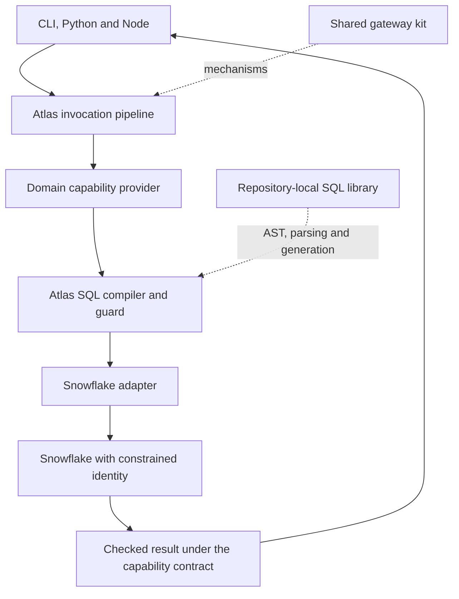

# Shared gateway and SQL foundations

**Status: design review and integration criteria, 2026-10-31.** The shared gateway kit and SQL library belong in the working Atlas data path. Their presence in the repository does not by itself prove integration. Use the [handoff progress](../../../HANDOFF-PROGRESS.md) for current implementation and test status.

## Repository-local components

| Component | Local interface | Role in Atlas |
|---|---|---|
| [Gateway kit](../../../../sdk/go/kit/) | `atlas.local/sdk/go/kit` | Reusable gateway mechanisms behind Atlas's central invocation path |
| [SQL library](../../../../sqlglot/) | `atlas.local/sqlglot` | SQL AST construction, parsing, qualification and strict generation behind the data adapter |

Build with the toolchain declared by the repository's module files. D28's Go SQL implementation is the library in `sqlglot/`; keep its typed-AST and adapter boundary rather than adding another parser.

Backtesting research remains a future capability implementation. This plan makes no decision about its internal design, operations or schema.

## One first implementation path

The public profile exposes business parameters and types. It does not expose Go AST types or the cloud kit's internal models. Atlas owns the integration interfaces and the semantics promised to callers.

The [proof plan](../../atlas-proof-plan.md) requires shared mechanisms behind Atlas-owned interfaces, with their relevant tests and license notices retained. Keep production dependencies reproducible through the module files and local workspace. A reusable mechanism still needs tests of its Atlas-specific adaptation.

## Gateway mechanisms: reuse and adapt

The kit and gateway core supply mechanisms with narrower contracts than Atlas's complete identity, authorization, storage and audit model. The table identifies each implementation or design seam; it is not a claim that every planned mechanism is complete.

| Mechanism and local reference | Reuse boundary | Atlas responsibility |
|---|---|---|
| [JWT verifier](../../../../sdk/go/kit/jwt/verifier.go) and [Entra adapter](../../../../gateway/adapter/entra/) | Signature/claim verification and authentication plumbing | Require configured issuer, audience and tenant; establish stable identity/delegation context; add Entra-specific behavior and OBO where required |
| [Idempotency design](../06-7-implementation-patterns.md) | Request ownership and response replay | Use caller-scoped canonical business requests; activate by semantic execution needs; retain uncertain effects instead of dropping keys on 5xx or response overflow |
| [Long-operation design](../04-plugging-in.md) | Operation identity and lifecycle | Persist key-to-operation ownership, use bounded durable workers and leases/fencing, reconcile on restart; process-local maps and goroutines do not provide restart safety |
| [Pipeline limits](../../../../gateway/core/pipeline/limits.go) | Local protective primitives | Add the selected hard-budget transaction model, reservations, settlement and shared concurrency semantics |
| [Retry rules](../09-7-clients.md) | Backoff and retry throttling | Apply replay safety, deadline and operation recovery rules; a generic token budget does not establish the spec's exact 10%-per-minute rule |
| [Configuration snapshots](../../../../sdk/go/kit/hot/config.go) | Validated atomic publication | Serialize catalogue construction or use correct compare-and-swap; add revision monotonicity, persistence and freshness policy |
| [Reconciliation design](../06-7-implementation-patterns.md) | Queue and resync model | Supply durable ownership, distributed leases and event/outbox handling where needed |
| [Registry](../../../../gateway/core/registry/registry.go) | Capability registration and lifecycle | Use explicit registration; discard a partially failed new generation completely; drain old users before cleanup |
| [Resource design](../02-3-resources.md) | State/version management | Enforce masks and mandatory preconditions; distinguish representation ETags from desired generation |
| [Audit contract](../06-2-access-limits-and-audit.md) | Separation of operational telemetry and audit concerns | Implement durable invocation lifecycle facts, source reconciliation and a queryable audit view |

The [gateway assembly](../../../../gateway/assemble/assemble.go) wires the chosen components. A development assembly using in-memory state is not evidence for production durability or identity guarantees.

## SQL library: use it as the SQL foundation

The local library implements the base, Snowflake and DuckDB dialects, together with AST construction, parsing, generation, optimization and qualification. Its logical planner and in-memory executor are not a Snowflake driver or a warehouse cost estimator. SQL Server and Postgres are not already available merely because Atlas's adapter table mentions them. See the [library documentation](../../../../sqlglot/README.md) and [porting status](../../../../sqlglot/PORTING.md).

Create a small Atlas SQL compiler/guard interface around the local library. It accepts the capability's approved model, request, scope and schema metadata, and returns a validated execution plan. Keep the library's AST internal to that integration.

### The planned-query path

1. Validate the business request and authorized data scope before planning.
2. Build a typed AST from reviewed source objects and the capability's declared columns and filter operators. Bind scalar user values through the driver; never construct SQL by string concatenation.
3. Qualify names using known catalog/database/schema metadata. Walk every relevant nested scope, source and function against Atlas's allowlists.
4. Generate strictly in the target dialect and validate the generated statement again. Refuse unsupported forms.
5. Return an immutable plan containing SQL, parameter bindings, referenced objects, output contract, request identity and provenance. Both `explain` and execution use this compiler path. A byte-identical execution promise requires the same retained plan and bindings, not two independent compilations after metadata changes.
6. Let the Snowflake adapter own driver execution, source estimates, cancellation and returned Arrow/type checks. Test the actual source's semantics rather than treating a successful transpilation as proof.

### Four important source-level details

| Inspected behavior | Integration rule |
|---|---|
| [`ParseOneOpts`](../../../../sqlglot/api.go#L134) returns the first parsed expression | Use full-statement parsing and require exactly one executable statement. Do not validate the first statement and execute unchecked original text. |
| [Unsupported statement parsing](../../../../sqlglot/parser_statements.go#L57) can produce `exp.Command` | Parse success is insufficient. Reject raw, command and unknown nodes that the Atlas policy does not explicitly support. |
| [Default generation](../../../../sqlglot/exp/hooks.go#L61) uses warning behavior for unsupported features | Configure unsupported transformations to fail, and test that no driver call occurs on failure. |
| [Qualification options](../../../../sqlglot/optimizer_qualify.go#L123) expose mechanisms, including configurable validation | Atlas chooses a strict reviewed configuration. Qualification is not resource authorization. |

A SELECT root is not enough to establish safety. The guard must inspect CTEs, nested queries, functions, identifiers and sources. Unapproved dynamic identifiers, stage/file access, external functions and UDFs need an explicit policy. A constrained source identity remains a separate enforcement layer.

Bound SQL input size, AST depth/nodes and compilation concurrency. The inspected parse/optimization API does not accept a cancellation context; abandoning a goroutine does not stop its computation. Use bounded transformations and isolate work if hard execution limits require it.

`snowflake.query` goes through the same strict guard but remains an explicitly privileged dynamic-schema capability. Its existence must not force every normal user to learn SQL or source table names.

For raw SQL, object/function allowlists alone cannot enforce row or column entitlements under a broad service credential. Use source-enforced caller scope, secured views or a proven restricted rewrite, and refuse the capability where those controls cannot enforce its authorized data boundary. Arbitrary subqueries or UDFs must not bypass that boundary.

### What to test at the integration boundary

- Accepted sanctioned queries produce the expected fields, units, nulls and types.
- Multiple statements, unsupported commands, inaccessible objects, unapproved functions, dynamic identifiers and excessive inputs are refused before driver execution.
- Quoted names, case handling, CTEs and subqueries do not evade scope checks.
- Driver parameter binding handles values independently from identifiers and SQL syntax.
- `explain` and execution use the same plan construction and policy context.
- DuckDB fixtures agree with the intended logical results; real Snowflake tests cover decimals, timestamps, nulls, identifiers, functions and any dialect differences.
- A partial stream, cancellation or repeated metered call obeys Atlas's result and operation contract.

Do not bring the library's entire optimizer or in-memory executor into production solely because they exist. Reusing the parser, AST, generator and qualification mechanisms fully satisfies the foundational integration need; Atlas supplies domain policy and source execution.

## The first end-to-end acceptance result

Choose a coherent domain journey already in the catalogue, such as holdings plus its identifier lookup and freshness information. Author complete profiles rather than mechanically exposing all source views.

The first accepted integration should demonstrate:

1. The shared gateway kit and SQL library participate in the running path, with their license notices and integration tests.
2. The same person discovers and calls the same capability from CLI, Python and Node using identical request records.
3. A second person with narrower data scope receives a correspondingly narrower result or a clear refusal.
4. A capability added after the clients were built works without releasing any of those clients.
5. Invalid requests, permission changes, exact decimals, incomplete streams, idempotent retries and source failures have matching logical behavior across clients.
6. The guide's example succeeds and its result can be checked independently against the source.

The existing Go/Python hermetic proof reduces the work needed to start. It does not remove the need for CLI/Node parity or live source proofs. Its report explicitly identifies assumed Snowflake chunk behavior, missing Windows lifetime handling and unimplemented client features.

## Evidence limits

This document records design criteria and source observations. It does not independently establish passed integration tests or live service behavior. Use the [verification reports](../../../HANDOFF-PROGRESS.md) to distinguish source inspection, hermetic tests and live-system evidence. No production access, data, credentials or deployment were used for the review.
